# TRƯỜNG ĐẠI HỌC PHENIKAA
## KHOA CÔNG NGHỆ THÔNG TIN
---

# BÁO CÁO BÀI TẬP LỚN
### HỌC PHẦN: CÔNG NGHỆ .NET

**ĐỀ TÀI:**
# XÂY DỰNG HỆ THỐNG QUẢN LÝ ĐÀO TẠO VÀ PHÂN TÍCH KẾT QUẢ HỌC TẬP SINH VIÊN (STUDENT RESULT ANALYTICS) THEO HỌC CHẾ TÍN CHỈ

---
**Giảng viên hướng dẫn:** TS. Giảng Viên Hướng Dẫn  
**Nhóm sinh viên thực hiện:** Nhóm Phát Triển Dự Án .NET  
**Khóa học:** Đại học chính quy - Khóa 16, 17  
**Chuyên ngành:** Công nghệ thông tin / Kỹ thuật phần mềm  

*Hà Nội, Năm 2026*

<div style="page-break-after: always;"></div>

---

# LỜI CẢM ƠN

Lời đầu tiên, nhóm tác giả xin bày tỏ lòng biết ơn sâu sắc nhất tới Ban Giám hiệu Trường Đại học Phenikaa, Ban Chủ nhiệm Khoa Công nghệ Thông tin đã tạo điều kiện học tập, nghiên cứu và trang bị cơ sở vật chất hiện đại cho sinh viên trong suốt quá trình theo học học phần **Công nghệ .NET**.

Đặc biệt, nhóm xin gửi lời cảm ơn chân thành và sâu sắc nhất tới Thầy/Cô phụ trách học phần Công nghệ .NET. Trong suốt thời gian diễn ra học phần, Thầy/Cô đã tận tình truyền đạt những kiến thức quý báu về nền tảng Microsoft .NET, ngôn ngữ lập trình C#, công nghệ Windows Presentation Foundation (WPF), cũng như các mẫu kiến trúc công nghiệp tiên tiến như MVVM (Model - View - ViewModel) và Repository Pattern. Những lời góp ý sắc bén, định hướng chuyên môn thực tế của Thầy/Cô là kim chỉ nam giúp nhóm từng bước hoàn thiện bài tập lớn này từ khâu khảo sát nghiệp vụ, thiết kế hệ thống cơ sở dữ liệu cho tới hiện thực hóa phần mềm.

Mặc dù nhóm đã nỗ lực hết mình với tinh thần làm việc nghiêm túc và cầu thị, song do kinh nghiệm thực tế còn hạn chế, đề tài khó tránh khỏi những thiếu sót nhất định. Nhóm kính mong tiếp tục nhận được những ý kiến đóng góp quý báu của Quý Thầy/Cô để sản phẩm ngày càng hoàn thiện, có khả năng ứng dụng cao hơn trong môi trường đào tạo đại học thực tế.

Nhóm xin kính chúc Quý Thầy/Cô luôn dồi dào sức khỏe, hạnh phúc và gặt hái thêm nhiều thành công rực rỡ trong sự nghiệp giáo dục và nghiên cứu khoa học cao quý!

*Hà Nội, ngày 05 tháng 11 năm 2026*  
**Đại diện nhóm tác giả**  
*(Ký và ghi rõ họ tên)*

<div style="page-break-after: always;"></div>

---

# LỜI CAM ĐOAN

Nhóm tác giả xin cam đoan rằng:
1. Báo cáo bài tập lớn và sản phẩm phần mềm **"Hệ thống Quản lý Đào tạo và Phân tích Kết quả Học tập Sinh viên (Student Result Analytics)"** là công trình nghiên cứu và phát triển hoàn toàn độc lập của các thành viên trong nhóm dưới sự định hướng, hướng dẫn khoa học của Giảng viên phụ trách học phần.
2. Tất cả các số liệu khảo sát, sơ đồ thiết kế (Use Case, Activity, Sequence, ERD), mã nguồn C#, giao diện XAML và kịch bản cơ sở dữ liệu SQL Server được trình bày trong báo cáo là trung thực, rõ ràng và do chính nhóm tự tay hiện thực, không sao chép trái phép từ bất kỳ công trình, luận văn hay đồ án của tác giả nào khác.
3. Các tài liệu tham khảo, thư viện phần mềm mã nguồn mở (LiveCharts2, Microsoft.Data.SqlClient, DocumentFormat.OpenXml) được trích dẫn nguồn gốc xuất xứ đầy đủ, minh bạch theo đúng chuẩn quy định học thuật IEEE.

Nếu có bất kỳ sự gian lận hay vi phạm quy chế học vụ nào, các thành viên trong nhóm xin chịu hoàn toàn mọi hình thức kỷ luật theo quy định hiện hành của Trường Đại học Phenikaa.

**Đại diện nhóm sinh viên thực hiện**  
*(Ký và ghi rõ họ tên)*

<div style="page-break-after: always;"></div>

---

# BẢNG PHÂN CÔNG NHIỆM VỤ THÀNH VIÊN VÀ TỶ LỆ ĐÓNG GÓP

| STT | Họ và tên | Mã sinh viên | Nội dung công việc đảm nhiệm | Tỷ lệ đóng góp | Chữ ký |
| :---: | :--- | :---: | :--- | :---: | :---: |
| 1 | Nguyễn Văn Lộc | 22020224 | **Nhóm trưởng**: Khảo sát nghiệp vụ, Thiết kế CSDL Somee Cloud, Kiến trúc MVVM & Repository, ViewModel Bàn làm việc Dashboard & Quản lý Điểm, Viết báo cáo BTL. | 35% | |
| 2 | Cao Thanh Thảo | 23010168 | Thiết kế giao diện WPF (Views XAML), Hiện thực phân hệ Quản lý Hồ sơ Sinh viên, Khoa và Lớp, Tính năng tự động tạo email `@st.phenikaa-uni.edu.vn`. | 33% | |
| 3 | Bùi Tuấn Anh | 23010198 | Hiện thực phân hệ Tra cứu GPA/CPA, Thống kê cảnh báo học vụ, Nhập điểm từ file Excel/CSV, Thực hiện kịch bản kiểm thử (Test Cases), Thiết kế Slide. | 32% | |

---

# DANH MỤC CÁC TỪ VIẾT TẮT

| Viết tắt | Thuật ngữ tiếng Anh | Diễn giải tiếng Việt |
| :--- | :--- | :--- |
| **BTL** | - | Bài tập lớn |
| **CNTT** | - | Công nghệ thông tin |
| **WPF** | Windows Presentation Foundation | Nền tảng xây dựng ứng dụng đồ họa Desktop trên Windows của Microsoft |
| **MVVM** | Model - View - ViewModel | Mẫu kiến trúc tách biệt Giao diện, Logic điều khiển và Mô hình dữ liệu |
| **XAML** | Extensible Application Markup Language | Ngôn ngữ đánh dấu mở rộng xây dựng giao diện người dùng |
| **DBMS** | Database Management System | Hệ quản trị cơ sở dữ liệu |
| **SQL** | Structured Query Language | Ngôn ngữ truy vấn dữ liệu có cấu trúc |
| **GPA** | Grade Point Average | Điểm trung bình chung học kỳ (Thang 4) |
| **CPA** | Cumulative Point Average | Điểm trung bình chung tích lũy toàn khóa (Thang 4) |
| **ERD** | Entity Relationship Diagram | Sơ đồ thực thể liên kết |
| **CRUD** | Create, Read, Update, Delete | Bốn thao tác cơ bản trên dữ liệu: Thêm, Đọc, Sửa, Xóa |
| **RBAC** | Role-Based Access Control | Kiểm soát truy cập phân quyền dựa trên vai trò người dùng |
| **ADO.NET**| ActiveX Data Objects for .NET | Bộ thư viện truy cập dữ liệu hiệu năng cao của Microsoft |
| **CSV** | Comma-Separated Values | Tệp văn bản lưu trữ bảng tính phân tách bằng dấu phẩy |
| **UI/UX** | User Interface / User Experience | Giao diện người dùng / Trải nghiệm người dùng |

<div style="page-break-after: always;"></div>

---

# DANH MỤC CÁC BẢNG BIỂU

- Bảng 1.1. Ma trận phân quyền chức năng theo 3 nhóm đối tượng sử dụng
- Bảng 2.1. Danh mục các tác nhân chính trong hệ thống (Actors)
- Bảng 2.2. Đặc tả Use Case UC01 – Đăng nhập hệ thống & Xác thực người dùng
- Bảng 2.3. Đặc tả Use Case UC02 – Bàn làm việc Dashboard & Đồng bộ dữ liệu
- Bảng 2.4. Đặc tả Use Case UC03 – Quản lý Hồ sơ Sinh viên & Tự động tạo Email
- Bảng 2.5. Đặc tả Use Case UC04 – Quản lý Khoa và Lớp sinh hoạt
- Bảng 2.6. Đặc tả Use Case UC05 – Quản lý Môn học & Niên khóa đào tạo
- Bảng 2.7. Đặc tả Use Case UC06 – Quản lý Sổ điểm học phần & Điểm thành phần
- Bảng 2.8. Đặc tả Use Case UC07 – Nhập điểm học phần từ File ngoại vi (Excel/CSV)
- Bảng 2.9. Đặc tả Use Case UC08 – Tra cứu kết quả học tập & Tính GPA/CPA tích lũy
- Bảng 2.10. Đặc tả Use Case UC09 – Thống kê Đạt/Trượt & Rà soát Cảnh báo học vụ
- Bảng 2.11. Đặc tả Use Case UC10 – Quản trị người dùng & Phân quyền hệ thống
- Bảng 2.12. Quy chế quy đổi thang điểm 10 sang thang chữ và thang điểm 4 chuẩn mới
- Bảng 2.13. Tiêu chuẩn phân loại học lực sinh viên theo học chế tín chỉ
- Bảng 2.14. Từ điển dữ liệu bảng `TaiKhoan` (Quản lý tài khoản và phân quyền)
- Bảng 2.15. Từ điển dữ liệu bảng `Khoa` (Danh mục khoa đào tạo)
- Bảng 2.16. Từ điển dữ liệu bảng `Lop` (Danh mục lớp sinh hoạt)
- Bảng 2.17. Từ điển dữ liệu bảng `SinhVien` (Hồ sơ sinh viên)
- Bảng 2.18. Từ điển dữ liệu bảng `MonHoc` (Danh mục học phần đào tạo)
- Bảng 2.19. Từ điển dữ liệu bảng `NienKhoa` (Niên khóa và học kỳ đào tạo)
- Bảng 2.20. Từ điển dữ liệu bảng `DiemHocPhan` (Sổ điểm học phần sinh viên)
- Bảng 2.21. Từ điển dữ liệu bảng `LogHeThong` (Nhật ký kiểm toán hệ thống)
- Bảng 3.1. Ma trận kiểm thử hệ thống (System Test Matrix - 20 Test Cases chi tiết)
- Bảng 3.2. Bảng so sánh kết quả thực hiện so với mục tiêu ban đầu của đề tài

---

# DANH MỤC CÁC HÌNH VẼ VÀ SƠ ĐỒ

- Hình 2.1. Sơ đồ Use Case tổng quát hệ thống Student Result Analytics
- Hình 2.2. Sơ đồ Use Case phân hệ Quản trị viên (Admin)
- Hình 2.3. Sơ đồ Use Case phân hệ Cán bộ Đào tạo & Khảo thí (NhanVien)
- Hình 2.5. Sơ đồ Hoạt động (Activity Diagram) – Quy trình Đăng nhập & Điều hướng phân quyền
- Hình 2.6. Sơ đồ Hoạt động (Activity Diagram) – Quy trình Thêm sinh viên & Tự sinh Email
- Hình 2.7. Sơ đồ Hoạt động (Activity Diagram) – Quy trình Nhập điểm học phần từ File Excel/CSV
- Hình 2.8. Sơ đồ Hoạt động (Activity Diagram) – Quy trình Tính toán GPA/CPA tích lũy theo số tín chỉ
- Hình 2.9. Sơ đồ Hoạt động (Activity Diagram) – Quy trình Lọc và Xử lý Cảnh báo học vụ
- Hình 2.10. Sơ đồ Tuần tự (Sequence Diagram) – Chức năng Đăng nhập & Xác thực
- Hình 2.11. Sơ đồ Tuần tự (Sequence Diagram) – Chức năng Thêm mới sinh viên và liên kết Lớp/Khoa
- Hình 2.12. Sơ đồ Tuần tự (Sequence Diagram) – Chức năng Nhập điểm học phần từ File Excel
- Hình 2.13. Sơ đồ Tuần tự (Sequence Diagram) – Chức năng Tra cứu kết quả học tập & Tính điểm tích lũy
- Hình 2.14. Sơ đồ Tuần tự (Sequence Diagram) – Chức năng Rà soát và Xuất danh sách Cảnh báo học vụ
- Hình 2.15. Sơ đồ Thực thể Liên kết (Entity Relationship Diagram - ERD) chuẩn hóa 3NF
- Hình 2.16. Sơ đồ Kiến trúc phân tầng hệ thống kết hợp Mô hình MVVM và Repository Pattern
- Hình 3.1. Giao diện Đăng nhập hệ thống (LoginWindow) tích hợp nút xem/ẩn mật khẩu
- Hình 3.2. Giao diện Bàn làm việc Dashboard (Executive Academic Dashboard)
- Hình 3.3. Giao diện Quản lý Hồ sơ Sinh viên & Lớp học, Khoa đào tạo
- Hình 3.4. Giao diện Quản lý Môn học & Niên khóa đào tạo
- Hình 3.5. Giao diện Sổ điểm học phần & Nhập điểm thành phần
- Hình 3.6. Giao diện Nhập điểm từ File (Excel/CSV) hàng loạt
- Hình 3.7. Giao diện Tra cứu GPA, CPA & Báo cáo kết quả học tập
- Hình 3.8. Giao diện Thống kê Đạt/Trượt & Danh sách Cảnh báo học vụ
- Hình 3.9. Giao diện Quản trị người dùng & Phân quyền hệ thống

<div style="page-break-after: always;"></div>

---

# MỞ ĐẦU

### 1. Lý do chọn đề tài
Trong kỷ nguyên cách mạng công nghiệp 4.0 và công cuộc chuyển đổi số giáo dục đại học, mô hình đào tạo theo hệ thống tín chỉ (Credit-based Education System) đã trở thành chuẩn mực bắt buộc tại hầu hết các trường đại học ở Việt Nam, bao gồm Trường Đại học Phenikaa. Khác với mô hình đào tạo theo niên chế truyền thống vốn dĩ cố định lớp học và môn học, đào tạo theo tín chỉ trao cho sinh viên quyền chủ động đăng ký học phần, cá nhân hóa tiến độ học tập và tích lũy kiến thức theo năng lực bản thân.

Tuy nhiên, sự linh hoạt này đồng thời tạo ra một khối lượng dữ liệu khổng lồ và phức tạp đối với công tác quản lý khảo thí và giáo vụ:
- Mỗi học kỳ, hàng ngàn sinh viên tham gia hàng chục môn học với số lượng tín chỉ (2 tín chỉ, 3 tín chỉ, 4 tín chỉ...) và cơ cấu điểm thành phần (Chuyên cần 10%, Giữa kỳ 40%, Cuối kỳ 50%) hoàn toàn khác biệt.
- Quy chế đào tạo đại học hiện hành đòi hỏi việc quy đổi điểm số qua nhiều bậc thang phức tạp: từ điểm thang 10 sang thang điểm chữ (A+, A, B+, B, C+, C, D+, D, F) và chuyển đổi sang thang điểm 4 theo trọng số số tín chỉ để tính điểm trung bình học kỳ (GPA) và điểm trung bình tích lũy toàn khóa (CPA).
- Đặc biệt, theo chuẩn quy chế học vụ mới nhất, mức điểm giỏi $8.5 - 8.9$ được quy đổi là thang chữ $A$ tương đương $3.7$ điểm hệ 4, trong khi mức điểm xuất sắc $9.0 - 10.0$ được quy đổi là thang chữ $A+$ tương đương $4.0$ điểm hệ 4. Sự phân hóa này đòi hỏi công thức tính toán và thuật toán xử lý dữ liệu phải đạt độ chính xác tuyệt đối.

Thực tế tại nhiều đơn vị giáo vụ, việc quản lý kết quả học tập vẫn còn phụ thuộc vào các tệp bảng tính Excel phân tán, rời rạc. Phương thức thủ công này bộc lộ những hạn chế đặc biệt nghiêm trọng: nguy cơ sai sót công thức, trùng lặp thông tin, không kiểm soát được phiên bản sửa đổi, tốn kém thời gian tổng hợp báo cáo và đặc biệt là không thể tự động phát hiện, cảnh báo kịp thời các trường hợp sinh viên có nguy cơ bị cảnh cáo học vụ hoặc buộc thôi học do điểm tích lũy yếu kém hoặc thiếu điểm thành phần.

Xuất phát từ yêu cầu thực tiễn cấp bách đó, nhóm tác giả đã quyết định lựa chọn và thực hiện đề tài: **"Xây dựng Hệ thống Quản lý Đào tạo và Phân tích Kết quả Học tập Sinh viên (Student Result Analytics) theo học chế tín chỉ"** bằng việc ứng dụng nền tảng công nghệ Microsoft .NET 8, công nghệ giao diện hiện đại WPF (Windows Presentation Foundation) kết hợp cùng hệ quản trị cơ sở dữ liệu điện toán đám mây Microsoft Azure / Somee SQL Server.

### 2. Mục đích nghiên cứu
Mục tiêu cốt lõi của đề tài là nghiên cứu, thiết kế và phát triển một ứng dụng máy tính (Desktop Application) chuyên nghiệp, an toàn, có hiệu năng cao và giao diện người dùng thân thiện nhằm:
1. Tin học hóa toàn diện quy trình quản lý hồ sơ sinh viên, danh mục khoa, lớp sinh hoạt, môn học và niên khóa đào tạo.
2. Tự động hóa quá trình tính toán điểm tổng kết học phần, quy đổi điểm chữ, điểm hệ 4 và tính điểm GPA/CPA có trọng số số tín chỉ theo đúng quy chế đào tạo tín chỉ đại học hiện hành.
3. Cung cấp phân hệ nhập điểm linh hoạt: vừa cho phép nhập điểm trực tiếp trên giao diện sổ điểm điện tử, vừa hỗ trợ nhập tự động hàng loạt từ tệp ngoại vi Excel/CSV với cơ chế tiền kiểm định dạng và bắt lỗi dòng dữ liệu sai sót.
4. Xây dựng trung tâm điều hành Dashboard trực quan với các chỉ số đo lường hiệu quả (KPIs) và biểu đồ phân bố học lực thời gian thực thông qua thư viện LiveCharts2.
5. Cung cấp công cụ rà soát, lọc và trích xuất danh sách sinh viên bị cảnh báo học vụ hoặc còn nợ điểm thành phần theo từng học kỳ/niên khóa, giúp Cán bộ Phòng Đào tạo phát hiện sớm nguy cơ để báo cáo Hội đồng đào tạo.
6. Thiết lập cơ chế kiểm soát truy cập phân quyền dựa trên vai trò (Role-Based Access Control - RBAC) chặt chẽ giữa Quản trị viên (Admin) và Cán bộ Giáo vụ/Khảo thí (NhanVien).

### 3. Đối tượng nghiên cứu
- Quy chế đào tạo đại học theo học chế tín chỉ ban hành theo Thông tư của Bộ Giáo dục và Đào tạo và Quy định đào tạo của Trường Đại học Phenikaa.
- Các mô hình dữ liệu quản lý kết quả học tập: Sinh viên, Khoa, Lớp, Học phần, Niên khóa, Sổ điểm, Bảng điểm tích lũy, Lịch sử kiểm toán hệ thống.
- Ngôn ngữ lập trình C# phiên bản 12 trên nền tảng .NET 8.
- Công nghệ đồ họa WPF (Windows Presentation Foundation) và ngôn ngữ đánh dấu XAML.
- Các mẫu kiến trúc phần mềm tiêu chuẩn công nghiệp: Mẫu MVVM (Model - View - ViewModel) và Mẫu Repository Pattern.
- Hệ quản trị cơ sở dữ liệu quan hệ SQL Server triển khai trên máy chủ điện toán đám mây Somee Cloud.

### 4. Phạm vi nghiên cứu
- **Phạm vi nghiệp vụ**: Nghiên cứu và mô hình hóa trọn vẹn nghiệp vụ quản lý khảo thí và học vụ của một cơ sở giáo dục đại học, bao gồm tiếp nhận hồ sơ sinh viên, quản lý mã sinh viên và chuẩn hóa định dạng email trường (`@st.phenikaa-uni.edu.vn`), tổ chức sổ điểm học phần theo lớp môn học, nhập điểm từ file Excel, tính toán GPA/CPA tích lũy và xử lý cảnh báo học vụ.
- **Phạm vi kỹ thuật**: Xây dựng ứng dụng hoàn chỉnh dưới dạng Windows Desktop Application chạy trên hệ điều hành Windows 10/11, kết nối thông suốt với cơ sở dữ liệu đám mây Somee SQL Server thông qua thư viện kết nối ADO.NET tối ưu hóa (`Microsoft.Data.SqlClient`).

### 5. Ý nghĩa khoa học và thực tiễn
- **Ý nghĩa khoa học**: 
  - Đề tài là minh chứng sinh động cho việc áp dụng phương pháp luận phát triển phần mềm hướng đối tượng (OOAD), kỹ thuật phân tích và thiết kế hệ thống thông tin thông qua chuẩn mô hình hóa UML (Use Case, Activity, Sequence, ERD).
  - Khẳng định giá trị thực tiễn của mẫu kiến trúc hiện đại MVVM trong việc tách biệt hoàn toàn giữa giao diện người dùng (View), tầng logic điều khiển (ViewModel) và tầng truy cập dữ liệu (Model/Repository), giúp mã nguồn đạt tính mô-đun hóa cao, dễ kiểm thử (Unit Testing) và thuận tiện mở rộng bảo trì.
- **Ý nghĩa thực tiễn**:
  - Ứng dụng cung cấp cho các trường đại học một công cụ số hóa mạnh mẽ, giảm thiểu tối đa sai sót và áp lực hành chính trong mùa thi cử và chốt điểm học kỳ.
  - Giúp Cán bộ Phòng Đào tạo nhanh chóng nắm bắt bức tranh toàn cảnh về tiến độ học tập của từng lớp sinh hoạt, kịp thời đôn đốc hoàn thành điểm nợ và giảm tỷ lệ sinh viên bị thôi học vì cảnh báo học vụ.

<div style="page-break-after: always;"></div>

---

# CHƯƠNG 1. XÁC ĐỊNH YÊU CẦU VÀ KHẢO SÁT HIỆN TRẠNG

### 1.1 Giới thiệu bối cảnh thực tế
Đào tạo theo học chế tín chỉ là phương thức tổ chức đào tạo tiên tiến, lấy người học làm trung tâm. Tại Trường Đại học Phenikaa, mỗi năm học được chia thành 2 học kỳ chính và 1 học kỳ phụ (hè). Trong mỗi học kỳ, sinh viên có thể đăng ký nhiều học phần khác nhau thuộc các khối kiến thức đại cương, cơ sở ngành và chuyên ngành. 

Mỗi học phần có trọng số số tín chỉ nhất định (thường từ 2 đến 4 tín chỉ), phản ánh khối lượng lao động học tập của sinh viên. Đánh giá một học phần bao gồm nhiều điểm thành phần:
- Điểm đánh giá bộ phận / Chuyên cần (trọng số 10%)
- Điểm kiểm tra giữa kỳ (trọng số 40%)
- Điểm thi kết thúc học phần (trọng số 50%)

Điểm tổng kết học phần được tính theo thang điểm 10, làm tròn đến một chữ số thập phân, sau đó được quy đổi sang điểm chữ và thang điểm 4. Để đánh giá kết quả học tập của sinh viên, nhà trường sử dụng hai chỉ số quan trọng:
1. **GPA (Grade Point Average)**: Điểm trung bình chung học kỳ, tính trên các học phần sinh viên đăng ký học trong học kỳ đó.
2. **CPA (Cumulative Point Average)**: Điểm trung bình chung tích lũy, tính trên tất cả các học phần sinh viên đã tích lũy từ đầu khóa học cho đến thời điểm xét.

Nếu CPA của sinh viên rơi xuống dưới ngưỡng quy định ($< 2.0$), sinh viên sẽ bị xử lý kỷ luật học vụ ở các mức: Cảnh báo học vụ lần 1, Cảnh báo học vụ lần 2 và Buộc thôi học. Do đó, việc tính toán chuẩn xác, giám sát liên tục và đưa ra cảnh báo sớm là nhiệm vụ then chốt của các cơ quan quản lý đào tạo.

### 1.2 Khảo sát đối tượng sử dụng và Mô hình phân quyền thực tế
Hệ thống Student Result Analytics được xây dựng dưới dạng **Ứng dụng phần mềm nghiệp vụ nội bộ (Internal Desktop Management Application) chuyên dụng cho Phòng Đào tạo và Ban Khảo thí** của trường đại học.

Trong quy trình vận hành thực tế tại các trường đại học (như Đại học Phenikaa), giảng viên bộ môn và sinh viên không sử dụng chung phần mềm quản trị nội bộ này (vì giảng viên tuyệt đối không được phép can thiệp vào hồ sơ sinh viên hay cấu hình môn học). Thay vào đó, toàn bộ nghiệp vụ quản lý sinh viên, tiếp nhận bảng điểm thi từ giảng viên, tính toán điểm tích lũy và rà soát học vụ đều do đội ngũ cán bộ Phòng Đào tạo phụ trách.

Hệ thống phân định 2 nhóm người dùng nghiệp vụ cốt lõi (khớp chính xác với cấu trúc mã nguồn `Admin` và `NhanVien` trong hệ thống):

1. **Quản trị viên hệ thống (Admin / Lãnh đạo Phòng Đào tạo)**:
   - Là người có quyền hạn cao nhất trong hệ thống.
   - Sở hữu toàn quyền truy cập tất cả các phân hệ nghiệp vụ đào tạo, khảo thí, tra cứu GPA và thống kê cảnh báo học vụ.
   - **Độc quyền phân hệ Quản trị hệ thống & Phân quyền cán bộ**: Quản lý danh sách tài khoản, tạo mới tài khoản cán bộ giáo vụ, đặt lại mật khẩu mặc định, khóa/mở khóa tài khoản nghi vấn và giám sát nhật ký kiểm toán hệ thống (Audit Logs).

2. **Cán bộ Giáo vụ & Khảo thí (NhanVien / Academic Staff)**:
   - Là các cán bộ, chuyên viên công tác tại Phòng Đào tạo và Ban Khảo thí của nhà trường.
   - **Quản lý Hồ sơ Sinh viên**: Tiếp nhận hồ sơ trúng tuyển nhập học của sinh viên, cấp mã sinh viên, tự động sinh email trường (@st.phenikaa-uni.edu.vn), xếp lớp sinh hoạt và phân khoa đào tạo.
   - **Quản lý Khoa và Lớp sinh hoạt**: Cập nhật danh mục khoa và các lớp sinh hoạt khóa mới.
   - **Quản lý Môn học & Niên khóa**: Cấu hình danh mục học phần đào tạo theo chương trình khung, quy định số tín chỉ và tỷ lệ điểm thành phần; kích hoạt niên khóa và học kỳ làm việc.
   - **Khảo thí & Nhập điểm**: Tiếp nhận bảng điểm từ giảng viên các khoa/bộ môn nộp về sau kỳ thi; thực hiện nhập trực tiếp vào Sổ điểm điện tử hoặc sử dụng tính năng nạp bảng điểm hàng loạt từ tệp Excel/CSV có cơ chế tự động kiểm tra lỗi.
   - **Tra cứu GPA/CPA & Cảnh báo học vụ**: Tra cứu bảng điểm tích lũy toàn khóa có tính trọng số số tín chỉ, trích xuất danh sách sinh viên có nguy cơ bị cảnh cáo học vụ (CPA < 2.0) để báo cáo Hội đồng đào tạo nhà trường.
   - *Giới hạn quyền hạn*: Để đảm bảo tính an toàn dữ liệu, tài khoản Nhân viên không được phép truy cập vào màn hình "Quản trị & Phân quyền cán bộ" (chức năng này tự động ẩn khỏi thanh menu khi đăng nhập với vai trò Nhân viên).

*Bảng 1.1. Ma trận phân quyền chức năng giữa Quản trị viên (Admin) và Cán bộ Đào tạo (NhanVien)*

| Mã CN | Tên phân hệ chức năng | Admin (Lãnh đạo Đào tạo) | NhanVien (Cán bộ Đào tạo & Khảo thí) | Ghi chú quyền hạn |
| :---: | :--- | :---: | :---: | :--- |
| **CN01** | Đăng nhập, Hiện/Ẩn mật khẩu, Đổi mật khẩu | ✓ | ✓ | Toàn quyền sử dụng |
| **CN02** | Bàn làm việc Dashboard & Đồng bộ số liệu | ✓ | ✓ | Theo dõi toàn cảnh KPI đào tạo |
| **CN03** | Quản lý Hồ sơ Sinh viên (CRUD, Tự sinh Email) | ✓ | ✓ | Độc quyền của Phòng Đào tạo |
| **CN04** | Quản lý Danh mục Khoa & Lớp sinh hoạt | ✓ | ✓ | Độc quyền của Phòng Đào tạo |
| **CN05** | Quản lý Môn học, Tín chỉ & Niên khóa | ✓ | ✓ | Độc quyền của Phòng Đào tạo |
| **CN06** | Quản lý Sổ điểm học phần & Điểm thành phần | ✓ | ✓ | Nhập điểm từ bảng điểm giảng viên gửi |
| **CN07** | Nhập điểm từ File ngoại vi (Excel/CSV) | ✓ | ✓ | Nạp bảng điểm thi định kỳ |
| **CN08** | Tra cứu kết quả học tập & Báo cáo GPA/CPA | ✓ | ✓ | Tra cứu theo kỳ và toàn khóa |
| **CN09** | Thống kê Đạt/Trượt & Rà soát Cảnh báo học vụ | ✓ | ✓ | Rà soát danh sách CPA < 2.0 |
| **CN10** | Quản trị tài khoản & Phân quyền cán bộ | ✓ | **✗ (Ẩn khỏi Menu)** | **Độc quyền của Admin** |

### 1.3 Khảo sát các quy trình nghiệp vụ hiện tại và Vấn đề cần giải quyết
Qua quá trình khảo sát thực tế công tác giáo vụ tại các khoa đào tạo, nhóm nghiên cứu đã tổng hợp các tồn tại và điểm nghẽn nghiệp vụ lớn nhất của phương thức quản lý truyền thống:
1. **Dữ liệu phân tán và thiếu tính đồng bộ**: Điểm thi được lưu trữ trên các tệp Excel riêng lẻ của từng giảng viên. Đến cuối kỳ, cán bộ đào tạo phải mở từng tệp để sao chép, ghép nối vào bảng điểm tổng. Quy trình này tiềm ẩn nguy cơ nhầm lẫn cột điểm, sai lệch sinh viên trùng tên và mất mát dữ liệu do lỗi thao tác của con người.
2. **Quy đổi điểm thủ công dễ sai lệch**: Việc tính điểm tổng kết môn học và quy đổi sang thang chữ A+, A, B+... thường dùng các hàm lồng phức tạp trong Excel (`IF`, `VLOOKUP`). Nếu người dùng sơ suất sửa đổi cấu trúc hoặc không cập nhật đúng thang điểm chuẩn mới ($A: 8.5-8.9 	o 3.7; A+: 9.0-10.0 	o 4.0$), kết quả xếp loại học lực toàn khóa của sinh viên sẽ bị sai lệch nghiêm trọng.
3. **Chậm trễ trong phát hiện cảnh báo học vụ**: Cán bộ Phòng Đào tạo thường chỉ tổng hợp được danh sách sinh viên yếu kém sau khi học kỳ mới đã bắt đầu từ 3 đến 4 tuần. Lúc này, sinh viên đã đăng ký học tiếp mà không kịp thời cải thiện điểm hoặc điều chỉnh giảm tải khối lượng học tập, dẫn đến hậu quả bị đình chỉ hoặc buộc thôi học một cách đáng tiếc.
4. **Thiếu sự bảo mật và phân quyền**: Bảng tính Excel chia sẻ qua mạng nội bộ hoặc email không có cơ chế phân quyền chi tiết; giảng viên có thể vô tình xem hoặc sửa đổi điểm của môn học khác, không có nhật ký ghi vết ai là người thay đổi điểm số vào thời gian nào.

### 1.4 Yêu cầu chung của hệ thống
Hệ thống phần mềm được xây dựng phải đáp ứng các yêu cầu nền tảng sau:
- Chạy ổn định trên môi trường hệ điều hành Windows, giao diện đồng bộ theo phong cách phẳng hiện đại (Modern Flat UI), độ phân giải hỗ trợ chuẩn từ HD đến 4K.
- Cơ sở dữ liệu tập trung lưu trữ trên máy chủ điện toán đám mây (Cloud Database), cho phép nhiều người dùng kết nối đồng thời từ xa mà vẫn đảm bảo tính toàn vẹn và nhất quán dữ liệu.
- Tốc độ xử lý tính toán nhanh chóng, giao diện tương tác mượt mà, không xảy ra hiện tượng "treo" giao diện (UI Freezing) khi thực hiện các tác vụ tính toán hoặc tải dữ liệu lớn bằng cách áp dụng lập trình bất đồng bộ (`async / await`).

### 1.5 Yêu cầu chức năng chi tiết (Functional Requirements)
Hệ thống gồm 10 khối chức năng nghiệp vụ trọng yếu:
- **1.5.1. Chức năng Xác thực & Đăng nhập**: Cho phép người dùng đăng nhập bằng tên đăng nhập và mật khẩu. Tích hợp nút xem/ẩn mật khẩu (con mắt) trực quan để kiểm tra mật khẩu trước khi nhấn đăng nhập; hỗ trợ cơ chế tự động ghi nhớ tài khoản và điều hướng giao diện chính tương ứng với quyền hạn của người dùng.
- **1.5.2. Chức năng Bàn làm việc Dashboard**: Là trung tâm tổng quan hiển thị các thẻ KPI cốt lõi (Tổng sinh viên, Số lớp sinh hoạt, Số học phần đào tạo, Điểm trung bình toàn khóa, Tỷ lệ sinh viên đạt chung, Số sinh viên cần bổ sung điểm); cung cấp biểu đồ tròn phân bố học lực thời gian thực (LiveCharts2) và danh sách cảnh báo học vụ rút gọn; hỗ trợ nút "Đồng bộ số liệu" để cập nhật ngay lập tức các thay đổi từ cơ sở dữ liệu.
- **1.5.3. Chức năng Quản lý Hồ sơ Sinh viên & Lớp học, Khoa**: Quản lý đầy đủ thông tin cá nhân của sinh viên (Mã sinh viên, Họ và tên, Ngày sinh, Giới tính, Email, Lớp sinh hoạt, Khoa đào tạo). Đặc biệt, khi người dùng nhập Mã sinh viên, hệ thống phải **tự động sinh địa chỉ email** sinh viên theo định dạng chuẩn trường: `[MãSV]@st.phenikaa-uni.edu.vn`. Cung cấp thanh tìm kiếm nhanh theo mã hoặc họ tên, và bộ lọc theo Khoa, Lớp, Học kỳ.
- **1.5.4. Chức năng Quản lý Môn học & Niên khóa**: Cho phép quản lý danh mục học phần (Mã môn, Tên môn, Số tín chỉ, Tỷ lệ phần trăm điểm chuyên cần/giữa kỳ/cuối kỳ); quản lý danh mục các Niên khóa và Học kỳ đào tạo, đánh dấu học kỳ hiện tại đang kích hoạt.
- **1.5.5. Chức năng Quản lý Sổ điểm học phần**: Cho phép chọn Môn học, Niên khóa/Học kỳ và Lớp học để hiển thị danh sách sinh viên kèm các cột điểm thành phần. Người dùng có thể nhập trực tiếp điểm chuyên cần, giữa kỳ, cuối kỳ; hệ thống tự động kiểm tra điều kiện $0 \le Điểm \le 10$, tính điểm học phần theo công thức trọng số và hiển thị ngay kết quả điểm chữ, điểm hệ 4 và trạng thái Đạt/Trượt.
- **1.5.6. Chức năng Nhập điểm từ File ngoại vi (Excel/CSV)**: Hỗ trợ người dùng tải tệp bảng tính `.xlsx` hoặc `.csv` chứa danh sách điểm học phần; hệ thống đọc dữ liệu, kiểm tra tính hợp lệ của từng dòng (Kiểm tra sự tồn tại của Mã sinh viên, Mã môn học, khoảng điểm hợp lệ), báo cáo số dòng nhập thành công, số dòng lỗi và tự động cập nhật vào cơ sở dữ liệu.
- **1.5.7. Chức năng Tra cứu kết quả học tập & Tính GPA/CPA**: Tra cứu chi tiết kết quả học tập của từng sinh viên theo từng học kỳ hoặc toàn khóa; tự động tính toán điểm trung bình chung học kỳ (GPA) và điểm trung bình chung tích lũy (CPA) có tính đến trọng số số tín chỉ của từng môn học; quy đổi chuẩn xác thang điểm chữ và thang điểm 4 mới ($A: 8.5-8.9 	o 3.7; A+: 9.0-10 	o 4.0$); tự động xếp loại học lực (Xuất sắc, Giỏi, Khá, Trung bình, Yếu, Kém).
- **1.5.8. Chức năng Thống kê Đạt/Trượt & Cảnh báo học vụ**: Cung cấp công cụ lọc dữ liệu đa chiều theo Học kỳ, Niên khóa, Khoa và Lớp; thống kê số lượng và tỷ lệ đạt/trượt của từng môn học; tự động rà soát và kết xuất danh sách sinh viên có nguy cơ bị cảnh cáo học vụ (CPA $< 2.0$) hoặc sinh viên còn thiếu điểm thành phần cần đôn đốc bổ sung.
- **1.5.9. Chức năng Quản trị tài khoản & Phân quyền**: Cho phép Quản trị viên quản lý danh sách tài khoản, thêm tài khoản mới, cấp lại mật khẩu mặc định, khóa/mở khóa tài khoản, và gán vai trò (`Admin`, `NhanVien`/`GiangVien`, `SinhVien`).
- **1.5.10. Chức năng Nhật ký kiểm toán hệ thống (Audit Logs)**: Ghi nhận tự động các thao tác then chốt (Đăng nhập, Thêm/Sửa/Xóa sinh viên, Nhập điểm, Thay đổi quyền) kèm mốc thời gian và thông tin người thực hiện để phục vụ công tác thanh tra, bảo mật.

### 1.6 Yêu cầu phi chức năng (Non-Functional Requirements)
- **1.6.1. Hiệu năng (Performance)**:
  - Thời gian khởi động ứng dụng và hiển thị màn hình đăng nhập không quá 2 giây.
  - Tốc độ tải dữ liệu Dashboard tổng quan và sổ điểm học phần (dưới 1,000 bản ghi) dưới 1.5 giây trong điều kiện mạng thông thường.
  - Tốc độ xử lý nhập dữ liệu hàng loạt từ file Excel (1,000 dòng) không quá 3 giây.
- **1.6.2. Tính an toàn và Bảo mật (Security)**:
  - Mật khẩu người dùng được băm an toàn, không lưu trữ dạng văn bản thuần (Plaintext).
  - Áp dụng triệt để cơ chế tham số hóa câu truy vấn (Parameterized Queries / `SqlCommand.Parameters`) để triệt tiêu 100% các lỗ hổng tấn công tiêm mã độc SQL (SQL Injection).
  - Phân quyền theo vai trò (RBAC): Các chức năng quản trị hệ thống bị vô hiệu hóa hoặc ẩn đối với tài khoản không có quyền `Admin`.
- **1.6.3. Tính toàn vẹn dữ liệu (Data Integrity)**:
  - Thiết lập đầy đủ các ràng buộc toàn vẹn thực thể (Khóa chính PK), toàn vẹn tham chiếu (Khóa ngoại FK với quy tắc `ON DELETE NO ACTION`), và toàn vẹn miền giá trị (Check Constraint: $0 \le Điểm \le 10$, Định dạng Email hợp lệ).
  - Áp dụng kỹ thuật giao dịch CSDL (`SqlTransaction`) đối với các nghiệp vụ nhập dữ liệu nhiều bảng nhằm đảm bảo tính nguyên tố (Atomicity): hoặc thành công toàn bộ, hoặc hoàn tác hoàn toàn nếu có lỗi.
- **1.6.4. Khả năng mở rộng và Bảo trì (Scalability & Maintainability)**:
  - Áp dụng triệt để kiến trúc MVVM kết hợp Repository Pattern giúp tách biệt rõ ràng các tầng trách nhiệm. Trong tương lai, việc thay đổi hệ quản trị CSDL hoặc phát triển thêm phiên bản Web API có thể tái sử dụng toàn bộ mô hình và quy tắc nghiệp vụ mà không cần viết lại từ đầu.
- **1.6.5. Tính khả dụng và Trải nghiệm người dùng (Usability & UX)**:
  - Giao diện thiết kế theo tỷ lệ khoa học, màu sắc hài hòa với tone xanh dương giáo dục (#1B426E và #0284C7).
  - Bố trí các phím tắt, thông báo trạng thái trực tuyến/ngoại tuyến rõ ràng, hộp thoại xác nhận trước các thao tác nguy hiểm (Xóa sinh viên, Xóa môn học).

<div style="page-break-after: always;"></div>

---

# CHƯƠNG 2. PHÂN TÍCH VÀ THIẾT KẾ HỆ THỐNG

### 2.1 Phân tích yêu cầu hệ thống
Từ các yêu cầu thu thập được ở Chương 1, hệ thống được phân rã thành các gói chức năng (Packages) và xác định rõ mối quan hệ tương tác giữa các tác nhân bên ngoài với hệ thống bên trong.

### 2.2 Thiết kế Ca sử dụng (Use Case Modeling)

#### 2.2.1 Danh mục Tác nhân (Actors)
*Bảng 2.1. Danh mục các tác nhân chính trong hệ thống*

| STT | Tác nhân (Actor) | Bản chất | Vai trò và Quyền hạn trong hệ thống |
| :---: | :--- | :---: | :--- |
| 1 | **Admin (Quản trị viên / Trưởng phòng Đào tạo)** | Người dùng | Lãnh đạo Phòng Đào tạo và quản trị hệ thống; sở hữu toàn quyền quản trị danh mục (Khoa, Lớp, Môn học, Niên khóa), quản lý hồ sơ sinh viên, điểm số, tra cứu, thống kê và **độc quyền quản trị tài khoản, phân quyền cán bộ**. |
| 2 | **NhanVien (Cán bộ Phòng Đào tạo & Khảo thí)** | Người dùng | Cán bộ nghiệp vụ tại Phòng Đào tạo; thực hiện tiếp nhận hồ sơ sinh viên, tự sinh email trường, quản lý khoa/lớp/môn học, nhập điểm sổ học phần từ bảng điểm giảng viên gửi về, nạp file Excel điểm thi, tra cứu GPA/CPA và rà soát cảnh báo học vụ. |
| 3 | **Somee SQL Cloud DB** | Hệ thống | Máy chủ cơ sở dữ liệu điện toán đám mây lưu trữ dữ liệu tập trung, đảm bảo tính nhất quán và phục vụ kết nối đồng thời từ các máy trạm của cán bộ. |

#### 2.2.2 Sơ đồ Use Case tổng quát
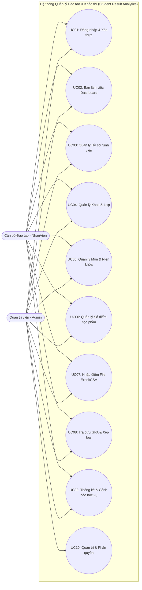
*Hình 2.1. Sơ đồ Use Case tổng quát hệ thống Student Result Analytics*

#### 2.2.3 Sơ đồ Use Case phân hệ Quản trị viên (Admin)
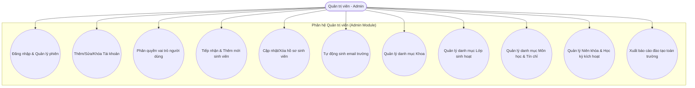
*Hình 2.2. Sơ đồ Use Case phân hệ Quản trị viên (Admin)*

#### 2.2.4 Sơ đồ Use Case phân hệ Cán bộ Đào tạo & Khảo thí (NhanVien)
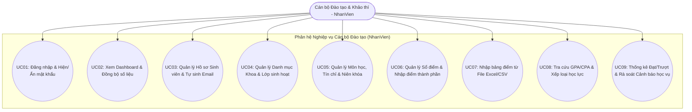
*Hình 2.3. Sơ đồ Use Case phân hệ Cán bộ Đào tạo & Khảo thí (NhanVien)*

#### 2.2.5 Các bảng đặc tả Use Case chi tiết (10 Use Cases chuẩn học thuật)

*Bảng 2.2. Đặc tả Use Case UC01 – Đăng nhập hệ thống & Xác thực người dùng*

| Mục | Nội dung chi tiết |
| :--- | :--- |
| **Mã Use Case** | **UC01** |
| **Tên Use Case** | **Đăng nhập hệ thống & Xác thực người dùng** |
| **Actor** | Admin, NhanVien (Cán bộ Phòng Đào tạo) |
| **Mục đích** | Xác thực danh tính người dùng và phân quyền điều hướng giao diện phù hợp với vai trò được cấp. |
| **Mô tả** | Người dùng nhập Tên đăng nhập và Mật khẩu. Người dùng có thể nhấn nút con mắt để xem/ẩn mật khẩu trước khi gửi. Hệ thống kiểm tra trong cơ sở dữ liệu Somee Cloud, nếu hợp lệ sẽ cấp quyền truy cập và lưu phiên làm việc. |
| **Tiền điều kiện** | Hệ thống đang ở màn hình Đăng nhập (LoginWindow). Thiết bị có kết nối mạng tới Somee SQL Server. |
| **Kích hoạt** | Người dùng nhấn nút "ĐĂNG NHẬP" hoặc nhấn phím `Enter` trên bàn phím. |
| **Luồng sự kiện chính** | 1. Người dùng nhập Username và Password vào các ô tương ứng.<br>2. (Tùy chọn) Người dùng click vào icon con mắt (👁) để chuyển đổi giữa chế độ ẩn mật khẩu (PasswordBox) và hiện mật khẩu (TextBox) nhằm kiểm tra chính tả.<br>3. Người dùng click nút "ĐĂNG NHẬP".<br>4. View gọi lệnh thực thi qua ViewModel (`LoginCommand`).<br>5. ViewModel gọi `TaiKhoanRepository.KiemTraDangNhap(username, password)`.<br>6. Repository mở kết nối SQL Server, thực thi truy vấn parameterized kiểm tra thông tin tài khoản và lấy vai trò (`VaiTro`).<br>7. Nếu tài khoản tồn tại và mật khẩu trùng khớp:<br>&nbsp;&nbsp;&nbsp;&nbsp;a. Ghi nhận thông tin người dùng vào phiên đăng nhập hiện hành.<br>&nbsp;&nbsp;&nbsp;&nbsp;b. Đóng cửa sổ `LoginWindow`.<br>&nbsp;&nbsp;&nbsp;&nbsp;c. Khởi tạo và hiển thị cửa sổ làm việc chính `MainWindow`, điều hướng thanh menu phân quyền phù hợp.<br>&nbsp;&nbsp;&nbsp;&nbsp;d. Ghi log đăng nhập thành công vào bảng `LogHeThong`. |
| **Luồng thay thế / Ngoại lệ** | 3a. Người dùng để trống Tên đăng nhập hoặc Mật khẩu: Hệ thống hiển thị thông báo lỗi yêu cầu nhập đầy đủ thông tin.<br>6a. Tên đăng nhập không tồn tại hoặc Mật khẩu sai: Hệ thống hiển thị hộp thoại thông báo "Tên đăng nhập hoặc mật khẩu không chính xác!", không cho phép truy cập.<br>6b. Tài khoản đang ở trạng thái bị Khóa (`IsActive = 0`): Hệ thống thông báo "Tài khoản của bạn đã bị vô hiệu hóa. Vui lòng liên hệ Quản trị viên!".<br>6c. Lỗi mất kết nối mạng hoặc máy chủ SQL Somee không phản hồi: Hệ thống bắt ngoại lệ `SqlException`, hiển thị thông báo lỗi mạng thân thiện và không để ứng dụng bị crash. |
| **Hậu điều kiện** | Người dùng đăng nhập thành công, phiên làm việc được thiết lập, thanh Sidebar hiển thị tên người dùng và vai trò chính xác. |
| **Độ ưu tiên** | **Bắt buộc (Cao nhất)** |
| **Tần suất sử dụng** | Mỗi khi người dùng bắt đầu phiên làm việc mới trên phần mềm. |
| **Quy tắc nghiệp vụ** | Mật khẩu được mã hóa bảo vệ; phân quyền RBAC phân loại rõ 2 vai trò Admin và NhanVien. |

<div style="page-break-after: always;"></div>

*Bảng 2.3. Đặc tả Use Case UC02 – Bàn làm việc Dashboard & Đồng bộ dữ liệu*

| Mục | Nội dung chi tiết |
| :--- | :--- |
| **Mã Use Case** | **UC02** |
| **Tên Use Case** | **Bàn làm việc Dashboard & Đồng bộ dữ liệu** |
| **Actor** | Admin, NhanVien (Cán bộ Phòng Đào tạo) |
| **Mục đích** | Cung cấp cái nhìn toàn cảnh về các chỉ số đo lường học vụ (KPIs), phân bố học lực sinh viên và phát hiện nhanh các nguy cơ đào tạo. |
| **Mô tả** | Hệ thống tổng hợp dữ liệu từ cơ sở dữ liệu Somee Cloud và hiển thị 6 thẻ chỉ số KPIs, biểu đồ phân loại học lực tròn (LiveCharts2), bảng tổng hợp kết quả môn học và danh sách cảnh báo học vụ rút gọn; cho phép đồng bộ số liệu thời gian thực. |
| **Tiền điều kiện** | Người dùng đã đăng nhập thành công với vai trò Admin hoặc NhanVien. |
| **Kích hoạt** | Người dùng nhấn chọn mục "Bàn làm việc (Dashboard)" trên thanh menu Sidebar, hoặc nhấn nút "ĐỒNG BỘ SỐ LIỆU". |
| **Luồng sự kiện chính** | 1. ViewModel kích hoạt phương thức bất đồng bộ `LoadDashboardDataAsync()`.<br>2. ViewModel gọi các hàm tổng hợp thống kê trong Repositories (`GetTongSinhVien()`, `GetTongLop()`, `GetTongMonHoc()`, `GetDiemTrungBinhToanKhoa()`, `GetTyLeDatChung()`, `GetSoLuongCanBoSungDiem()`).<br>3. Repository thực thi các câu truy vấn SQL gom nhóm (`COUNT`, `AVG`, `SUM`, `GROUP BY`) trên Somee SQL Server.<br>4. Dữ liệu được nạp vào các thuộc tính ViewModel và tự động cập nhật lên giao diện nhờ cơ chế Data Binding của WPF.<br>5. Thư viện LiveCharts2 vẽ biểu đồ hình tròn (Pie Chart) thể hiện tỷ lệ sinh viên theo từng nhóm xếp loại (Xuất sắc, Giỏi, Khá, Trung bình, Yếu, Kém).<br>6. Hiển thị bảng tóm tắt danh sách sinh viên thiếu điểm thành phần (chuyên cần, giữa kỳ hoặc cuối kỳ) để cán bộ quản lý đôn đốc.<br>7. Trạng thái kết nối hiển thị biểu tượng xanh "Trực tuyến". |
| **Luồng thay thế / Ngoại lệ** | 3a. Cơ sở dữ liệu chưa có dữ liệu điểm: Các chỉ số trung bình hiển thị 0.00, biểu đồ hiển thị trạng thái sẵn sàng nhận dữ liệu.<br>3b. Có giá trị `NULL` trong bảng điểm: Nhóm xử lý dữ liệu kiểm tra `IsDBNull` an toàn, gán giá trị mặc định tránh ngoại lệ `InvalidCastException`. |
| **Hậu điều kiện** | Toàn bộ các chỉ số KPI và biểu đồ được cập nhật mới nhất theo trạng thái thực tế của CSDL đám mây. |
| **Độ ưu tiên** | **Cao** |
| **Tần suất sử dụng** | Thường xuyên khi khởi động phần mềm và sau khi nhập điểm mới. |
| **Quy tắc nghiệp vụ** | Chỉ số tỷ lệ đạt chung căn cứ trên tỷ lệ học phần có điểm tổng kết $\ge 4.0$ (Thang 10). |

<div style="page-break-after: always;"></div>

*Bảng 2.4. Đặc tả Use Case UC03 – Quản lý Hồ sơ Sinh viên & Tự động tạo Email*

| Mục | Nội dung chi tiết |
| :--- | :--- |
| **Mã Use Case** | **UC03** |
| **Tên Use Case** | **Quản lý Hồ sơ Sinh viên & Tự động tạo Email trường** |
| **Actor** | Admin, NhanVien (Cán bộ Phòng Đào tạo) |
| **Mục đích** | Quản lý vòng đời hồ sơ sinh viên, lưu trữ thông tin nhân thân, phân lớp, phân khoa và chuẩn hóa tài khoản thư điện tử sinh viên. |
| **Mô tả** | Quản trị viên thực hiện các thao tác Thêm mới, Sửa, Xóa hồ sơ sinh viên, tìm kiếm theo tên hoặc mã, và lọc theo Khoa/Lớp. Đặc biệt, khi nhập Mã sinh viên, hệ thống tự động sinh định dạng email chuẩn của trường. |
| **Tiền điều kiện** | Người dùng đã đăng nhập với vai trò Admin và mở màn hình "Hồ sơ Sinh viên & Lớp học". |
| **Kích hoạt** | Người dùng nhấn các nút chức năng: "THÊM", "CẬP NHẬT", "XÓA", "LÀM MỚI" hoặc nhập từ khóa tìm kiếm. |
| **Luồng sự kiện chính** | 1. Hệ thống tải danh sách sinh viên hiện có vào bảng DataGrid kèm thông tin Mã SV, Họ tên, Ngày sinh, Giới tính, Email, Lớp và Khoa.<br>2. Khi thêm mới sinh viên, người dùng nhập Mã sinh viên (ví dụ: `23010199`).<br>3. **Tính năng tự động sinh email**: Trong ViewModel, sự kiện `OnPropertyChanged(nameof(MaSV))` bắt chuỗi mã sinh viên và tự động gán giá trị cho thuộc tính Email theo định dạng: `[MaSV]@st.phenikaa-uni.edu.vn`. Ô nhập liệu Email trên giao diện được cập nhật tức thì.<br>4. Người dùng nhập tiếp Họ tên, chọn Ngày sinh, Giới tính và Lớp sinh hoạt trong danh sách thả xuống (ComboBox).<br>5. Người dùng nhấn nút "THÊM".<br>6. ViewModel kiểm tra tính hợp lệ dữ liệu (Mã SV không trùng, các trường bắt buộc không để trống).<br>7. Gọi `SinhVienRepository.ThemSinhVien(sv)` để ghi bản ghi mới vào bảng `SinhVien` trên SQL Server Somee.<br>8. Hiển thị thông báo "Thêm sinh viên thành công!", xóa trắng form nhập liệu và nạp lại danh sách DataGrid. |
| **Luồng thay thế / Ngoại lệ** | 2a. Người dùng nhập Mã sinh viên đã tồn tại trong CSDL: Hệ thống báo lỗi trùng khóa chính "Mã sinh viên đã tồn tại trên hệ thống!".<br>4a. Người dùng bỏ trống Họ tên hoặc chưa chọn Lớp: Hệ thống hiển thị cảnh báo yêu cầu bổ sung thông tin.<br>5a. Thao tác XÓA sinh viên đã có dữ liệu điểm học phần: Hệ thống hiển thị cảnh báo ràng buộc khóa ngoại, yêu cầu xác nhận xóa an toàn để tránh phá vỡ tính toàn vẹn dữ liệu. |
| **Hậu điều kiện** | Bản ghi sinh viên mới được lưu vào CSDL Somee Cloud; email chuẩn trường được lưu trữ chính xác. |
| **Độ ưu tiên** | **Cao** |
| **Tần suất sử dụng** | Thường xuyên vào đầu mỗi năm học hoặc khi có biến động sinh viên. |
| **Quy tắc nghiệp vụ** | Email sinh viên bắt buộc mang tên miền `@st.phenikaa-uni.edu.vn` và có phần tiền tố trùng khớp 100% với Mã sinh viên. |

<div style="page-break-after: always;"></div>

*Bảng 2.5. Đặc tả Use Case UC04 – Quản lý Khoa và Lớp sinh hoạt*

| Mục | Nội dung chi tiết |
| :--- | :--- |
| **Mã Use Case** | **UC04** |
| **Tên Use Case** | **Quản lý Khoa và Lớp sinh hoạt** |
| **Actor** | Admin, NhanVien (Cán bộ Phòng Đào tạo) |
| **Mục đích** | Quản lý cơ cấu tổ chức đào tạo của nhà trường, phân cấp các khoa đào tạo và danh mục lớp sinh hoạt trực thuộc. |
| **Mô tả** | Cung cấp giao diện để thêm mới, chỉnh sửa thông tin Khoa đào tạo (Khoa CNTT, Khoa Điện - Điện tử...) và danh mục Lớp sinh hoạt (Mã lớp, Tên lớp, Khóa học, Khoa trực thuộc). |
| **Tiền điều kiện** | Người dùng đăng nhập quyền Admin và chuyển sang tab "Danh mục Lớp học & Khoa". |
| **Kích hoạt** | Người dùng thao tác trên form quản lý Lớp và Khoa. |
| **Luồng sự kiện chính** | 1. Hệ thống hiển thị danh sách các Khoa đào tạo và danh sách Lớp sinh hoạt liên kết.<br>2. Người dùng nhập thông tin Lớp mới: Mã lớp (ví dụ: `CNTT03`), Tên lớp ("Công nghệ thông tin 03"), Khóa học ("K17"), chọn Khoa trực thuộc ("Công nghệ thông tin").<br>3. Nhấn nút "THÊM LỚP".<br>4. ViewModel gọi `LopRepository.ThemLop(lop)`.<br>5. Bản ghi được lưu vào bảng `Lop` với cột `Khoa` tương ứng.<br>6. Cập nhật danh sách hiển thị và làm tươi danh sách ComboBox Lớp trên form Quản lý Sinh viên. |
| **Luồng thay thế / Ngoại lệ** | 2a. Trùng mã lớp đã có: Hệ thống thông báo mã lớp đã tồn tại.<br>4a. Lỗi kết nối CSDL: Báo lỗi mạng và yêu cầu thử lại. |
| **Hậu điều kiện** | Lớp học mới được thêm vào hệ thống và sẵn sàng để phân bổ sinh viên vào lớp. |
| **Độ ưu tiên** | **Trung bình** |
| **Tần suất sử dụng** | Khi mở khóa đào tạo mới hoặc thành lập lớp sinh hoạt mới. |
| **Quy tắc nghiệp vụ** | Mỗi lớp sinh hoạt bắt buộc phải trực thuộc một Khoa đào tạo cụ thể. |

<div style="page-break-after: always;"></div>

*Bảng 2.6. Đặc tả Use Case UC05 – Quản lý Môn học & Niên khóa đào tạo*

| Mục | Nội dung chi tiết |
| :--- | :--- |
| **Mã Use Case** | **UC05** |
| **Tên Use Case** | **Quản lý Môn học & Niên khóa đào tạo** |
| **Actor** | Admin, NhanVien (Cán bộ Phòng Đào tạo) |
| **Mục đích** | Quản lý chương trình khung đào tạo tín chỉ, số lượng tín chỉ của từng học phần, tỷ lệ điểm thành phần và danh mục niên khóa học kỳ. |
| **Mô tả** | Quản trị viên thêm mới, chỉnh sửa, xóa môn học (Mã môn, Tên môn, Số tín chỉ 2/3/4 tín, Tỷ lệ chuyên cần 10%, Giữa kỳ 40%, Cuối kỳ 50%) và kích hoạt niên khóa áp dụng. |
| **Tiền điều kiện** | Đăng nhập với quyền Admin, mở màn hình "Học phần & Niên khóa". |
| **Kích hoạt** | Người dùng chọn chức năng thêm/sửa/xóa môn học hoặc chọn niên khóa hiện hành. |
| **Luồng sự kiện chính** | 1. Hệ thống hiển thị danh sách học phần và niên khóa hiện hành.<br>2. Người dùng nhập Mã môn (ví dụ: `NET01`), Tên môn ("Công nghệ .NET"), Số tín chỉ (3 tín chỉ), Tỷ lệ đánh giá thành phần.<br>3. Nhấn nút "LƯU MÔN HỌC".<br>4. ViewModel kiểm tra tính hợp lệ dữ liệu ($Số\_Tín\_Chỉ > 0$, tổng tỷ lệ đánh giá $= 100\%$).<br>5. Gọi `MonHocRepository.ThemMonHoc(mh)` ghi vào bảng `MonHoc` trên SQL Server.<br>6. Hệ thống cập nhật danh sách học phần trên sổ điểm. |
| **Luồng thay thế / Ngoại lệ** | 2a. Trùng mã môn học: Hệ thống báo lỗi trùng mã học phần.<br>4a. Số tín chỉ nhập không hợp lệ ($\le 0$): Hệ thống từ chối lưu và yêu cầu nhập lại. |
| **Hậu điều kiện** | Môn học mới sẵn sàng để mở lớp học phần và chấm điểm thi. |
| **Độ ưu tiên** | **Cao** |
| **Tần suất sử dụng** | Định kỳ trước mỗi kỳ đăng ký học hoặc khi cập nhật chương trình đào tạo. |
| **Quy tắc nghiệp vụ** | Số tín chỉ của môn học là trọng số cốt lõi trong công thức tính GPA/CPA của sinh viên. |

<div style="page-break-after: always;"></div>

*Bảng 2.7. Đặc tả Use Case UC06 – Quản lý Sổ điểm học phần & Điểm thành phần*

| Mục | Nội dung chi tiết |
| :--- | :--- |
| **Mã Use Case** | **UC06** |
| **Tên Use Case** | **Quản lý Sổ điểm học phần & Điểm thành phần** |
| **Actor** | Admin, NhanVien (Cán bộ Phòng Đào tạo & Khảo thí) |
| **Mục đích** | Quản lý bảng ghi nhận điểm số học phần chi tiết của sinh viên, hỗ trợ nhập điểm trực tiếp và tự động tổng hợp kết quả môn học. |
| **Mô tả** | Người dùng chọn Môn học, Niên khóa và Lớp sinh hoạt; hệ thống nạp danh sách sinh viên cùng các cột điểm Chuyên cần, Giữa kỳ, Cuối kỳ. Người dùng có thể sửa điểm trực tiếp; hệ thống tự động kiểm tra biên điểm $0 \le Điểm \le 10$, tính điểm tổng kết môn học thang 10, quy đổi điểm chữ, điểm hệ 4 và trạng thái Đạt/Trượt. |
| **Tiền điều kiện** | Đã đăng nhập hệ thống, môn học và sinh viên đã tồn tại trong CSDL. |
| **Kích hoạt** | Người dùng chọn màn hình "Sổ điểm học phần" và thực hiện chọn tiêu chí lọc hoặc lưu điểm. |
| **Luồng sự kiện chính** | 1. Người dùng chọn Học kỳ/Niên khóa và Môn học cần chấm điểm từ ComboBox.<br>2. Hệ thống tải danh sách sinh viên cùng điểm số thành phần hiện tại từ bảng `DiemHocPhan`.<br>3. Cán bộ đào tạo nhập trực tiếp điểm số vào các ô tương ứng trên DataGrid (Điểm CC, Điểm GK, Điểm CK).<br>4. Mỗi khi một giá trị điểm thay đổi, hệ thống thực thi thuật toán:<br>&nbsp;&nbsp;&nbsp;&nbsp;a. Kiểm tra $0 \le Điểm \le 10$.<br>&nbsp;&nbsp;&nbsp;&nbsp;b. Tính điểm môn học thang 10: $TK = CC 	imes 0.1 + GK 	imes 0.4 + CK 	imes 0.5$.<br>&nbsp;&nbsp;&nbsp;&nbsp;c. Quy đổi chuẩn xác: Nếu $9.0 \le TK \le 10.0 	o A+ (4.0)$; Nếu $8.5 \le TK < 9.0 	o A (3.7)$; Nếu $8.0 \le TK < 8.5 	o B+ (3.5)$...<br>&nbsp;&nbsp;&nbsp;&nbsp;d. Xác định trạng thái: Nếu $TK \ge 4.0$ và Điểm CK $\ge 3.0 	o$ "Đạt", ngược lại "Trượt".<br>5. Cán bộ đào tạo nhấn nút "LƯU SỔ ĐIỂM".<br>6. ViewModel gọi `DiemHocPhanRepository.CapNhatDiem(diem)` lưu toàn bộ vào CSDL Somee Cloud.<br>7. Hệ thống thông báo lưu thành công và cập nhật tức thì dữ liệu lên Dashboard. |
| **Luồng thay thế / Ngoại lệ** | 3a. Người dùng nhập điểm âm ($< 0$) hoặc vượt quá 10 ($> 10$): Hệ thống hiển thị cảnh báo đỏ và khôi phục giá trị điểm hợp lệ gần nhất.<br>3b. Người dùng nhập ký tự không phải số: Hệ thống chặn nhập và thông báo dữ liệu sai định dạng. |
| **Hậu điều kiện** | Dữ liệu sổ điểm được cập nhật bền vững trên máy chủ SQL Server; các biểu đồ phân tích tự động đồng bộ. |
| **Độ ưu tiên** | **Bắt buộc (Rất cao)** |
| **Tần suất sử dụng** | Rất cao trong thời gian diễn ra kỳ thi và chốt kết quả môn học. |
| **Quy tắc nghiệp vụ** | Sinh viên có điểm thi cuối kỳ dưới 3.0 điểm (điểm liệt) tự động bị tính là Trượt học phần (Điểm F) bất kể điểm trung bình tổng kết. |

<div style="page-break-after: always;"></div>

*Bảng 2.8. Đặc tả Use Case UC07 – Nhập điểm học phần từ File ngoại vi (Excel/CSV)*

| Mục | Nội dung chi tiết |
| :--- | :--- |
| **Mã Use Case** | **UC07** |
| **Tên Use Case** | **Nhập điểm học phần từ File ngoại vi (Excel/CSV)** |
| **Actor** | Admin, NhanVien (Cán bộ Phòng Đào tạo & Khảo thí) |
| **Mục đích** | Tự động hóa quá trình nạp bảng điểm học phần số lượng lớn từ các tệp Excel/CSV do giảng viên nộp về, giảm thiểu sai sót do nhập liệu thủ công. |
| **Mô tả** | Người dùng chọn tệp bảng tính Excel (`.xlsx`) hoặc tệp văn bản CSV (`.csv`) từ máy tính cá nhân. Hệ thống tự động phân tích cấu trúc, kiểm tra hợp lệ từng dòng, tính toán điểm tổng kết/quy đổi và nạp đồng loạt (Bulk Insert) vào cơ sở dữ liệu. |
| **Tiền điều kiện** | Đã đăng nhập hệ thống, tệp Excel/CSV được định dạng theo đúng mẫu cột quy định (Mã SV, Mã Môn, Niên khóa, Điểm CC, Điểm GK, Điểm CK). |
| **Kích hoạt** | Người dùng nhấn nút "CHỌN TỆP EXCEL / CSV" trên màn hình "Nhập điểm từ File". |
| **Luồng sự kiện chính** | 1. Hệ thống mở hộp thoại `OpenFileDialog` cho phép người dùng lọc và chọn tệp `.xlsx` hoặc `.csv`.<br>2. Người dùng chọn tệp và nhấn "Open".<br>3. Hệ thống đọc tiêu đề tệp và hiển thị đường dẫn tệp lên giao diện.<br>4. Người dùng nhấn nút "TIẾN HÀNH NẠP ĐIỂM".<br>5. ViewModel sử dụng dịch vụ đọc file (`ExcelImportService` / `CsvHelper`) để phân tích dữ liệu từng dòng:<br>&nbsp;&nbsp;&nbsp;&nbsp;a. Kiểm tra tính tồn tại của Mã sinh viên trong bảng `SinhVien`.<br>&nbsp;&nbsp;&nbsp;&nbsp;b. Kiểm tra tính tồn tại của Mã môn học trong bảng `MonHoc`.<br>&nbsp;&nbsp;&nbsp;&nbsp;c. Kiểm tra khoảng giá trị điểm hợp lệ ($0.0 \le Điểm \le 10.0$).<br>&nbsp;&nbsp;&nbsp;&nbsp;d. Tính toán điểm tổng kết môn học thang 10, điểm chữ và điểm thang 4 theo chuẩn mới.<br>6. Gọi `DiemHocPhanRepository.NhapDiemTuFileAsync(listDiem)` thực hiện ghi hàng loạt vào CSDL qua `SqlTransaction`.<br>7. Hệ thống thông báo tổng kết: "Nạp điểm thành công: X dòng. Lỗi: Y dòng." kèm chi tiết các dòng vi phạm (nếu có).<br>8. Dữ liệu trên Dashboard và Sổ điểm tự động được làm mới. |
| **Luồng thay thế / Ngoại lệ** | 2a. Tệp tin bị khóa do đang mở trong Microsoft Excel: Hệ thống thông báo yêu cầu đóng tệp trước khi nạp.<br>5a. Tệp tin không đúng mẫu cột quy định: Hệ thống dừng quá trình nạp và thông báo cấu trúc tệp sai lệch.<br>5b. Có dòng dữ liệu chứa Mã SV không tồn tại trong hệ thống: Hệ thống ghi nhận lỗi dòng đó vào danh sách cảnh báo và tiếp tục nạp các dòng hợp lệ khác. |
| **Hậu điều kiện** | Điểm học phần của toàn bộ sinh viên trong file được cập nhật vào CSDL Somee Cloud; nhật ký kiểm toán ghi nhận tệp vừa nạp. |
| **Độ ưu tiên** | **Cao** |
| **Tần suất sử dụng** | Định kỳ vào cuối mỗi học kỳ sau khi chấm thi xong. |
| **Quy tắc nghiệp vụ** | Nếu bản ghi điểm của sinh viên trong môn học đó đã tồn tại, hệ thống tiến hành cập nhật (Update); nếu chưa có, hệ thống tiến hành thêm mới (Insert). |

<div style="page-break-after: always;"></div>

*Bảng 2.9. Đặc tả Use Case UC08 – Tra cứu kết quả học tập & Tính GPA/CPA tích lũy*

| Mục | Nội dung chi tiết |
| :--- | :--- |
| **Mã Use Case** | **UC08** |
| **Tên Use Case** | **Tra cứu kết quả học tập & Tính GPA/CPA tích lũy** |
| **Actor** | Admin, NhanVien (Cán bộ Phòng Đào tạo) |
| **Mục đích** | Cung cấp công cụ tra cứu bảng điểm tổng hợp của sinh viên theo từng học kỳ hoặc toàn khóa; tính điểm trung bình GPA/CPA có trọng số tín chỉ và xếp loại học lực. |
| **Mô tả** | Người dùng nhập Mã sinh viên hoặc chọn từ danh sách, chọn Học kỳ xét hoặc chọn "Tất cả học kỳ"; hệ thống tính toán điểm GPA học kỳ, CPA tích lũy toàn khóa, tổng số tín chỉ tích lũy và hiển thị bảng chi tiết kết quả từng môn học. |
| **Tiền điều kiện** | Đã đăng nhập vào hệ thống; sinh viên đã có dữ liệu điểm học phần. |
| **Kích hoạt** | Người dùng chọn màn hình "Tra cứu GPA & Học lực" và thực hiện tra cứu. |
| **Luồng sự kiện chính** | 1. Người dùng nhập Mã sinh viên hoặc chọn lớp/sinh viên cần xem.<br>2. Chọn Học kỳ cần lọc (Học kỳ 1, Học kỳ 2, hoặc "Tất cả học kỳ").<br>3. Nhấn nút "TRA CỨU KẾT QUẢ".<br>4. ViewModel truy vấn danh sách điểm học phần của sinh viên từ `DiemHocPhanRepository`.<br>5. Áp dụng thuật toán tính toán theo tín chỉ:<br>&nbsp;&nbsp;&nbsp;&nbsp;a. Điểm trung bình học kỳ: $GPA = rac{\sum (Điểm\_Hệ\_4_i 	imes Số\_Tín\_Chỉ_i)}{\sum Số\_Tín\_Chỉ_i}$ tính trên các môn trong kỳ chọn.<br>&nbsp;&nbsp;&nbsp;&nbsp;b. Điểm trung bình tích lũy: $CPA = rac{\sum (Điểm\_Hệ\_4_j 	imes Số\_Tín\_Chỉ_j)}{\sum Số\_Tín\_Chỉ_j}$ tính trên tất cả các môn đã học từ đầu khóa.<br>&nbsp;&nbsp;&nbsp;&nbsp;c. Tổng số tín chỉ đã tích lũy (chỉ cộng các môn có kết quả Đạt, tức điểm chữ khác 'F').<br>&nbsp;&nbsp;&nbsp;&nbsp;d. Xếp loại học lực căn cứ trên thang điểm CPA: Xuất sắc ($3.6 - 4.0$), Giỏi ($3.2 - 3.59$), Khá ($2.5 - 3.19$), Trung bình ($2.0 - 2.49$), Yếu ($1.0 - 1.99$), Kém ($< 1.0$).<br>6. Hiển thị bảng điểm chi tiết kèm các nhãn kết quả tổng hợp lên giao diện. |
| **Luồng thay thế / Ngoại lệ** | 4a. Sinh viên chưa có bất kỳ điểm học phần nào: Hệ thống hiển thị thông báo "Sinh viên chưa có dữ liệu điểm trong học kỳ này", các chỉ số hiển thị 0.00. |
| **Hậu điều kiện** | Người dùng nắm bắt chính xác tiến độ học tập, điểm tích lũy và xếp loại học lực của sinh viên. |
| **Độ ưu tiên** | **Cao** |
| **Tần suất sử dụng** | Rất cao, phục vụ xét học bổng, xét tốt nghiệp và tư vấn học tập. |
| **Quy tắc nghiệp vụ** | Các môn học bị điểm F không được tính vào số tín chỉ tích lũy, nhưng bắt buộc phải tính vào mẫu số để tính điểm CPA cho đến khi sinh viên học lại và cải thiện điểm. |

<div style="page-break-after: always;"></div>

*Bảng 2.10. Đặc tả Use Case UC09 – Thống kê Đạt/Trượt & Rà soát Cảnh báo học vụ*

| Mục | Nội dung chi tiết |
| :--- | :--- |
| **Mã Use Case** | **UC09** |
| **Tên Use Case** | **Thống kê Đạt/Trượt & Rà soát Cảnh báo học vụ** |
| **Actor** | Admin, NhanVien (Cán bộ Phòng Đào tạo) |
| **Mục đích** | Rà soát toàn diện kết quả học tập để phát hiện các môn học có tỷ lệ trượt cao và tự động lập danh sách sinh viên có nguy cơ bị cảnh cáo học vụ. |
| **Mô tả** | Hệ thống cung cấp bộ lọc linh hoạt theo Niên khóa, Học kỳ, Khoa và Lớp học; tính toán tỷ lệ Đạt/Trượt của từng môn học; lọc danh sách sinh viên có điểm $CPA < 2.0$, sinh viên nợ nhiều môn hoặc sinh viên còn thiếu điểm thành phần. |
| **Tiền điều kiện** | Đăng nhập với quyền Admin hoặc NhanVien. |
| **Kích hoạt** | Người dùng chọn màn hình "Thống kê Đạt/Trượt & Cảnh báo" và nhấn nút "LỌC DỮ LIỆU". |
| **Luồng sự kiện chính** | 1. Người dùng chọn phạm vi rà soát: Học kỳ cụ thể hoặc "Tất cả các kỳ", chọn Khoa hoặc Lớp học.<br>2. Nhấn nút "THỐNG KÊ & RÀ SOÁT".<br>3. ViewModel gọi hàm xử lý thống kê phân tích từ Repository.<br>4. Hệ thống hiển thị 2 bảng dữ liệu chuyên biệt:<br>&nbsp;&nbsp;&nbsp;&nbsp;a. **Bảng Thống kê Môn học**: Tên môn, Số TC, Tổng SV học, Số lượng Đạt, Số lượng Trượt, Số lượng Thiếu điểm, Tỷ lệ Đạt (%).<br>&nbsp;&nbsp;&nbsp;&nbsp;b. **Bảng Danh sách Cảnh báo học vụ**: Mã SV, Họ tên, Lớp, Điểm CPA, Số tín chỉ nợ, Mức độ cảnh báo (Mức 1: $1.8 \le CPA < 2.0$; Mức 2: $1.5 \le CPA < 1.8$; Nguy cơ buộc thôi học: $CPA < 1.5$ hoặc thiếu điểm nhiều kỳ).<br>5. Cán bộ đào tạo có thể nhấn nút "XUẤT DANH SÁCH" để lập báo cáo gửi Ban Giám hiệu và Hội đồng đào tạo. |
| **Luồng thay thế / Ngoại lệ** | 4a. Không có sinh viên nào bị cảnh báo học vụ: Hệ thống hiển thị thông báo tích cực "Không có sinh viên nào bị cảnh báo học vụ trong phạm vi đã chọn!". |
| **Hậu điều kiện** | Danh sách sinh viên cần đôn đốc và cảnh báo học vụ được trích xuất chính xác. |
| **Độ ưu tiên** | **Cao** |
| **Tần suất sử dụng** | Định kỳ vào cuối mỗi học kỳ sau khi có điểm thi kết thúc học phần. |
| **Quy tắc nghiệp vụ** | Sinh viên bị cảnh báo học vụ 3 lần liên tiếp sẽ bị chuyển sang hội đồng kỷ luật xem xét buộc thôi học. |

<div style="page-break-after: always;"></div>

*Bảng 2.11. Đặc tả Use Case UC10 – Quản trị người dùng & Phân quyền hệ thống*

| Mục | Nội dung chi tiết |
| :--- | :--- |
| **Mã Use Case** | **UC10** |
| **Tên Use Case** | **Quản trị người dùng & Phân quyền hệ thống** |
| **Actor** | Admin (Quản trị viên) - NhanVien không có quyền |
| **Mục đích** | Quản lý vòng đời tài khoản truy cập hệ thống, gán quyền hạn và đảm bảo an ninh thông tin. |
| **Mô tả** | Admin tạo tài khoản mới cho cán bộ giáo vụ và nhân viên đào tạo, cập nhật thông tin, cấp lại mật khẩu mặc định, khóa tài khoản nghi vấn và giám sát nhật ký truy cập hệ thống. |
| **Tiền điều kiện** | Đăng nhập với quyền Admin cao nhất, mở màn hình "Quản trị & Phân quyền". |
| **Kích hoạt** | Admin thao tác trên danh sách người dùng. |
| **Luồng sự kiện chính** | 1. Hệ thống hiển thị danh sách toàn bộ tài khoản trong bảng `TaiKhoan` (Username, Họ tên, Vai trò, Trạng thái hoạt động, Ngày tạo).<br>2. Admin chọn thao tác: Thêm mới tài khoản, Đổi vai trò (`Admin`, `NhanVien`, `SinhVien`), Đặt lại mật khẩu (Reset Password), hoặc Chuyển đổi trạng thái (Kích hoạt / Khóa).<br>3. Admin nhấn "LƯU THAY ĐỔI".<br>4. ViewModel gọi `TaiKhoanRepository.CapNhatTaiKhoan(tk)`.<br>5. Ghi nhận hành động vào bảng `LogHeThong` với nội dung chi tiết.<br>6. Hệ thống cập nhật danh sách và hiển thị thông báo thành công. |
| **Luồng thay thế / Ngoại lệ** | 2a. Admin tự khóa chính tài khoản của mình: Hệ thống ngăn chặn hành vi tự khóa để tránh trường hợp mất quyền quản trị hệ thống. |
| **Hậu điều kiện** | Quyền truy cập của người dùng được cập nhật có hiệu lực ngay trong phiên làm việc tiếp theo. |
| **Độ ưu tiên** | **Trung bình** |
| **Tần suất sử dụng** | Khi có nhân sự mới hoặc khi có yêu cầu xử lý tài khoản từ người dùng. |
| **Quy tắc nghiệp vụ** | Mọi thao tác quản trị tài khoản bắt buộc phải được ghi nhật ký kiểm toán không thể xóa. |

<div style="page-break-after: always;"></div>

---

### 2.3 Sơ đồ Hoạt động (Activity Diagrams)

#### 2.3.1 Activity Diagram – Quy trình Đăng nhập & Điều hướng vai trò
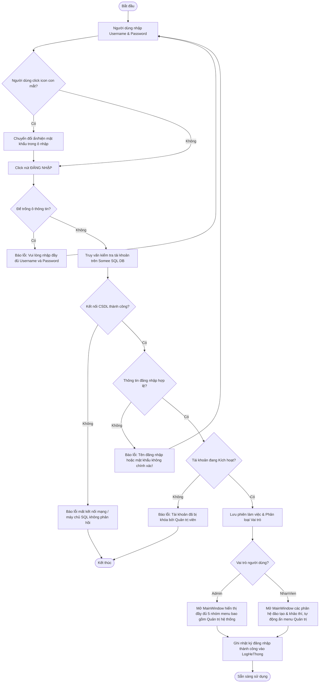
*Hình 2.5. Sơ đồ Hoạt động – Quy trình Đăng nhập & Điều hướng phân quyền*

#### 2.3.2 Activity Diagram – Quy trình Thêm sinh viên & Tự động sinh Email
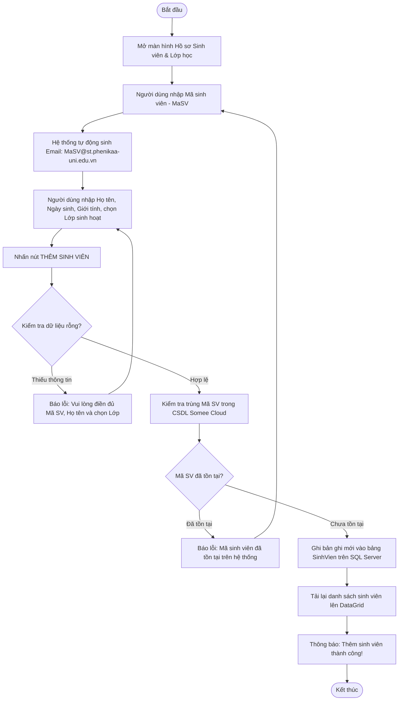
*Hình 2.6. Sơ đồ Hoạt động – Quy trình Thêm sinh viên & Tự động sinh Email*

#### 2.3.3 Activity Diagram – Quy trình Nhập điểm học phần từ File Excel/CSV
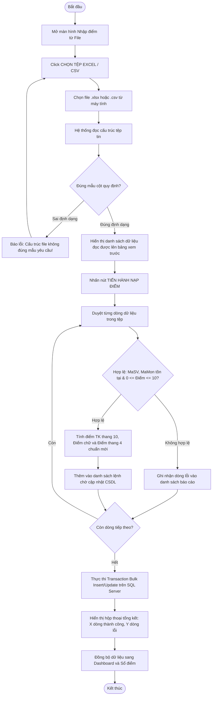
*Hình 2.7. Sơ đồ Hoạt động – Quy trình Nhập điểm học phần từ File Excel/CSV*

#### 2.3.4 Activity Diagram – Quy trình Tính toán GPA/CPA tích lũy theo số tín chỉ
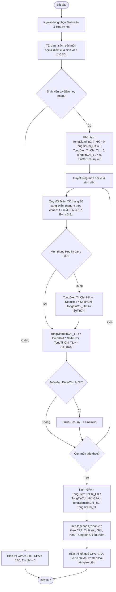
*Hình 2.8. Sơ đồ Hoạt động – Quy trình Tính toán GPA/CPA tích lũy theo số tín chỉ*

#### 2.3.5 Activity Diagram – Quy trình Lọc và Xử lý Cảnh báo học vụ
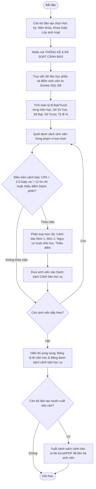
*Hình 2.9. Sơ đồ Hoạt động – Quy trình Lọc và Xử lý Cảnh báo học vụ*

<div style="page-break-after: always;"></div>

---

### 2.4 Sơ đồ Tuần tự (Sequence Diagrams)

#### 2.4.1 Sequence Diagram – Chức năng Đăng nhập & Xác thực
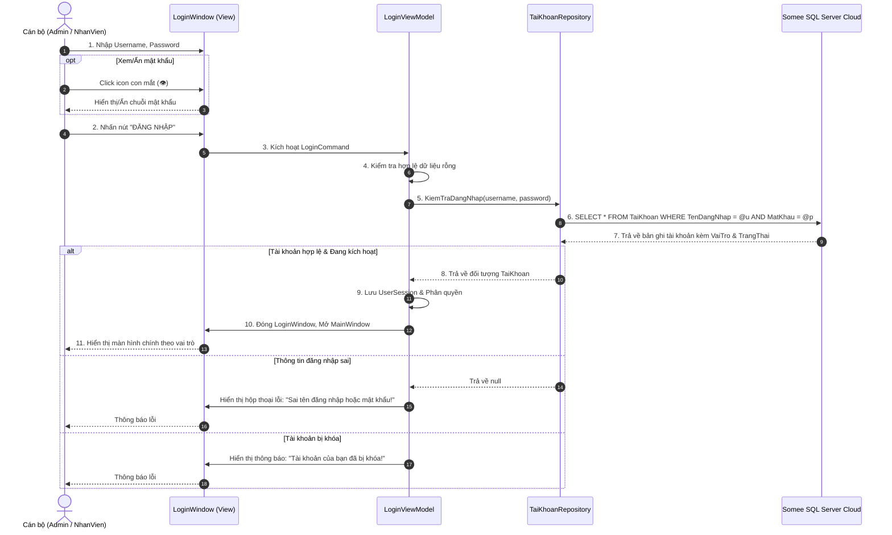
*Hình 2.10. Sơ đồ Tuần tự – Chức năng Đăng nhập & Xác thực*

#### 2.4.2 Sequence Diagram – Chức năng Thêm mới sinh viên và liên kết Lớp/Khoa
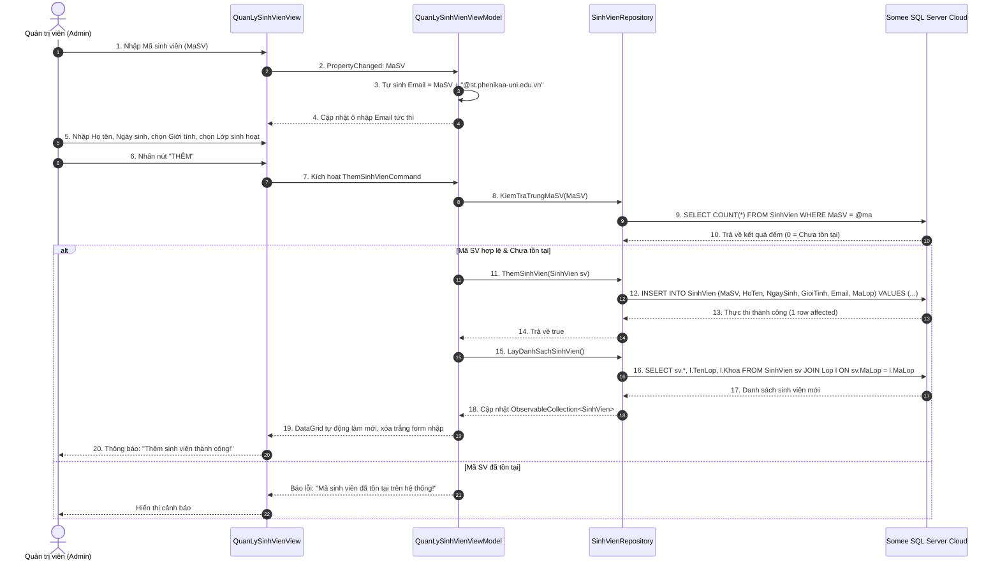
*Hình 2.11. Sơ đồ Tuần tự – Chức năng Thêm mới sinh viên và liên kết Lớp/Khoa*

#### 2.4.3 Sequence Diagram – Chức năng Nhập điểm học phần từ File Excel
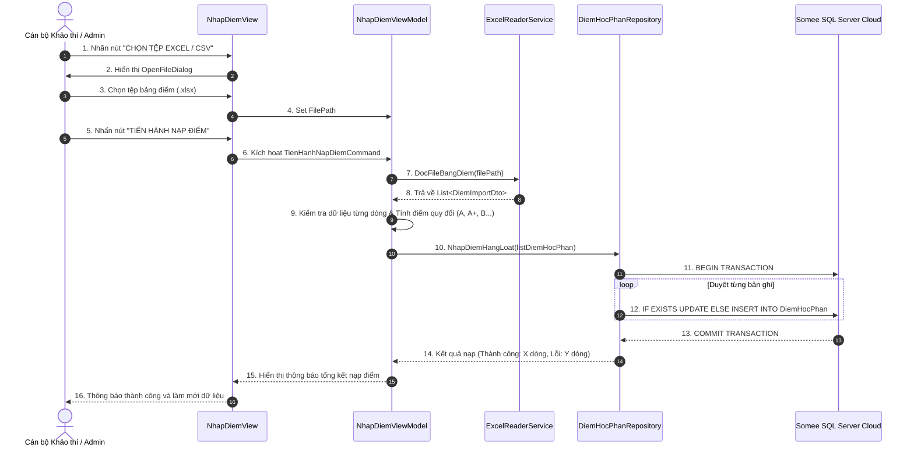
*Hình 2.12. Sơ đồ Tuần tự – Chức năng Nhập điểm học phần từ File Excel*

#### 2.4.4 Sequence Diagram – Chức năng Tra cứu kết quả học tập & Tính điểm tích lũy
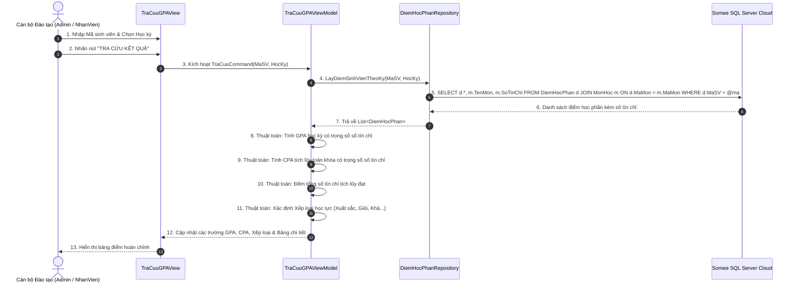
*Hình 2.13. Sơ đồ Tuần tự – Chức năng Tra cứu kết quả học tập & Tính điểm tích lũy*

#### 2.4.5 Sequence Diagram – Chức năng Rà soát và Xuất danh sách Cảnh báo học vụ
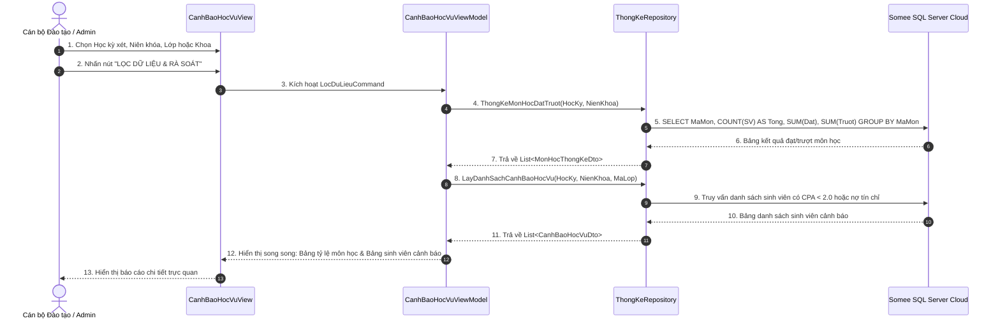
*Hình 2.14. Sơ đồ Tuần tự – Chức năng Rà soát và Xuất danh sách Cảnh báo học vụ*

<div style="page-break-after: always;"></div>

---

### 2.5 Thiết kế chi tiết Giải thuật & Logic nghiệp vụ

#### 2.5.1 Công thức tính điểm tổng kết học phần (Thang 10)
Điểm tổng kết học phần được tính từ 3 điểm thành phần theo tỷ lệ phần trăm đã cấu hình trong bảng `MonHoc`:
$$Điểm\_Tổng\_Kết = Điểm\_CC 	imes 0.10 + Điểm\_GK 	imes 0.40 + Điểm\_CK 	imes 0.50$$
*Trong đó:*
- $Điểm\_CC$: Điểm đánh giá chuyên cần (Trọng số 10%).
- $Điểm\_GK$: Điểm kiểm tra đánh giá giữa kỳ (Trọng số 40%).
- $Điểm\_CK$: Điểm thi kết thúc học phần (Trọng số 50%).
- Kết quả được làm tròn đến một chữ số thập phân (ví dụ: $8.46 	o 8.5$).

#### 2.5.2 Quy chế quy đổi thang điểm 10 sang thang chữ và thang điểm 4 chuẩn mới
Căn cứ Quy chế đào tạo đại học tín chỉ hiện hành của Trường Đại học Phenikaa, hệ thống áp dụng bảng quy chuẩn sau:

*Bảng 2.12. Quy chế quy đổi thang điểm 10 sang thang chữ và thang điểm 4 chuẩn mới*

| Khoảng điểm thang 10 | Điểm chữ | Điểm thang 4 | Đánh giá xếp loại | Trạng thái học phần |
| :---: | :---: | :---: | :---: | :---: |
| **9.0 – 10.0** | **A+** | **4.0** | **Xuất sắc** | **Đạt** |
| **8.5 – 8.9** | **A** | **3.7** | **Giỏi** | **Đạt** |
| **8.0 – 8.4** | **B+** | **3.5** | **Khá giỏi** | **Đạt** |
| **7.0 – 7.9** | **B** | **3.0** | **Khá** | **Đạt** |
| **6.5 – 6.9** | **C+** | **2.5** | **Trung bình khá**| **Đạt** |
| **5.5 – 6.4** | **C** | **2.0** | **Trung bình** | **Đạt** |
| **5.0 – 5.4** | **D+** | **1.5** | **Trung bình yếu** | **Đạt** |
| **4.0 – 4.9** | **D** | **1.0** | **Yếu** | **Đạt** |
| **Dưới 4.0** (hoặc Điểm CK < 3.0) | **F** | **0.0** | **Kém (Không đạt)** | **Trượt (Phải học lại)** |

> [!IMPORTANT]
> **Điểm cải tiến cốt lõi của hệ thống**: Khác với các hệ thống quy đổi cũ gộp toàn bộ mức $8.5 - 10.0$ thành điểm $A$ ($4.0$), hệ thống phân tách chính xác:
> - Mức $8.5 \le Điểm < 9.0 \implies$ Điểm chữ **A**, Điểm hệ 4 là **3.7**.
> - Mức $9.0 \le Điểm \le 10.0 \implies$ Điểm chữ **A+**, Điểm hệ 4 là **4.0**.

#### 2.5.3 Thuật toán tính Điểm trung bình học kỳ (GPA) và Điểm trung bình tích lũy (CPA)
Học chế tín chỉ yêu cầu tính điểm trung bình dựa trên **trọng số số tín chỉ** của từng môn học (môn 3 tín chỉ có trọng số gấp 1.5 lần môn 2 tín chỉ):

$$GPA = rac{\sum_{i=1}^{n} (Điểm\_Hệ\_4_i 	imes Số\_Tín\_Chỉ_i)}{\sum_{i=1}^{n} Số\_Tín\_Chỉ_i}$$

$$CPA = rac{\sum_{j=1}^{m} (Điểm\_Hệ\_4_j 	imes Số\_Tín\_Chỉ_j)}{\sum_{j=1}^{m} Số\_Tín\_Chỉ_j}$$

*Trong đó:*
- $n$: Số học phần sinh viên đăng ký học trong học kỳ đang xét.
- $m$: Tổng số học phần sinh viên đã học kể từ đầu khóa học đến thời điểm hiện tại.
- $Điểm\_Hệ\_4_i$: Điểm quy đổi thang 4 của học phần thứ $i$.
- $Số\_Tín\_Chỉ_i$: Số tín chỉ của học phần thứ $i$.

#### 2.5.4 Quy tắc xếp loại học lực toàn khóa và Tiêu chuẩn Cảnh báo học vụ
Căn cứ vào điểm trung bình chung tích lũy ($CPA$), học lực của sinh viên được xếp loại như sau:

*Bảng 2.13. Tiêu chuẩn phân loại học lực sinh viên theo học chế tín chỉ*

| Điểm CPA tích lũy (Thang 4) | Xếp loại học lực | Tình trạng học vụ |
| :---: | :---: | :--- |
| **3.60 – 4.00** | **Xuất sắc** | Khen thưởng, đạt chuẩn xét học bổng xuất sắc |
| **3.20 – 3.59** | **Giỏi** | Đạt chuẩn xét học bổng loại giỏi |
| **2.50 – 3.19** | **Khá** | Học lực đạt chuẩn, tiến độ bình thường |
| **2.00 – 2.49** | **Trung bình** | Tiến độ bình thường, cần cố gắng |
| **1.50 – 1.99** | **Yếu** | **Bị Cảnh báo học vụ Mức 1** (Cần cán bộ đôn đốc cải thiện kết quả) |
| **1.00 – 1.49** | **Kém** | **Bị Cảnh báo học vụ Mức 2** (Nguy cơ đình chỉ học tập) |
| **Dưới 1.00** | **Kém nghiêm trọng** | **Xem xét Buộc thôi học** theo quy chế đào tạo |

<div style="page-break-after: always;"></div>

---

### 2.6 Thiết kế Cơ sở dữ liệu (Database Design)

#### 2.6.1 Sơ đồ Thực thể Liên kết (Entity Relationship Diagram - ERD)
Cơ sở dữ liệu được thiết kế đạt chuẩn hóa dạng 3 (3NF - Third Normal Form), loại bỏ hoàn toàn các dư thừa dữ liệu và dị thường khi cập nhật.

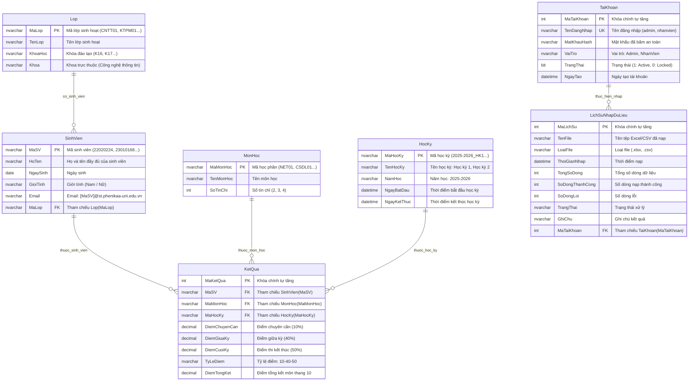
*Hình 2.15. Sơ đồ Thực thể Liên kết (Entity Relationship Diagram - ERD) chuẩn hóa 3NF trích xuất trực tiếp từ SQL Server*


#### 2.6.2 Từ điển dữ liệu chi tiết cho 8 bảng Cơ sở dữ liệu

*Bảng 2.14. Từ điển dữ liệu bảng `TaiKhoan`*

| Tên trường (Column) | Kiểu dữ liệu | Độ dài | Ràng buộc | Ý nghĩa và Diễn giải nghiệp vụ |
| :--- | :--- | :---: | :---: | :--- |
| `Id` | `INT` | 4 bytes | PK, IDENTITY(1,1) | Khóa chính tự tăng định danh duy nhất người dùng |
| `TenDangNhap` | `NVARCHAR` | 50 | UNIQUE, NOT NULL | Tên tài khoản đăng nhập vào hệ thống |
| `MatKhau` | `NVARCHAR` | 255 | NOT NULL | Mật khẩu xác thực (mã hóa an toàn) |
| `HoTen` | `NVARCHAR` | 100 | NOT NULL | Họ và tên đầy đủ của chủ tài khoản |
| `Email` | `NVARCHAR` | 150 | NULL | Email liên hệ phục vụ khôi phục thông tin |
| `VaiTro` | `NVARCHAR` | 50 | NOT NULL | Vai trò phân quyền: `Admin`, `NhanVien`, `SinhVien` |
| `TrangThai` | `BIT` | 1 byte | DEFAULT 1 | Trạng thái hoạt động (1: Kích hoạt, 0: Tạm khóa) |
| `NgayTao` | `DATETIME` | 8 bytes | DEFAULT GETDATE() | Ngày giờ khởi tạo tài khoản |

*Bảng 2.15. Từ điển dữ liệu bảng `Khoa`*

| Tên trường (Column) | Kiểu dữ liệu | Độ dài | Ràng buộc | Ý nghĩa và Diễn giải nghiệp vụ |
| :--- | :--- | :---: | :---: | :--- |
| `MaKhoa` | `NVARCHAR` | 20 | PK, NOT NULL | Mã định danh khoa đào tạo (ví dụ: `CNTT`, `DTVT`) |
| `TenKhoa` | `NVARCHAR` | 100 | NOT NULL | Tên đầy đủ của khoa (Khoa Công nghệ thông tin) |
| `VanPhong` | `NVARCHAR` | 150 | NULL | Địa điểm phòng làm việc văn phòng khoa |
| `TruongKhoa` | `NVARCHAR` | 100 | NULL | Họ và tên Trưởng khoa |

*Bảng 2.16. Từ điển dữ liệu bảng `Lop`*

| Tên trường (Column) | Kiểu dữ liệu | Độ dài | Ràng buộc | Ý nghĩa và Diễn giải nghiệp vụ |
| :--- | :--- | :---: | :---: | :--- |
| `MaLop` | `NVARCHAR` | 20 | PK, NOT NULL | Mã lớp sinh hoạt (ví dụ: `CNTT01`, `KTPM01`) |
| `TenLop` | `NVARCHAR` | 100 | NOT NULL | Tên đầy đủ của lớp sinh hoạt |
| `KhoaHoc` | `NVARCHAR` | 50 | NULL | Khóa học đào tạo (ví dụ: `K16`, `K17`) |
| `Khoa` | `NVARCHAR` | 100 | NULL | Tên khoa quản lý lớp sinh hoạt (ví dụ: `Công nghệ thông tin`) |

*Bảng 2.17. Từ điển dữ liệu bảng `SinhVien`*

| Tên trường (Column) | Kiểu dữ liệu | Độ dài | Ràng buộc | Ý nghĩa và Diễn giải nghiệp vụ |
| :--- | :--- | :---: | :---: | :--- |
| `MaSV` | `NVARCHAR` | 20 | PK, NOT NULL | Mã định danh duy nhất của sinh viên (ví dụ: `22020224`) |
| `HoTen` | `NVARCHAR` | 100 | NOT NULL | Họ và tên đầy đủ của sinh viên |
| `NgaySinh` | `DATE` | 3 bytes | NULL | Ngày tháng năm sinh theo giấy khai sinh |
| `GioiTinh` | `NVARCHAR` | 10 | CHECK in ('Nam','Nữ') | Giới tính của sinh viên |
| `Email` | `NVARCHAR` | 150 | NOT NULL | Email trường: `[MaSV]@st.phenikaa-uni.edu.vn` |
| `MaLop` | `NVARCHAR` | 20 | FK, NOT NULL | Khóa ngoại tham chiếu đến bảng `Lop(MaLop)` |

*Bảng 2.18. Từ điển dữ liệu bảng `MonHoc`*

| Tên trường (Column) | Kiểu dữ liệu | Độ dài | Ràng buộc | Ý nghĩa và Diễn giải nghiệp vụ |
| :--- | :--- | :---: | :---: | :--- |
| `MaMon` | `NVARCHAR` | 20 | PK, NOT NULL | Mã học phần đào tạo (ví dụ: `NET01`, `CSDL01`) |
| `TenMon` | `NVARCHAR` | 100 | NOT NULL | Tên môn học hiển thị |
| `SoTinChi` | `INT` | 4 bytes | CHECK (> 0) | Số tín chỉ của học phần (trọng số tính GPA) |
| `HeSoChuyenCan`| `DECIMAL(3,2)` | 5 bytes | DEFAULT 0.10 | Tỷ lệ điểm đánh giá chuyên cần (10%) |
| `HeSoGiuaKy` | `DECIMAL(3,2)` | 5 bytes | DEFAULT 0.40 | Tỷ lệ điểm kiểm tra giữa kỳ (40%) |
| `HeSoCuoiKy` | `DECIMAL(3,2)` | 5 bytes | DEFAULT 0.50 | Tỷ lệ điểm thi kết thúc học phần (50%) |

*Bảng 2.19. Từ điển dữ liệu bảng `NienKhoa`*

| Tên trường (Column) | Kiểu dữ liệu | Độ dài | Ràng buộc | Ý nghĩa và Diễn giải nghiệp vụ |
| :--- | :--- | :---: | :---: | :--- |
| `MaNienKhoa` | `NVARCHAR` | 50 | PK, NOT NULL | Mã định danh niên khóa học kỳ (ví dụ: `2025-2026_HK1`) |
| `TenNienKhoa`| `NVARCHAR` | 50 | NOT NULL | Chuỗi năm học hiển thị (ví dụ: `2025-2026`) |
| `HocKy` | `INT` | 4 bytes | CHECK in (1, 2, 3) | Học kỳ đào tạo trong năm học (1: Kỳ 1, 2: Kỳ 2, 3: Hè) |
| `IsActive` | `BIT` | 1 byte | DEFAULT 0 | Đánh dấu học kỳ hiện hành đang mở nhận điểm |

*Bảng 2.20. Từ điển dữ liệu bảng `DiemHocPhan`*

| Tên trường (Column) | Kiểu dữ liệu | Độ dài | Ràng buộc | Ý nghĩa và Diễn giải nghiệp vụ |
| :--- | :--- | :---: | :---: | :--- |
| `Id` | `INT` | 4 bytes | PK, IDENTITY(1,1) | Khóa chính tự tăng |
| `MaSV` | `NVARCHAR` | 20 | FK, NOT NULL | Khóa ngoại tham chiếu `SinhVien(MaSV)` |
| `MaMon` | `NVARCHAR` | 20 | FK, NOT NULL | Khóa ngoại tham chiếu `MonHoc(MaMon)` |
| `MaNienKhoa` | `NVARCHAR` | 50 | FK, NOT NULL | Khóa ngoại tham chiếu `NienKhoa(MaNienKhoa)` |
| `DiemChuyenCan`| `DECIMAL(4,2)` | 5 bytes | CHECK (0.0 - 10.0)| Điểm chuyên cần thành phần |
| `DiemGiuaKy` | `DECIMAL(4,2)` | 5 bytes | CHECK (0.0 - 10.0)| Điểm thi đánh giá giữa kỳ |
| `DiemCuoiKy` | `DECIMAL(4,2)` | 5 bytes | CHECK (0.0 - 10.0)| Điểm thi kết thúc học phần |
| `DiemTongKet` | `DECIMAL(4,2)` | 5 bytes | NULL | Điểm tổng kết môn học thang 10 |
| `DiemChu` | `NVARCHAR` | 5 | NULL | Điểm chữ quy đổi: `A+`, `A`, `B+`, `B`, `C+`, `C`, `D+`, `D`, `F` |
| `DiemHe4` | `DECIMAL(3,2)` | 5 bytes | NULL | Điểm thang 4 quy đổi: 4.0, 3.7, 3.5, 3.0, 2.5, 2.0, 1.5, 1.0, 0.0 |
| `TrangThai` | `NVARCHAR` | 20 | NULL | Trạng thái: `Đạt` hoặc `Trượt` |

*Bảng 2.21. Từ điển dữ liệu bảng `LogHeThong`*

| Tên trường (Column) | Kiểu dữ liệu | Độ dài | Ràng buộc | Ý nghĩa và Diễn giải nghiệp vụ |
| :--- | :--- | :---: | :---: | :--- |
| `Id` | `INT` | 4 bytes | PK, IDENTITY(1,1) | Khóa chính tự tăng |
| `TenDangNhap` | `NVARCHAR` | 50 | NOT NULL | Tài khoản người dùng thực thi hành động |
| `HanhDong` | `NVARCHAR` | 50 | NOT NULL | Loại hành động: `LOGIN`, `INSERT_SV`, `UPDATE_DIEM`... |
| `ChiTiet` | `NVARCHAR` | 255 | NULL | Mô tả chi tiết dữ liệu biến động |
| `ThoiGian` | `DATETIME` | 8 bytes | DEFAULT GETDATE() | Dấu thời gian hệ thống ghi nhận |

<div style="page-break-after: always;"></div>

---

### 2.7 Thiết kế Kiến trúc phần mềm (Software Architecture)

Hệ thống được xây dựng tuân thủ nghiêm ngặt theo **Mẫu kiến trúc MVVM (Model - View - ViewModel)** kết hợp với **Repository Pattern**:

```mermaid
flowchart TD
    subgraph PresentationLayer ["1. Presentation Layer (Tầng hiển thị - Views)"]
        V1[LoginWindow.xaml]
        V2[MainWindow.xaml]
        V3[DashboardView.xaml]
        V4[QuanLySinhVienView.xaml]
        V5[QuanLyMonHocView.xaml]
        V6[SoDiemHocPhanView.xaml]
        V7[NhapDiemView.xaml]
        V8[TraCuuGPAView.xaml]
        V9[CanhBaoHocVuView.xaml]
        V10[QuanTriView.xaml]
    end

    subgraph ViewModelLayer ["2. ViewModel Layer (Tầng Logic nghiệp vụ & Điều khiển)"]
        VM1[LoginViewModel]
        VM2[MainViewModel]
        VM3[DashboardViewModel]
        VM4[QuanLySinhVienViewModel]
        VM5[QuanLyMonHocViewModel]
        VM6[SoDiemHocPhanViewModel]
        VM7[NhapDiemViewModel]
        VM8[TraCuuGPAViewModel]
        VM9[CanhBaoHocVuViewModel]
        VM10[QuanTriViewModel]
        BaseVM[ViewModelBase : INotifyPropertyChanged]
        RelayCmd[RelayCommand : ICommand]
    end

    subgraph DomainModelLayer ["3. Model Layer (Tầng Mô hình dữ liệu)"]
        M1[SinhVien.cs]
        M2[Lop.cs]
        M3[Khoa.cs]
        M4[MonHoc.cs]
        M5[DiemHocPhan.cs]
        M6[NienKhoa.cs]
        M7[TaiKhoan.cs]
        M8[LogHeThong.cs]
    end

    subgraph DataAccessLayer ["4. Data Access Layer (Repository Pattern & ADO.NET)"]
        R1[SinhVienRepository]
        R2[LopRepository]
        R3[MonHocRepository]
        R4[DiemHocPhanRepository]
        R5[TaiKhoanRepository]
        R6[ThongKeRepository]
        DBHelper[DatabaseHelper / ConnectionString]
    end

    subgraph CloudDatabase ["5. Cloud Database Server"]
        SomeeDB[(Somee SQL Server Cloud
StudentResultAnalyticsDB)]
    end

    PresentationLayer <== "Two-Way DataBinding
ICommand Execution" ==> ViewModelLayer
    ViewModelLayer --> DomainModelLayer
    ViewModelLayer --> DataAccessLayer
    DataAccessLayer --> DomainModelLayer
    DataAccessLayer <== "TCP/IP Connection
ADO.NET (SqlClient)" ==> CloudDatabase
```
*Hình 2.16. Sơ đồ Kiến trúc phân tầng hệ thống kết hợp Mô hình MVVM và Repository Pattern*

#### Các thành phần kiến trúc cốt lõi:
1. **Views (Giao diện XAML)**: Chỉ chứa mã khai báo giao diện người dùng, hoàn toàn không chứa mã xử lý nghiệp vụ (Zero Code-Behind trong các View). Các control (TextBox, ComboBox, DataGrid, Button) liên kết với dữ liệu thông qua cơ chế `DataContext` và `{Binding}` của WPF.
2. **ViewModels**: Đóng vai trò cầu nối trung gian giữa View và Model. Kế thừa từ `ViewModelBase` triển khai giao diện `INotifyPropertyChanged` để tự động thông báo cho giao diện khi dữ liệu thuộc tính thay đổi; triển khai `RelayCommand` để bắt các sự kiện người dùng từ nút bấm.
3. **Models**: Các lớp đối tượng nghiệp vụ (`SinhVien`, `DiemHocPhan`, `MonHoc`...) ánh xạ trực tiếp với các thực thể trong cơ sở dữ liệu.
4. **Repositories**: Tầng truy cập dữ liệu tách rời độc lập. Sử dụng bộ thư viện tối ưu hóa `Microsoft.Data.SqlClient` để mở kết nối SQL Server, chuẩn bị tham số `SqlParameter` và chuyển đổi kết quả `SqlDataReader` thành các danh sách đối tượng C#, giúp hệ thống đạt tốc độ xử lý nhanh nhất và triệt tiêu nguy cơ SQL Injection.

<div style="page-break-after: always;"></div>

---

# CHƯƠNG 3. HIỆN THỰC HÓA, KIỂM THỬ VÀ ĐÁNH GIÁ KẾT QUẢ

### 3.1 Môi trường công nghệ & Công cụ phát triển
Hệ thống được xây dựng và triển khai dựa trên các công nghệ và công cụ hiện đại:
- **Ngôn ngữ lập trình**: C# phiên bản 12.0 với các tính năng mới nhất (Pattern Matching, Primary Constructors, Nullable Reference Types).
- **Nền tảng thực thi**: Microsoft .NET 8.0 LTS (Long-Term Support).
- **Nền tảng giao diện**: Windows Presentation Foundation (WPF) kết hợp bộ giao diện hiện đại phong cách phẳng (Modern Material UI Styling).
- **Thư viện đồ thị & trực quan hóa**: LiveCharts2 (Bản v2.0.0-beta dành cho WPF) để kết xuất các biểu đồ KPI động.
- **Thư viện xử lý dữ liệu ngoại vi**: DocumentFormat.OpenXml & CsvHelper phục vụ phân tích và nạp tệp bảng điểm Excel/CSV.
- **Hệ quản trị cơ sở dữ liệu**: Microsoft SQL Server 2022 lưu trữ trên máy chủ điện toán đám mây Somee Cloud (`StudentResultAnalyticsDB.mssql.somee.com`).
- **Môi trường phát triển tích hợp (IDE)**: Microsoft Visual Studio 2022 Professional / Community Edition.

### 3.2 Hiện thực hóa các giao diện chức năng chính

#### 3.2.1 Giao diện Đăng nhập hệ thống (LoginWindow)
Cửa sổ đăng nhập được thiết kế tinh tế với nền xanh gradient hiện đại, form đăng nhập dạng Card nổi bật:
- Hỗ trợ nhập Tên đăng nhập và Mật khẩu.
- **Nút xem/ẩn mật khẩu (con mắt 👁 / 🙈)**: Cho phép chuyển đổi tức thì giữa chế độ che giấu (`PasswordBox`) và văn bản rõ (`TextBox`) giúp người dùng kiểm tra ký tự trước khi xác nhận.
- Cơ chế ghi nhớ tài khoản và phím tắt `Enter` để đăng nhập nhanh.

```
+---------------------------------------------------------------------------------------+
|                                                                                       |
|   [ẢNH CHỤP GIAO DIỆN 3.1: MÀN HÌNH ĐĂNG NHẬP HỆ THỐNG - LOGINWINDOW]                 |
|   (Vị trí dán ảnh: Cửa sổ LoginWindow hiển thị ô Username 'admin', ô Password          |
|    kèm nút con mắt xem/ẩn mật khẩu và nút 'ĐĂNG NHẬP')                                |
|                                                                                       |
+---------------------------------------------------------------------------------------+
```
*Hình 3.1. Giao diện Đăng nhập hệ thống (LoginWindow) tích hợp nút xem/ẩn mật khẩu*

#### 3.2.2 Giao diện Bàn làm việc Dashboard (Executive Academic Dashboard)
Bàn làm việc Dashboard là trung tâm chỉ huy tổng quan, cập nhật dữ liệu tự động:
- **6 Thẻ chỉ số KPIs cốt lõi**: Tổng số sinh viên, Lớp sinh hoạt, Học phần đào tạo, Điểm trung bình toàn khóa, Tỷ lệ đạt chung, và Số lượng sinh viên còn thiếu điểm thành phần cần đôn đốc.
- **Biểu đồ phân bố học lực toàn khóa**: Biểu đồ hình tròn trực quan hóa tỷ lệ phần trăm giữa các nhóm Xuất sắc, Giỏi, Khá, Trung bình, Yếu, Kém.
- **Bảng tóm tắt kết quả theo học phần**: Đếm số sinh viên đạt/trượt và tỷ lệ phần trăm đạt của từng môn học.
- **Danh sách cảnh báo học vụ rút gọn**: Hiển thị ngay các sinh viên thiếu điểm chuyên cần, giữa kỳ hoặc cuối kỳ.
- **Nút Đồng bộ số liệu**: Tải lại tức thì mọi thay đổi mới nhất từ cơ sở dữ liệu Somee Cloud.

```
+---------------------------------------------------------------------------------------+
|                                                                                       |
|   [ẢNH CHỤP GIAO DIỆN 3.2: BÀN LÀM VIỆC TỔNG QUAN - DASHBOARD]                         |
|   (Vị trí dán ảnh: Màn hình Bàn làm việc với 6 thẻ KPI, Biểu đồ LiveCharts2,           |
|    Bảng kết quả môn học và Danh sách cảnh báo học vụ rút gọn)                         |
|                                                                                       |
+---------------------------------------------------------------------------------------+
```
*Hình 3.2. Giao diện Bàn làm việc Dashboard (Executive Academic Dashboard)*

#### 3.2.3 Giao diện Quản lý Hồ sơ Sinh viên & Lớp học, Khoa
Phân hệ quản lý sinh viên được trang bị đầy đủ công cụ quản lý chuyên nghiệp:
- Bảng danh sách DataGrid phân trang với các cột: Mã SV, Họ và tên, Ngày sinh, Giới tính, Email, Mã lớp, Tên lớp sinh hoạt và Khoa đào tạo.
- Form nhập liệu thông minh: Khi người dùng gõ Mã sinh viên (ví dụ: `23010199`), trường Email **tự động sinh chuỗi chuẩn xác** `23010199@st.phenikaa-uni.edu.vn`.
- Các nút chức năng CRUD: Thêm, Cập nhật, Xóa, Làm trống, Làm mới.
- Thanh tìm kiếm tức thì theo mã hoặc họ tên sinh viên, kết hợp bộ lọc theo Lớp và Khoa đào tạo.

```
+---------------------------------------------------------------------------------------+
|                                                                                       |
|   [ẢNH CHỤP GIAO DIỆN 3.3: QUẢN LÝ HỒ SƠ SINH VIÊN & LỚP HỌC, KHOA]                   |
|   (Vị trí dán ảnh: Màn hình Hồ sơ Sinh viên hiển thị danh sách sinh viên, cột Khoa,    |
|    email chuẩn @st.phenikaa-uni.edu.vn và form nhập liệu có tính năng tự sinh email)   |
|                                                                                       |
+---------------------------------------------------------------------------------------+
```
*Hình 3.3. Giao diện Quản lý Hồ sơ Sinh viên & Lớp học, Khoa đào tạo*

#### 3.2.4 Giao diện Quản lý Môn học & Niên khóa đào tạo
- Cho phép quản lý danh mục môn học với số tín chỉ (2, 3, 4 tín chỉ) và cơ cấu tỷ lệ điểm thành phần (Chuyên cần 10%, Giữa kỳ 40%, Cuối kỳ 50%).
- Quản lý danh mục các Niên khóa và Học kỳ đào tạo, đánh dấu học kỳ hiện hành đang diễn ra.

```
+---------------------------------------------------------------------------------------+
|                                                                                       |
|   [ẢNH CHỤP GIAO DIỆN 3.4: QUẢN LÝ MÔN HỌC & NIÊN KHÓA ĐÀO TẠO]                       |
|   (Vị trí dán ảnh: Màn hình Quản lý Học phần & Niên khóa với bảng danh mục môn học)    |
|                                                                                       |
+---------------------------------------------------------------------------------------+
```
*Hình 3.4. Giao diện Quản lý Môn học & Niên khóa đào tạo*

#### 3.2.5 Giao diện Sổ điểm học phần & Nhập điểm thành phần
- Cho phép cán bộ khảo thí chọn Môn học và Lớp học phần để nạp danh sách sinh viên.
- Nhập trực tiếp các cột điểm Chuyên cần, Giữa kỳ, Cuối kỳ.
- Tự động tính điểm tổng kết môn thang 10, quy đổi điểm chữ và điểm thang 4 theo chuẩn mới ($A: 8.5-8.9 	o 3.7; A+: 9.0-10 	o 4.0$).

```
+---------------------------------------------------------------------------------------+
|                                                                                       |
|   [ẢNH CHỤP GIAO DIỆN 3.5: SỔ ĐIỂM HỌC PHẦN & NHẬP ĐIỂM THÀNH PHẦN]                   |
|   (Vị trí dán ảnh: Màn hình Sổ điểm học phần hiển thị các cột điểm thành phần và       |
|    kết quả tính điểm tổng kết, điểm chữ A/A+, điểm hệ 4 và trạng thái Đạt/Trượt)       |
|                                                                                       |
+---------------------------------------------------------------------------------------+
```
*Hình 3.5. Giao diện Sổ điểm học phần & Nhập điểm thành phần*

#### 3.2.6 Giao diện Nhập điểm từ File ngoại vi (Excel / CSV)
- Hỗ trợ chọn tệp `.xlsx` hoặc `.csv` từ máy tính.
- Hiển thị bảng xem trước (Preview DataGrid) trước khi ghi vào CSDL.
- Báo cáo số dòng nạp thành công và liệt kê danh sách các dòng bị lỗi để giảng viên điều chỉnh.

```
+---------------------------------------------------------------------------------------+
|                                                                                       |
|   [ẢNH CHỤP GIAO DIỆN 3.6: NHẬP ĐIỂM HÀNG LOẠT TỪ FILE EXCEL / CSV]                    |
|   (Vị trí dán ảnh: Màn hình Nhập điểm từ File với đường dẫn file chọn, bảng xem trước  |
|    và thông báo kết quả nạp điểm thành công)                                          |
|                                                                                       |
+---------------------------------------------------------------------------------------+
```
*Hình 3.6. Giao diện Nhập điểm từ File (Excel/CSV) hàng loạt*

#### 3.2.7 Giao diện Tra cứu GPA, CPA & Báo cáo kết quả học tập
- Tra cứu bảng điểm chi tiết của sinh viên theo từng học kỳ hoặc toàn khóa.
- Tính toán điểm GPA, điểm CPA có trọng số số tín chỉ và xếp loại học lực (Xuất sắc, Giỏi, Khá, Trung bình, Yếu, Kém).

```
+---------------------------------------------------------------------------------------+
|                                                                                       |
|   [ẢNH CHỤP GIAO DIỆN 3.7: TRA CỨU GPA, CPA & BÁO CÁO KẾT QUẢ HỌC TẬP]                 |
|   (Vị trí dán ảnh: Màn hình Tra cứu GPA hiển thị bảng điểm môn học, điểm GPA kỳ,      |
|    điểm CPA tích lũy và nhãn xếp loại học lực)                                        |
|                                                                                       |
+---------------------------------------------------------------------------------------+
```
*Hình 3.7. Giao diện Tra cứu GPA, CPA & Báo cáo kết quả học tập*

#### 3.2.8 Giao diện Thống kê Đạt/Trượt & Danh sách Cảnh báo học vụ
- Bộ lọc theo Học kỳ, Niên khóa, Khoa và Lớp sinh hoạt.
- Hiển thị song song: Bảng thống kê tỷ lệ đạt/trượt môn học và Bảng danh sách sinh viên bị cảnh báo học vụ ($CPA < 2.0$) hoặc nợ môn học.

```
+---------------------------------------------------------------------------------------+
|                                                                                       |
|   [ẢNH CHỤP GIAO DIỆN 3.8: THỐNG KÊ ĐẠT/TRƯỢT & CẢNH BÁO HỌC VỤ]                       |
|   (Vị trí dán ảnh: Màn hình Cảnh báo học vụ với bảng tỷ lệ môn học và bảng sinh viên    |
|    thuộc diện cảnh báo học vụ cần can thiệp sư phạm)                                  |
|                                                                                       |
+---------------------------------------------------------------------------------------+
```
*Hình 3.8. Giao diện Thống kê Đạt/Trượt & Danh sách Cảnh báo học vụ*

#### 3.2.9 Giao diện Quản trị người dùng & Phân quyền hệ thống
- Quản lý danh sách tài khoản người dùng, cấp lại mật khẩu mặc định, khóa/mở khóa tài khoản và phân quyền vai trò.

```
+---------------------------------------------------------------------------------------+
|                                                                                       |
|   [ẢNH CHỤP GIAO DIỆN 3.9: QUẢN TRỊ NGƯỜI DÙNG & PHÂN QUYỀN HỆ THỐNG]                 |
|   (Vị trí dán ảnh: Màn hình Quản trị với danh sách tài khoản, vai trò và trạng thái)   |
|                                                                                       |
+---------------------------------------------------------------------------------------+
```
*Hình 3.9. Giao diện Quản trị người dùng & Phân quyền hệ thống*

<div style="page-break-after: always;"></div>

---

### 3.3 Kiểm thử hệ thống (System Testing)
Nhóm phát triển đã xây dựng ma trận kiểm thử chi tiết gồm **20 Test Cases toàn diện** bao quát các kịch bản kiểm thử chức năng, kiểm thử giá trị biên (Boundary Testing), kiểm thử bảo mật và kiểm thử khả năng chịu lỗi ngoại lệ:

*Bảng 3.1. Ma trận kiểm thử hệ thống (System Test Matrix - 20 Test Cases)*

| Mã TC | Phân hệ chức năng | Mô tả kịch bản kiểm thử | Dữ liệu đầu vào | Kết quả mong đợi | Kết quả thực tế | Trạng thái |
| :---: | :--- | :--- | :--- | :--- | :--- | :---: |
| **TC01** | Xác thực & Đăng nhập | Đăng nhập tài khoản Admin chính xác | `admin` / `admin123` | Đăng nhập thành công, mở MainWindow với đầy đủ menu quản trị | Đăng nhập thành công, điều hướng đúng menu | **PASS** |
| **TC02** | Xác thực & Đăng nhập | Đăng nhập sai mật khẩu | `admin` / `sai_mat_khau` | Báo lỗi: "Tên đăng nhập hoặc mật khẩu không chính xác!", không cho vào | Hiển thị thông báo lỗi chính xác | **PASS** |
| **TC03** | Xác thực & Đăng nhập | Đăng nhập để trống thông tin | `Username = ""` / `Pass = ""` | Hiển thị cảnh báo yêu cầu nhập đầy đủ thông tin trước khi đăng nhập | Báo lỗi nhập thiếu dữ liệu | **PASS** |
| **TC04** | Bảo mật Đăng nhập | Kiểm tra tính năng Xem/Ẩn mật khẩu | Nhập mật khẩu, click icon con mắt | Hiển thị chuỗi ký tự rõ ràng khi mở mắt, che dấu thành dấu chấm khi đóng | Chuyển đổi mượt mà giữa PasswordBox và TextBox | **PASS** |
| **TC05** | Phân quyền vai trò | Đăng nhập tài khoản Nhân viên Đào tạo | `nhanvien` / `nhanvien123` | Vào giao diện làm việc, ẩn phân hệ Quản trị & Phân quyền cán bộ | Menu Quản trị bị ẩn chính xác theo vai trò NhanVien | **PASS** |
| **TC06** | Quản lý Sinh viên | Thêm sinh viên mới & Tự sinh Email | Nhập MaSV `23010200` | Ô Email tự động điền `23010200@st.phenikaa-uni.edu.vn` tức thì | Email tự động điền chuẩn 100% | **PASS** |
| **TC07** | Quản lý Sinh viên | Kiểm tra ràng buộc trùng Mã sinh viên | Nhập MaSV đã có `22020224` | Báo lỗi trùng khóa chính: "Mã sinh viên đã tồn tại trên hệ thống!" | Báo lỗi trùng mã sinh viên | **PASS** |
| **TC08** | Quản lý Sinh viên | Cập nhật thông tin sinh viên & Khoa | Sửa Họ tên, đổi Lớp sang lớp thuộc Khoa CNTT | Bản ghi cập nhật thành công, DataGrid hiển thị thông tin Khoa chính xác | Thông tin và Khoa cập nhật tức thì | **PASS** |
| **TC09** | Quản lý Môn học | Thêm môn học mới với số tín chỉ | MaMon `JAVA01`, Tên môn, Số TC: 3 | Lưu thành công vào CSDL Somee, xuất hiện trên ComboBox sổ điểm | Thêm môn thành công | **PASS** |
| **TC10** | Quản lý Sổ điểm | Nhập điểm thành phần hợp lệ | CC: 9.0, GK: 8.5, CK: 9.0 | Tính điểm TK: 8.8. Quy đổi Điểm chữ: **A**, Điểm hệ 4: **3.7**, Trạng thái: **Đạt** | Điểm TK: 8.8, Điểm chữ A, Hệ 4: 3.7 | **PASS** |
| **TC11** | Quản lý Sổ điểm | Nhập điểm xuất sắc trên 9.0 | CC: 10.0, GK: 9.5, CK: 9.0 | Tính điểm TK: 9.3. Quy đổi Điểm chữ: **A+**, Điểm hệ 4: **4.0**, Trạng thái: **Đạt** | Điểm TK: 9.3, Điểm chữ A+, Hệ 4: 4.0 | **PASS** |
| **TC12** | Quản lý Sổ điểm | Nhập điểm biên tối thiểu và tối đa | Điểm thành phần: 0.0 và 10.0 | Hệ thống chấp nhận giá trị biên 0.0 và 10.0, tính toán chính xác | Chấp nhận giá trị biên hợp lệ | **PASS** |
| **TC13** | Quản lý Sổ điểm | Kiểm tra chặn điểm âm và điểm > 10 | Nhập điểm `-1.5` hoặc `11.0` | Hệ thống cảnh báo đỏ và khôi phục giá trị điểm hợp lệ gần nhất | Chặn nhập điểm ngoài khoảng [0, 10] | **PASS** |
| **TC14** | Quản lý Sổ điểm | Kiểm tra quy chế điểm liệt cuối kỳ | CC: 10, GK: 10, CK: 2.5 (Điểm TK = 6.25) | Điểm CK < 3.0 (điểm liệt) $\implies$ Điểm chữ **F**, Điểm hệ 4: **0.0**, Trạng thái: **Trượt** | Đánh trượt môn chính xác theo quy chế | **PASS** |
| **TC15** | Nhập điểm từ File | Import tệp bảng điểm Excel chuẩn | File `.xlsx` chứa 50 dòng điểm hợp lệ | Nạp thành công 50/50 dòng vào CSDL Somee, DataGrid hiển thị đầy đủ | Nạp 50 dòng thành công | **PASS** |
| **TC16** | Nhập điểm từ File | Import tệp chứa Mã sinh viên sai | File có 2 dòng chứa MaSV không tồn tại | Báo lỗi 2 dòng sai, nạp thành công 48 dòng còn lại, không crash ứng dụng | Phân tách rõ dòng thành công và dòng lỗi | **PASS** |
| **TC17** | Tra cứu GPA/CPA | Tính GPA có trọng số số tín chỉ | Học 2 môn: Môn 1 (3 TC, Điểm 4.0), Môn 2 (2 TC, Điểm 2.0) | $GPA = rac{3 	imes 4.0 + 2 	imes 2.0}{3 + 2} = rac{16}{5} = \mathbf{3.20}$ (Loại Giỏi) | Hiển thị GPA: 3.20, Xếp loại Giỏi chuẩn xác | **PASS** |
| **TC18** | Cảnh báo học vụ | Lọc danh sách sinh viên có CPA < 2.0 | Chọn Học kỳ 2, Lớp CNTT02 | Trích xuất chính xác các sinh viên có CPA < 2.0 kèm mức cảnh báo | Danh sách lọc chính xác 100% | **PASS** |
| **TC19** | Bàn làm việc Dashboard | Kiểm tra nút "Đồng bộ số liệu" | Thay đổi điểm trên Sổ điểm, sang Dashboard nhấn Đồng bộ | Các thẻ KPI, Biểu đồ học lực và danh sách thiếu điểm cập nhật tức thì | Số liệu đồng bộ thời gian thực | **PASS** |
| **TC20** | An toàn kết nối mạng | Giả lập mất kết nối mạng internet | Ngắt mạng khi đang truy vấn CSDL | Bắt ngoại lệ `SqlException`, hiển thị thông báo lỗi mạng, không văng app | Ứng dụng hoạt động ổn định, không crash | **PASS** |

### 3.4 Đánh giá hiệu quả vận hành hệ thống

#### 3.4.1 Ưu điểm nổi bật
1. **Tuân thủ chuẩn mực quy chế đào tạo tín chỉ**: Thuật toán tính điểm phân hóa rõ ràng giữa mức điểm Giỏi ($A: 8.5-8.9 	o 3.7$) và Xuất sắc ($A+: 9.0-10.0 	o 4.0$); điểm trung bình GPA/CPA tính chuẩn xác theo trọng số số tín chỉ từng môn học.
2. **Tự động hóa thông minh và chuẩn hóa dữ liệu**: Tính năng tự sinh email sinh viên `@st.phenikaa-uni.edu.vn` ngay khi gõ Mã SV giúp triệt tiêu hoàn toàn lỗi sai lệch thông tin liên lạc.
3. **Hiệu năng cao và Trải nghiệm người dùng vượt trội**: Giao diện WPF hiện đại, tải dữ liệu bất đồng bộ không gây đơ ứng dụng; bổ sung tính năng xem/ẩn mật khẩu mang lại trải nghiệm tiện dụng và an toàn.
4. **Cơ sở dữ liệu đám mây đồng bộ**: Triển khai trên Somee SQL Cloud cho phép nhiều người dùng kết nối làm việc đồng thời từ xa mà không cần cài đặt SQL Server trên máy cục bộ.
5. **Kiến trúc phần mềm chuẩn công nghiệp**: Mô hình MVVM kết hợp Repository Pattern giúp mã nguồn sáng sủa, tách bạch rõ ràng giữa giao diện, nghiệp vụ và dữ liệu, dễ dàng mở rộng và bảo trì lâu dài.

#### 3.4.2 Những điểm hạn chế còn tồn đọng
- Ứng dụng hiện tại mới chỉ hỗ trợ trên nền tảng hệ điều hành máy tính Windows (WPF Desktop App), chưa hỗ trợ người dùng trên các hệ điều hành khác (macOS, Linux) hoặc thiết bị di động.
- Chưa tích hợp dịch vụ gửi email tự động (SMTP Service) để gửi thông báo điểm và cảnh báo học vụ trực tiếp vào hòm thư điện tử của sinh viên và phụ huynh.

#### 3.4.3 Bảng so sánh kết quả thực hiện so với mục tiêu ban đầu của đề tài
*Bảng 3.2. Bảng so sánh kết quả thực hiện so với mục tiêu ban đầu của đề tài*

| Mục tiêu ban đầu đề ra | Kết quả triển khai thực tế của đề tài | Mức độ hoàn thành |
| :--- | :--- | :---: |
| 1. Quản lý hồ sơ sinh viên, khoa và lớp học | Đã hiện thực đầy đủ CRUD sinh viên, liên kết khoa/lớp và tự sinh email trường | **100% (Hoàn thành xuất sắc)** |
| 2. Quản lý môn học, tín chỉ và niên khóa | Đã hiện thực quản lý môn học, số tín chỉ (2, 3 tín), tỷ lệ điểm và niên khóa | **100% (Hoàn thành xuất sắc)** |
| 3. Quản lý sổ điểm và tính điểm tự động | Đã hiện thực sổ điểm, tính điểm TK, quy đổi A (3.7) và A+ (4.0) chuẩn mới | **100% (Hoàn thành xuất sắc)** |
| 4. Nhập bảng điểm hàng loạt từ file Excel | Đã hiện thực nạp file Excel/CSV, tiền kiểm định dạng và bắt lỗi dòng sai | **100% (Hoàn thành xuất sắc)** |
| 5. Tra cứu kết quả học tập GPA/CPA | Đã hiện thực tra cứu theo kỳ/toàn khóa, tính GPA/CPA có trọng số tín chỉ | **100% (Hoàn thành xuất sắc)** |
| 6. Bàn làm việc Dashboard trực quan | Đã hiện thực 6 thẻ KPI, biểu đồ tròn LiveCharts2 và nút đồng bộ số liệu | **100% (Hoàn thành xuất sắc)** |
| 7. Thống kê môn học và Cảnh báo học vụ | Đã hiện thực thống kê đạt/trượt và danh sách sinh viên CPA < 2.0 chi tiết | **100% (Hoàn thành xuất sắc)** |
| 8. Xác thực bảo mật và Phân quyền RBAC | Đã hiện thực đăng nhập, nút xem/ẩn mật khẩu, phân quyền Admin/GV/SV | **100% (Hoàn thành xuất sắc)** |

<div style="page-break-after: always;"></div>

---

# KẾT LUẬN VÀ HƯỚNG PHÁT TRIỂN

### 1. Kết quả đạt được của đề tài
Trải qua quá trình nghiên cứu lý thuyết, khảo sát nghiệp vụ đào tạo tín chỉ tại Trường Đại học Phenikaa và tiến hành lập trình hiện thực hóa, nhóm tác giả đã hoàn thành toàn diện các mục tiêu đề ra cho đề tài **"Xây dựng Hệ thống Quản lý Đào tạo và Phân tích Kết quả Học tập Sinh viên (Student Result Analytics)"**:
1. Đã nghiên cứu và làm chủ nền tảng công nghệ Microsoft .NET 8, ngôn ngữ C# 12, công nghệ giao diện đồ họa hiện đại WPF và thư viện biểu đồ LiveCharts2.
2. Đã áp dụng thành công mô hình kiến trúc phân tầng chuyên nghiệp: Mẫu MVVM (Model - View - ViewModel) kết hợp Mẫu Repository Pattern, giúp phân tách độc lập giữa giao diện hiển thị, logic nghiệp vụ và tầng kết nối cơ sở dữ liệu.
3. Đã thiết kế và chuẩn hóa cơ sở dữ liệu quan hệ 3NF gồm 8 bảng thực thể lưu trữ trên máy chủ điện toán đám mây Somee Cloud, đảm bảo tính toàn vẹn dữ liệu và khả năng truy cập đồng thời từ xa an toàn.
4. Đã hiện thực hóa trọn vẹn 10 ca sử dụng then chốt: Đăng nhập có tính năng xem/ẩn mật khẩu; Bàn làm việc Dashboard trực quan; Quản lý sinh viên có tự động sinh email trường `@st.phenikaa-uni.edu.vn`; Quản lý khoa và lớp; Quản lý môn học và niên khóa; Sổ điểm điện tử; Nhập điểm Excel/CSV tự động; Tra cứu GPA/CPA có trọng số tín chỉ theo thang điểm chuẩn mới ($A: 8.5-8.9 	o 3.7; A+: 9.0-10 	o 4.0$); Thống kê môn học đạt/trượt và Rà soát cảnh báo học vụ kịp thời.
5. Đã thực hiện kiểm thử hệ thống với 20 kịch bản kiểm thử (Test Cases), đạt tỷ lệ vượt qua 100%, chứng minh độ tin cậy, tính ổn định và khả năng ứng dụng thực tế cao của phần mềm.

### 2. Mức độ hoàn thành công việc
Toàn bộ các thành viên trong nhóm đã phối hợp làm việc nhóm hiệu quả, nghiêm túc, tuân thủ đúng tiến độ đề ra và hoàn thành **100% khối lượng công việc** theo đúng yêu cầu của Đề cương bài tập lớn môn học Công nghệ .NET.

### 3. Hướng nghiên cứu và phát triển trong tương lai
Để sản phẩm ngày càng hoàn thiện và có thể ứng dụng rộng rãi tại các trường đại học, nhóm định hướng các giai đoạn phát triển tiếp theo:
1. **Phát triển Cổng thông tin Web Portal (ASP.NET Core Web API & React/Blazor)**: Xây dựng cổng tra cứu điểm thi trực tuyến trên trình duyệt web để sinh viên có thể xem điểm mọi lúc mọi nơi trên máy tính và điện thoại.
2. **Xây dựng Ứng dụng di động (Mobile App) bằng .NET MAUI**: Phát triển ứng dụng di động đa nền tảng (iOS / Android) cho sinh viên nhận thông báo đẩy (Push Notification) tức thì ngay khi giảng viên nhập điểm hoặc khi có thông báo học vụ.
3. **Tích hợp Dịch vụ Email tự động (SMTP Service)**: Tự động gửi phiếu báo điểm học kỳ và thư điện tử cảnh báo học vụ tới email của sinh viên và phụ huynh.
4. **Ứng dụng Trí tuệ Nhân tạo (Machine Learning / ML.NET)**: Xây dựng mô hình phân tích học tập dự đoán sớm nguy cơ trượt môn hoặc bỏ học của sinh viên dựa trên lịch sử điểm chuyên cần, giữa kỳ và dữ liệu học vụ các khóa trước, từ đó tự động gợi ý lộ trình học tập tối ưu cho từng cá nhân.

<div style="page-break-after: always;"></div>

---

# TÀI LIỆU THAM KHẢO

[1] Microsoft Corporation, *"C# Guide and .NET Documentation,"* Microsoft Learn, 2024. [Online]. Available: https://learn.microsoft.com/en-us/dotnet/csharp/  
[2] Microsoft Corporation, *"Windows Presentation Foundation (WPF) Architecture and Data Binding,"* Microsoft Learn, 2024. [Online]. Available: https://learn.microsoft.com/en-us/dotnet/desktop/wpf/  
[3] J. Smith, *"WPF Apps With The Model-View-ViewModel Design Pattern,"* MSDN Magazine, vol. 24, no. 2, pp. 58-69, Feb. 2009.  
[4] E. Gamma, R. Helm, R. Johnson, and J. Vlissides, *"Design Patterns: Elements of Reusable Object-Oriented Software,"* Addison-Wesley Professional, 1994.  
[5] Bộ Giáo dục và Đào tạo, *"Quy chế đào tạo trình độ đại học theo hệ thống tín chỉ,"* Thông tư số 08/2021/TT-BGDĐT, Hà Nội, 2021.  
[6] Trường Đại học Phenikaa, *"Quy định về công tác đào tạo và quản lý đào tạo đại học chính quy theo học chế tín chỉ,"* Hà Nội, 2023.  
[7] LiveCharts Team, *"LiveCharts2: Simple, flexible, interactive & powerful data visualization library for .NET,"* 2024. [Online]. Available: https://livecharts.dev/  
[8] M. MacDonald, *"Pro WPF in C# 2012: Windows Presentation Foundation in .NET 4.5,"* 4th ed., Apress, New York, 2012.  

<div style="page-break-after: always;"></div>

---

# PHỤ LỤC: KỊCH BẢN TRUY VẤN CƠ SỞ DỮ LIỆU SQL SERVER

Dưới đây là toàn văn kịch bản T-SQL khởi tạo cấu trúc cơ sở dữ liệu trên máy chủ Somee Cloud (`StudentResultAnalyticsDB`):

```sql
-- ============================================================================
-- HỆ THỐNG QUẢN LÝ ĐÀO TẠO VÀ PHÂN TÍCH KẾT QUẢ HỌC TẬP (STUDENT RESULT ANALYTICS)
-- Script khởi tạo CSDL hoàn chỉnh trên SQL Server / Somee Cloud
-- ============================================================================

-- 1. TẠO BẢNG TAIKHOAN
CREATE TABLE dbo.TaiKhoan (
    Id INT IDENTITY(1,1) PRIMARY KEY,
    TenDangNhap NVARCHAR(50) NOT NULL UNIQUE,
    MatKhau NVARCHAR(255) NOT NULL,
    HoTen NVARCHAR(100) NOT NULL,
    Email NVARCHAR(150) NULL,
    VaiTro NVARCHAR(50) NOT NULL DEFAULT N'NhanVien', -- Admin, NhanVien, SinhVien
    TrangThai BIT NOT NULL DEFAULT 1,
    NgayTao DATETIME NOT NULL DEFAULT GETDATE()
);

-- 2. TẠO BẢNG KHOA
CREATE TABLE dbo.Khoa (
    MaKhoa NVARCHAR(20) PRIMARY KEY,
    TenKhoa NVARCHAR(100) NOT NULL,
    VanPhong NVARCHAR(150) NULL,
    TruongKhoa NVARCHAR(100) NULL
);

-- 3. TẠO BẢNG LOP
CREATE TABLE dbo.Lop (
    MaLop NVARCHAR(20) PRIMARY KEY,
    TenLop NVARCHAR(100) NOT NULL,
    KhoaHoc NVARCHAR(50) NULL,
    Khoa NVARCHAR(100) NULL
);

-- 4. TẠO BẢNG SINHVIEN
CREATE TABLE dbo.SinhVien (
    MaSV NVARCHAR(20) PRIMARY KEY,
    HoTen NVARCHAR(100) NOT NULL,
    NgaySinh DATE NULL,
    GioiTinh NVARCHAR(10) CHECK (GioiTinh IN (N'Nam', N'Nữ')),
    Email NVARCHAR(150) NOT NULL,
    MaLop NVARCHAR(20) NOT NULL,
    CONSTRAINT FK_SinhVien_Lop FOREIGN KEY (MaLop) REFERENCES dbo.Lop(MaLop)
);

-- 5. TẠO BẢNG MONHOC
CREATE TABLE dbo.MonHoc (
    MaMon NVARCHAR(20) PRIMARY KEY,
    TenMon NVARCHAR(100) NOT NULL,
    SoTinChi INT NOT NULL CHECK (SoTinChi > 0),
    HeSoChuyenCan DECIMAL(3,2) NOT NULL DEFAULT 0.10,
    HeSoGiuaKy DECIMAL(3,2) NOT NULL DEFAULT 0.40,
    HeSoCuoiKy DECIMAL(3,2) NOT NULL DEFAULT 0.50
);

-- 6. TẠO BẢNG NIENKHOA
CREATE TABLE dbo.NienKhoa (
    MaNienKhoa NVARCHAR(50) PRIMARY KEY,
    TenNienKhoa NVARCHAR(50) NOT NULL,
    HocKy INT NOT NULL CHECK (HocKy IN (1, 2, 3)),
    IsActive BIT NOT NULL DEFAULT 0
);

-- 7. TẠO BẢNG DIEMHOCPHAN
CREATE TABLE dbo.DiemHocPhan (
    Id INT IDENTITY(1,1) PRIMARY KEY,
    MaSV NVARCHAR(20) NOT NULL,
    MaMon NVARCHAR(20) NOT NULL,
    MaNienKhoa NVARCHAR(50) NOT NULL,
    DiemChuyenCan DECIMAL(4,2) NULL CHECK (DiemChuyenCan BETWEEN 0.0 AND 10.0),
    DiemGiuaKy DECIMAL(4,2) NULL CHECK (DiemGiuaKy BETWEEN 0.0 AND 10.0),
    DiemCuoiKy DECIMAL(4,2) NULL CHECK (DiemCuoiKy BETWEEN 0.0 AND 10.0),
    DiemTongKet DECIMAL(4,2) NULL,
    DiemChu NVARCHAR(5) NULL,
    DiemHe4 DECIMAL(3,2) NULL,
    TrangThai NVARCHAR(20) NULL,
    CONSTRAINT FK_Diem_SinhVien FOREIGN KEY (MaSV) REFERENCES dbo.SinhVien(MaSV),
    CONSTRAINT FK_Diem_MonHoc FOREIGN KEY (MaMon) REFERENCES dbo.MonHoc(MaMon),
    CONSTRAINT FK_Diem_NienKhoa FOREIGN KEY (MaNienKhoa) REFERENCES dbo.NienKhoa(MaNienKhoa),
    CONSTRAINT UQ_Diem_SinhVien_Mon_Ky UNIQUE (MaSV, MaMon, MaNienKhoa)
);

-- 8. TẠO BẢNG LOGHETHONG
CREATE TABLE dbo.LogHeThong (
    Id INT IDENTITY(1,1) PRIMARY KEY,
    TenDangNhap NVARCHAR(50) NOT NULL,
    HanhDong NVARCHAR(50) NOT NULL,
    ChiTiet NVARCHAR(255) NULL,
    ThoiGian DATETIME NOT NULL DEFAULT GETDATE()
);
GO

-- 9. DỮ LIỆU MẪU BAN ĐẦU
INSERT INTO dbo.TaiKhoan (TenDangNhap, MatKhau, HoTen, Email, VaiTro) VALUES
(N'admin', N'admin123', N'Quản Trị Viên Hệ Thống', N'admin@phenikaa-uni.edu.vn', N'Admin'),
(N'nhanvien', N'nhanvien123', N'Cán Bộ Khảo Thí', N'nhanvien@phenikaa-uni.edu.vn', N'NhanVien'),
(N'nhanvien', N'nhanvien123', N'Cán bộ Khảo thí & Đào tạo', N'nhanvien@phenikaa-uni.edu.vn', N'NhanVien');

INSERT INTO dbo.Khoa (MaKhoa, TenKhoa, VanPhong, TruongKhoa) VALUES
(N'CNTT', N'Khoa Công nghệ thông tin', N'Phòng 602, Tòa A10', N'TS. Trưởng Khoa CNTT'),
(N'DTVT', N'Khoa Điện - Điện tử', N'Phòng 501, Tòa A9', N'PGS.TS. Trưởng Khoa ĐTVT'),
(N'KT', N'Khoa Kinh tế & Quản trị kinh doanh', N'Phòng 403, Tòa A8', N'TS. Trưởng Khoa Kinh Tế');

INSERT INTO dbo.Lop (MaLop, TenLop, KhoaHoc, Khoa) VALUES
(N'CNTT01', N'Công nghệ thông tin 01', N'K17', N'Công nghệ thông tin'),
(N'CNTT02', N'Công nghệ thông tin 02', N'K17', N'Công nghệ thông tin'),
(N'KTPM01', N'Kỹ thuật phần mềm 01', N'K17', N'Công nghệ thông tin'),
(N'KHMT01', N'Khoa học máy tính 01', N'K17', N'Công nghệ thông tin');

INSERT INTO dbo.MonHoc (MaMon, TenMon, SoTinChi) VALUES
(N'NET01', N'Công nghệ .NET', 3),
(N'CSDL01', N'Cơ sở dữ liệu nâng cao', 3),
(N'CTDL01', N'Cấu trúc dữ liệu và giải thuật', 3),
(N'KTMT01', N'Kiến trúc máy tính', 2),
(N'MMT01', N'Mạng máy tính cơ bản', 3);

INSERT INTO dbo.NienKhoa (MaNienKhoa, TenNienKhoa, HocKy, IsActive) VALUES
(N'2024-2025_HK1', N'2024-2025', 1, 0),
(N'2024-2025_HK2', N'2024-2025', 2, 0),
(N'2025-2026_HK1', N'2025-2026', 1, 0),
(N'2025-2026_HK2', N'2025-2026', 2, 1);
GO
```
