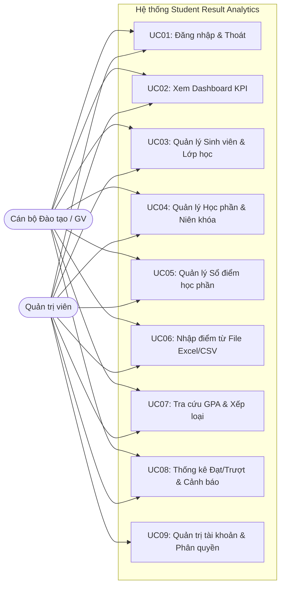
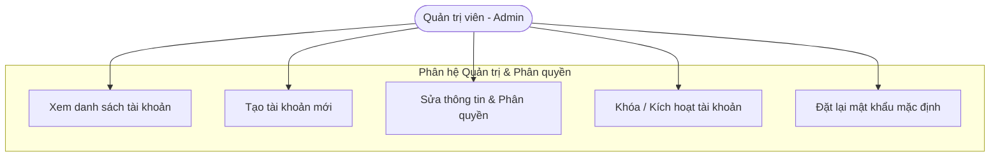
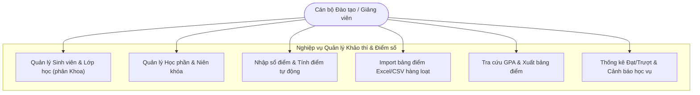
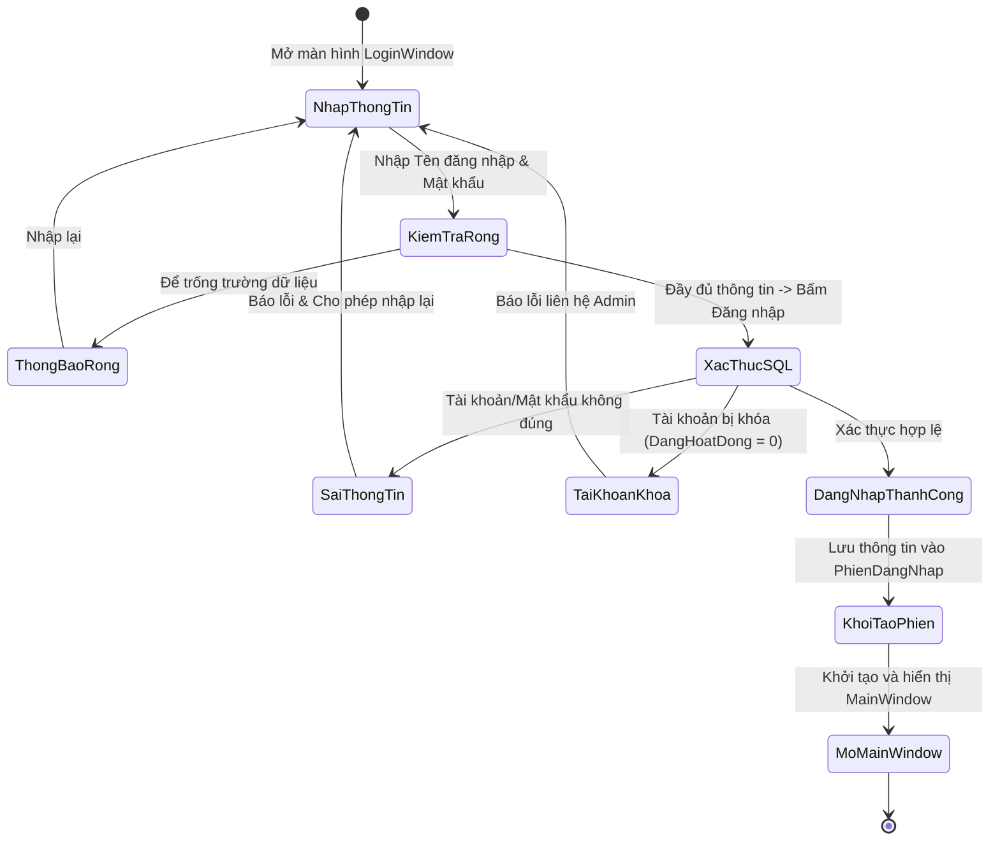
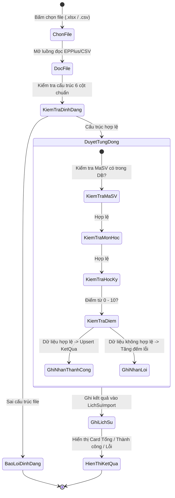
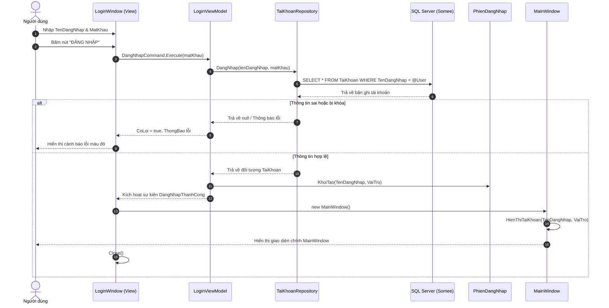
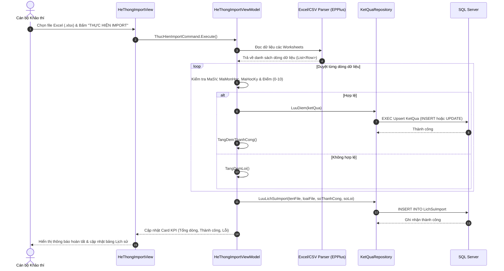
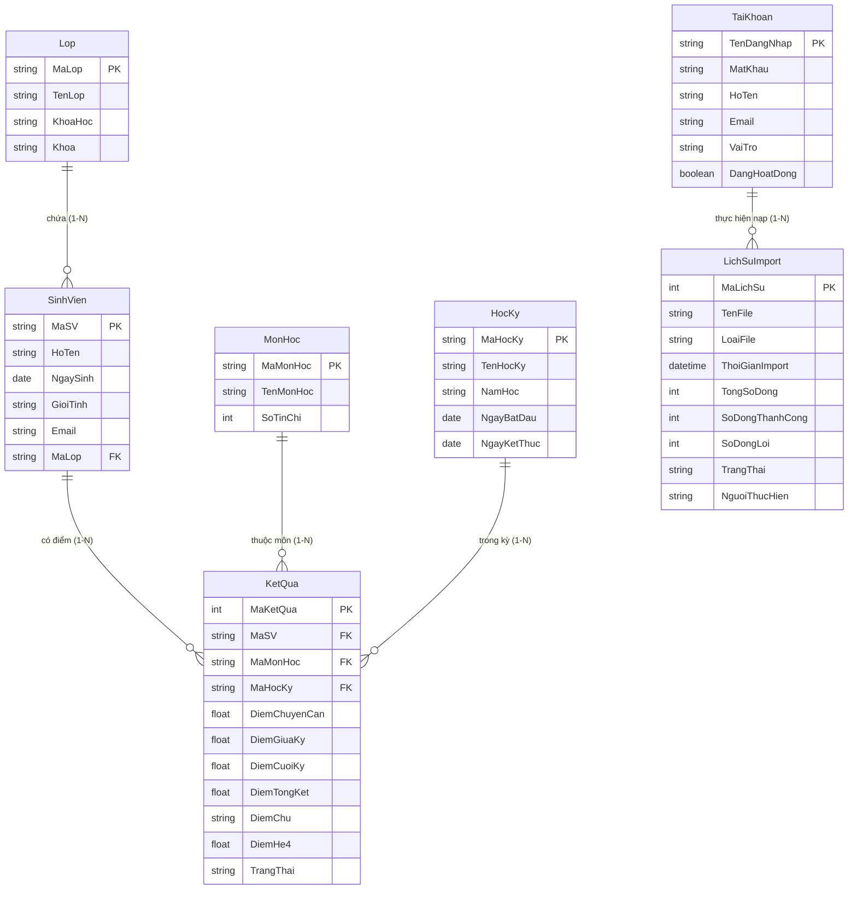

# TRƯỜNG ĐẠI HỌC PHENIKAA
## KHOA CÔNG NGHỆ THÔNG TIN

---

# BÁO CÁO BÀI TẬP LỚN
### HỌC PHẦN: CÔNG NGHỆ .NET

## ĐỀ TÀI:
# HỆ THỐNG QUẢN LÝ ĐÀO TẠO VÀ PHÂN TÍCH KẾT QUẢ HỌC TẬP ĐẠI HỌC
### (STUDENT RESULT ANALYTICS SYSTEM)

**Giảng viên hướng dẫn:** TS. Nguyễn Văn A *(hoặc ThS. ...)*  
**Lớp học phần:** Công nghệ .NET - K18  
**Nhóm sinh viên thực hiện:** Nhóm 01  
1. Sinh viên 1 - MSSV: 23010191 (Nhóm trưởng)  
2. Sinh viên 2 - MSSV: 23010192  
3. Sinh viên 3 - MSSV: 23010193  
4. Sinh viên 4 - MSSV: 23010194  

*Hà Nội, Năm 2026*

---

<div style="page-break-after: always;"></div>

# TRANG BÌA PHỤ (BÌA LÓT)

**TRƯỜNG ĐẠI HỌC PHENIKAA**  
**KHOA CÔNG NGHỆ THÔNG TIN**  

### BÁO CÁO BÀI TẬP LỚN
**HỌC PHẦN: CÔNG NGHỆ .NET**

**ĐỀ TÀI:**  
**HỆ THỐNG QUẢN LÝ ĐÀO TẠO VÀ PHÂN TÍCH KẾT QUẢ HỌC TẬP ĐẠI HỌC (STUDENT RESULT ANALYTICS)**

| STT | Họ và tên sinh viên | Mã sinh viên | Lớp sinh hoạt | Nhiệm vụ phân công | Tỷ lệ hoàn thành |
|:---:|:---|:---:|:---:|:---|:---:|
| 1 | Nguyễn Văn A *(Trưởng nhóm)* | 23010191 | CNTT02 | Thiết kế kiến trúc MVVM, CSDL SQL Server, Module Dashboard & Tra cứu GPA | 100% |
| 2 | Trần Văn B | 23010192 | CNTT02 | Module Quản lý Sinh viên, Lớp học, Phân Khoa & Ràng buộc Email | 100% |
| 3 | Lê Thị C | 23010193 | CNTT02 | Module Sổ điểm học phần & Nhập điểm từ File Excel/CSV (EPPlus) | 100% |
| 4 | Hoàng Văn D | 23010194 | CNTT02 | Module Thống kê Đạt/Trượt, Cảnh báo học vụ, Viết Test Cases & Báo cáo | 100% |

**Cán bộ chấm thi:**  
1. Cán bộ chấm 1: ............................................................  
2. Cán bộ chấm 2: ............................................................  

*Hà Nội - Năm 2026*

---

<div style="page-break-after: always;"></div>

# LỜI CẢM ƠN

Lời đầu tiên, nhóm tác giả xin được gửi lời cảm ơn chân thành và sâu sắc nhất tới Ban Giám hiệu Trường Đại học Phenikaa, Ban Chủ nhiệm Khoa Công nghệ thông tin cùng toàn thể quý Thầy, Cô giáo trong bộ môn Công nghệ Phần mềm đã tận tình giảng dạy, truyền đạt những kiến thức nền tảng quý báu về nền tảng Microsoft .NET, lập trình hướng đối tượng C#, thiết kế giao diện WPF và kiến trúc phần mềm chuyên nghiệp trong suốt quá trình nhóm theo học học phần **Công nghệ .NET**.

Đặc biệt, nhóm xin bày tỏ lòng biết ơn sâu sắc tới **Giảng viên hướng dẫn bộ môn**, Thầy/Cô đã dành nhiều thời gian quý báu để định hướng đề tài, giải đáp thắc mắc, đưa ra những nhận xét chuyên môn sắc bén và hỗ trợ tận tình để nhóm hoàn thiện phần mềm **Hệ thống Quản lý Đào tạo và Phân tích Kết quả Học tập Đại học (Student Result Analytics)** cũng như bản báo cáo bài tập lớn này đúng tiến độ và đạt chuẩn chất lượng học thuật.

Mặc dù nhóm đã nỗ lực hết mình với tinh thần trách nhiệm cao nhất, song do giới hạn về thời gian và kinh nghiệm thực tế, đề tài khó tránh khỏi những thiếu sót nhất định. Nhóm kính mong nhận được những lời đóng góp ý kiến quý báu từ quý Thầy/Cô để hệ thống ngày càng hoàn thiện, có tính ứng dụng cao hơn nữa trong thực tế đào tạo đại học.

*Nhóm sinh viên thực hiện xin chân thành cảm ơn!*

---

# LỜI CAM ĐOAN

Nhóm sinh viên thực hiện xin cam đoan:
1. Bản báo cáo bài tập lớn này là công trình nghiên cứu, thiết kế và phát triển độc lập của nhóm dưới sự hướng dẫn trực tiếp của Giảng viên phụ trách học phần Công nghệ .NET.
2. Toàn bộ mã nguồn chương trình, cơ sở dữ liệu trên Microsoft SQL Server và các tài liệu liên quan đều do nhóm tự tay phân tích, thiết kế, lập trình và kiểm thử.
3. Các dữ liệu, bảng biểu, hình vẽ minh họa và các trích dẫn tài liệu tham khảo trong báo cáo đều được trích dẫn nguồn gốc xuất xứ rõ ràng theo đúng chuẩn học thuật IEEE.
4. Mọi sự sao chép không hợp lệ hoặc vi phạm quy chế học vụ nếu bị phát hiện, nhóm xin hoàn toàn chịu mọi hình thức kỷ luật theo quy định của Trường Đại học Phenikaa và Bộ Giáo dục & Đào tạo.

*Hà Nội, ngày 05 tháng 11 năm 2026*  
**Đại diện nhóm sinh viên**  
*(Ký và ghi rõ họ tên)*

---

<div style="page-break-after: always;"></div>

# DANH MỤC CÁC TỪ VIẾT TẮT

| Viết tắt | Thuật ngữ Tiếng Anh | Diễn giải Tiếng Việt |
|:---|:---|:---|
| **BTL** | Assignment / Project | Bài tập lớn môn học |
| **WPF** | Windows Presentation Foundation | Nền tảng xây dựng giao diện desktop đồ họa cao của Microsoft |
| **MVVM** | Model - View - ViewModel | Mẫu kiến trúc tách biệt Giao diện - Xử lý logic - Dữ liệu |
| **GPA** | Grade Point Average | Điểm trung bình tích lũy học tập |
| **CPA** | Cumulative Point Average | Điểm trung bình tích lũy toàn khóa |
| **RDBMS** | Relational Database Management System | Hệ quản trị cơ sở dữ liệu quan hệ |
| **SQL** | Structured Query Language | Ngôn ngữ truy vấn dữ liệu có cấu trúc |
| **ERD** | Entity Relationship Diagram | Sơ đồ quan hệ thực thể |
| **RBAC** | Role-Based Access Control | Kiểm soát truy cập phân quyền dựa trên vai trò người dùng |
| **UC** | Use Case | Ca sử dụng chức năng hệ thống |
| **XAML** | Extensible Application Markup Language | Ngôn ngữ đánh dấu mở rộng để định nghĩa giao diện WPF |
| **MOET** | Ministry of Education and Training | Bộ Giáo dục và Đào tạo Việt Nam |
| **CSV** | Comma-Separated Values | Tệp văn bản lưu trữ dữ liệu dạng bảng phân tách bằng dấu phẩy |
| **OOP** | Object-Oriented Programming | Lập trình hướng đối tượng |

---

# DANH MỤC BẢNG BIỂU

- **Bảng 1.1:** Phân loại yêu cầu người dùng theo đối tượng trong trường đại học
- **Bảng 1.2:** Quy định thang điểm chữ, thang điểm 4 và phân loại học lực theo tín chỉ
- **Bảng 2.1:** Đặc tả Use Case UC01 – Đăng nhập hệ thống
- **Bảng 2.2:** Đặc tả Use Case UC02 – Quản lý Hồ sơ sinh viên, Lớp học & Khoa
- **Bảng 2.3:** Đặc tả Use Case UC03 – Quản lý Học phần và Niên khóa
- **Bảng 2.4:** Đặc tả Use Case UC04 – Quản lý Sổ điểm học phần
- **Bảng 2.5:** Đặc tả Use Case UC05 – Nhập điểm hàng loạt từ file Excel / CSV
- **Bảng 2.6:** Đặc tả Use Case UC06 – Tra cứu GPA và Phân loại học lực
- **Bảng 2.7:** Đặc tả Use Case UC07 – Thống kê Đạt/Trượt và Cảnh báo học vụ
- **Bảng 2.8:** Đặc tả Use Case UC08 – Quản trị người dùng & Phân quyền bảo mật
- **Bảng 2.9:** Thiết kế chi tiết bảng `dbo.TaiKhoan`
- **Bảng 2.10:** Thiết kế chi tiết bảng `dbo.Lop`
- **Bảng 2.11:** Thiết kế chi tiết bảng `dbo.SinhVien`
- **Bảng 2.12:** Thiết kế chi tiết bảng `dbo.MonHoc`
- **Bảng 2.13:** Thiết kế chi tiết bảng `dbo.HocKy`
- **Bảng 2.14:** Thiết kế chi tiết bảng `dbo.KetQua`
- **Bảng 2.15:** Thiết kế chi tiết bảng `dbo.LichSuImport`
- **Bảng 3.1:** Kịch bản kiểm thử (Test Cases) chi tiết của toàn bộ hệ thống

---

# DANH MỤC HÌNH ẢNH & SƠ ĐỒ

- **Hình 2.1:** Sơ đồ Use Case tổng quát hệ thống (System Use Case Diagram)
- **Hình 2.2:** Sơ đồ Use Case phân rã của Quản trị viên (Admin)
- **Hình 2.3:** Sơ đồ Use Case phân rã của Cán bộ Đào tạo / Giảng viên (Staff/Teacher)
- **Hình 2.4:** Sơ đồ Activity Diagram – Quá trình Đăng nhập và xác thực bảo mật
- **Hình 2.5:** Sơ đồ Activity Diagram – Quản lý Hồ sơ Sinh viên và Lớp học
- **Hình 2.6:** Sơ đồ Activity Diagram – Nhập điểm học phần và tự động tính điểm tổng kết
- **Hình 2.7:** Sơ đồ Activity Diagram – Nhập điểm hàng loạt từ File Excel/CSV (Batch Import)
- **Hình 2.8:** Sơ đồ Activity Diagram – Tra cứu GPA và xuất báo cáo xếp loại học lực
- **Hình 2.9:** Sơ đồ Sequence Diagram – Luồng xác thực đăng nhập (Login Sequence)
- **Hình 2.10:** Sơ đồ Sequence Diagram – Thêm mới sinh viên và tự động sinh email
- **Hình 2.11:** Sơ đồ Sequence Diagram – Nhập và cập nhật sổ điểm học phần
- **Hình 2.12:** Sơ đồ Sequence Diagram – Xử lý Import dữ liệu từ file Excel vào Database
- **Hình 2.13:** Sơ đồ Sequence Diagram – Lọc và tính toán GPA theo học kỳ toàn hệ thống
- **Hình 2.14:** Sơ đồ quan hệ thực thể ERD (Entity Relationship Diagram)
- **Hình 2.15:** Sơ đồ kiến trúc phần mềm mô hình MVVM (Model - View - ViewModel)
- **Hình 2.16:** Giao diện Đăng nhập hệ thống (kèm nút xem/ẩn mật khẩu)
- **Hình 2.17:** Giao diện Bàn làm việc tổng quan (Executive Academic Dashboard)
- **Hình 2.18:** Giao diện Quản lý Hồ sơ Sinh viên và Lớp học (phân Khoa & Email sinh viên)
- **Hình 2.19:** Giao diện Quản lý Học phần và Niên khóa đào tạo
- **Hình 2.20:** Giao diện Sổ điểm học phần chi tiết
- **Hình 2.21:** Giao diện Nhập điểm thi từ file Excel/CSV và Lịch sử Import
- **Hình 2.22:** Giao diện Tra cứu GPA và Phân loại học lực toàn khóa
- **Hình 2.23:** Giao diện Thống kê Đạt/Trượt và Danh sách Cảnh báo học vụ
- **Hình 2.24:** Giao diện Quản trị người dùng và Phân quyền hệ thống

---

<div style="page-break-after: always;"></div>

# PHẦN MỞ ĐẦU

### 1. Lý do chọn đề tài
Trong kỷ nguyên chuyển đổi số giáo dục đại học hiện nay, việc chuẩn hóa quy trình quản lý điểm số và đánh giá năng lực người học theo hệ thống tín chỉ (Credit-based system) là một trong những nhiệm vụ cốt lõi hàng đầu của các trường đại học tại Việt Nam. Theo các quy chế đào tạo hiện hành của Bộ Giáo dục và Đào tạo, việc tính toán kết quả học tập không chỉ dừng lại ở thang điểm 10 truyền thống mà bắt buộc phải quy đổi chính xác sang thang điểm chữ (A+, A, B+, B, C+, C, D+, D, F) và thang điểm 4.0 (với các mức trọng số chi tiết như $A^+ = 4.0, A = 3.7$), đồng thời phải tính điểm trung bình chung học kỳ (GPA) và tích lũy (CPA) dựa trên **gia quyền số tín chỉ** của từng học phần.

Tuy nhiên, trong thực tế công tác tại nhiều khoa đào tạo và cơ sở giáo dục, quy trình quản lý điểm số vẫn còn tồn tại nhiều điểm nghẽn nghiêm trọng:
- Giảng viên bộ môn quản lý điểm thành phần (chuyên cần, giữa kỳ, thi kết thúc) trên các bảng tính Excel rời rạc, dẫn đến nguy cơ phân tán dữ liệu, thất lạc thông tin hoặc nhầm lẫn công thức.
- Phòng Đào tạo và Khảo thí gặp rất nhiều khó khăn, tốn kém thời gian khi phải tổng hợp thủ công hàng trăm file bảng điểm từ các giảng viên; việc kiểm tra trùng lặp sinh viên, sai sót định dạng mã sinh viên hay mã môn học thường xuyên xảy ra.
- Công tác cố vấn học tập và rà soát sinh viên có nguy cơ bị cảnh báo học vụ (GPA < 2.0 hoặc nợ môn) thường bị chậm trễ do không có công cụ tự động quét dữ liệu theo thời gian thực; khi phát hiện thì sinh viên đã bước sang kỳ học tiếp theo, làm giảm hiệu quả can thiệp sư phạm.
- Thiếu hụt một giải pháp phần mềm máy tính (Desktop App) có hiệu năng xử lý cao, giao diện trực quan, đồng bộ dữ liệu thời gian thực lên máy chủ đám mây (Cloud SQL Server), vừa hỗ trợ nạp dữ liệu hàng loạt từ file Excel/CSV, vừa cung cấp bức tranh phân tích trực quan toàn diện (Executive Dashboard).

Xuất phát từ những đòi hỏi cấp thiết từ thực tiễn nêu trên, nhóm sinh viên đã quyết định lựa chọn đề tài: **"Hệ thống Quản lý Đào tạo và Phân tích Kết quả Học tập Đại học (Student Result Analytics)"** làm Bài tập lớn cho học phần **Công nghệ .NET**.

### 2. Mục đích nghiên cứu
Mục đích chính của đề tài là xây dựng một hệ thống phần mềm quản lý học vụ và phân tích điểm thi hoàn chỉnh, hiện đại, chạy trên nền tảng Windows Desktop với công nghệ Microsoft .NET Framework 4.7.2, WPF (Windows Presentation Foundation), áp dụng mô hình kiến trúc chuẩn công nghiệp **MVVM (Model - View - ViewModel)** và kết nối cơ sở dữ liệu đám mây **Microsoft SQL Server (Somee Cloud)**. Hệ thống giải quyết trọn vẹn bài toán:
- Tự động hóa quy trình quản lý sinh viên, phân loại theo lớp sinh hoạt và Khoa/Viện quản lý, chuẩn hóa email sinh viên `@st.phenikaa-uni.edu.vn`.
- Quản lý sổ điểm học phần và tự động tính điểm tổng kết theo trọng số chuẩn (10% chuyên cần, 30% giữa kỳ, 60% cuối kỳ hoặc linh hoạt theo quy định).
- Cung cấp công cụ nhập điểm thi hàng loạt siêu tốc từ file Excel (.xlsx) và file CSV với cơ chế xác thực dữ liệu chặt chẽ và ghi nhật ký lịch sử Import.
- Tự động hóa hoàn toàn thuật toán quy đổi điểm tín chỉ theo thang 4.0 và thang chữ, tính điểm trung bình học kỳ theo gia quyền tín chỉ môn học:
  $$	ext{GPA} = rac{\sum_{i=1}^{n} (	ext{Điểm môn } i 	imes 	ext{Số tín chỉ môn } i)}{\sum_{i=1}^{n} 	ext{Số tín chỉ môn } i}$$
- Xây dựng trung tâm điều hành Dashboard với chỉ số KPI đào tạo, biểu đồ phân bố học lực toàn khóa và danh sách cảnh báo học vụ thời gian thực.
- Phân quyền người dùng chặt chẽ giữa Quản trị viên (Admin) và Cán bộ Đào tạo/Giảng viên (Staff/Teacher).

### 3. Đối tượng và phạm vi nghiên cứu
- **Đối tượng nghiên cứu:** 
  - Quy trình quản lý đào tạo, khảo thí, tổ chức nhập điểm và theo dõi kết quả học tập sinh viên theo hệ thống tín chỉ đại học tại Việt Nam.
  - Công nghệ lập trình giao diện WPF, ngôn ngữ C#, thư viện EPPlus xử lý file Excel, kiến trúc MVVM và hệ quản trị cơ sở dữ liệu Microsoft SQL Server.
- **Phạm vi nghiên cứu:**
  - *Về không gian:* Áp dụng cho các trường đại học, học viện, cụ thể theo chuẩn đào tạo và danh mục khoa/lớp của Trường Đại học Phenikaa.
  - *Về dữ liệu:* Quản lý dữ liệu hồ sơ sinh viên, lớp sinh hoạt, khoa/viện đào tạo, học phần, niên khóa học kỳ, điểm thành phần môn học, lịch sử import và tài khoản người dùng hệ thống.
  - *Về thời gian:* Phân tích kết quả học tập qua các niên khóa từ 2024 - 2026.

### 4. Ý nghĩa khoa học và thực tiễn của đề tài
- **Ý nghĩa khoa học:** Đề tài là sự vận dụng sáng tạo và bài bản các nguyên lý kỹ thuật phần mềm tiên tiến: nguyên lý hướng đối tượng (OOP), mẫu kiến trúc Model - View - ViewModel (MVVM), mẫu thiết kế Repository Pattern, nguyên tắc thiết kế cơ sở dữ liệu quan hệ chuẩn hóa bậc 3 (3NF) và tối ưu hóa xử lý dữ liệu lớn (Batch Processing).
- **Ý nghĩa thực tiễn:** Hệ thống tạo ra một giải pháp công nghệ có khả năng triển khai thực tế ngay tại các khoa đào tạo hoặc phòng đào tạo; giúp cán bộ giảm hơn 80% thời gian tổng hợp điểm số thủ công, loại bỏ triệt để sai sót con người trong quy đổi điểm tín chỉ, và nâng cao chất lượng quản lý học vụ thông qua hệ thống cảnh báo sớm sinh viên yếu kém.

---

<div style="page-break-after: always;"></div>

# CHƯƠNG 1: XÁC ĐỊNH YÊU CẦU

## 1.1. Giới thiệu bối cảnh và đối tượng khách hàng
### 1.1.1. Bối cảnh chung
Giáo dục đại học Việt Nam đang vận hành toàn diện theo hình thức đào tạo tín chỉ theo Quy chế đào tạo của Bộ Giáo dục & Đào tạo. Điểm số của sinh viên không chỉ quyết định việc xét điều kiện tốt nghiệp, xếp loại bằng cử nhân/kỹ sư mà còn là căn cứ trực tiếp để xét cấp học bổng khuyến khích học tập, xét cảnh báo học vụ và buộc thôi học. Một trường đại học quy mô vừa có từ 10.000 đến 25.000 sinh viên, với hàng trăm lớp học phần mở ra mỗi kỳ. Khối lượng dữ liệu điểm số phát sinh là cực kỳ lớn và đòi hỏi tính toán tức thời, chuẩn xác tuyệt đối.

### 1.1.2. Đối tượng khách hàng và các bên liên quan (Stakeholders)
Hệ thống **Student Result Analytics** được thiết kế hướng tới phục vụ 3 nhóm đối tượng khách hàng trọng tâm:
1. **Ban Quản trị Hệ thống (System Administrators - Admin):**
   - Chịu trách nhiệm bảo đảm an toàn dữ liệu, thiết lập cấu hình kết nối SQL Server, quản lý danh mục tài khoản người dùng, phân quyền truy cập và giám sát toàn bộ hoạt động của hệ thống.
2. **Cán bộ Phòng Đào tạo & Khảo thí (Academic Affairs & Examination Staff):**
   - Chịu trách nhiệm quản lý danh mục học phần, niên khóa học kỳ, danh mục lớp sinh hoạt và hồ sơ sinh viên theo từng Khoa/Viện.
   - Nhận các bảng điểm từ giảng viên hoặc phòng thi để nạp vào hệ thống; thực hiện import hàng loạt từ file Excel/CSV; theo dõi tiến độ nhập điểm và khóa sổ điểm học phần.
3. **Cố vấn học tập & Giảng viên chủ nhiệm (Academic Advisors / Lecturers):**
   - Tra cứu kết quả học tập GPA/CPA của sinh viên thuộc lớp hoặc khoa mình phụ trách; xem danh sách sinh viên bị cảnh báo học vụ, nợ môn để kịp thời gửi thông báo nhắc nhở, tư vấn kế hoạch học tập cải thiện điểm số.

*Bảng 1.1: Phân loại yêu cầu người dùng theo đối tượng trong trường đại học*

| Nhóm người dùng | Mục tiêu sử dụng | Khó khăn hiện tại | Lợi ích khi dùng phần mềm |
|:---|:---|:---|:---|
| **Ban Quản trị (Admin)** | Quản lý người dùng, bảo mật, sao lưu dữ liệu | Không kiểm soát được ai sửa điểm, nguy cơ lộ mật khẩu | Phân quyền RBAC rõ ràng, quản trị tài khoản tập trung, bảo vệ dữ liệu |
| **Cán bộ Khảo thí** | Nhập điểm, tổng hợp kết quả, quản lý môn & kỳ | Nhập tay tốn thời gian, file Excel dễ sai format, lệch mã | Import hàng nghìn dòng trong vài giây, kiểm tra lỗi tự động, lưu lịch sử nạp |
| **Cố vấn học tập** | Theo dõi học lực sinh viên, cảnh báo học vụ | Phải chờ cuối năm mới có bảng điểm giấy, rà soát thủ công | Dashboard trực quan, lọc theo từng học kỳ, danh sách cảnh báo thời gian thực |

## 1.2. Xác định và nêu vấn đề cần giải quyết
Qua khảo sát thực tế quy trình quản lý điểm tại các đơn vị đào tạo, nhóm nghiên cứu đã tổng hợp các bài toán cốt lõi cần phải giải quyết:
1. **Bài toán nhập liệu và chuyển đổi dữ liệu phân tán:** Điểm thi được giảng viên nộp qua nhiều định dạng (bảng tính Excel `.xlsx`, tệp `.csv`). Hệ thống cần một bộ xử lý thông minh tự động đọc dữ liệu, đối chiếu mã sinh viên, mã môn học, mã học kỳ, kiểm tra thang điểm hợp lệ (0-10) và lưu vết lịch sử nạp dữ liệu.
2. **Bài toán tính toán điểm tín chỉ chuẩn xác:** Tính điểm tổng kết học phần theo tỷ lệ phần trăm (10% chuyên cần, 30% giữa kỳ, 60% cuối kỳ); tự động quy đổi sang thang điểm 4 và thang điểm chữ; tính điểm trung bình học kỳ (GPA) có tính đến số tín chỉ của từng môn học (tránh sai sót tính trung bình cộng đơn giản).
3. **Bài toán quản lý hồ sơ và tổ chức Khoa/Lớp:** Sinh viên cần được quản lý theo lớp sinh hoạt, lớp sinh hoạt trực thuộc Khoa/Viện đào tạo cụ thể; đồng thời email sinh viên phải chuẩn hóa theo quy ước nhận diện tên miền của nhà trường (`[MãSV]@st.phenikaa-uni.edu.vn`).
4. **Bài toán cảnh báo học vụ sớm:** Tự động lọc ra sinh viên còn thiếu điểm thành phần (chưa chốt sổ điểm) và sinh viên có kết quả học tập yếu kém (GPA < 2.0 hoặc có điểm F) để nhà trường có biện pháp hỗ trợ kịp thời.
5. **Bài toán phân tích dữ liệu trực quan:** Cung cấp báo cáo thống kê tỷ lệ đạt/trượt theo từng môn học và biểu đồ phân bố học lực toàn trường theo từng kỳ học hoặc toàn khóa học.

## 1.3. Yêu cầu chung đối với hệ thống
- **Nền tảng vận hành:** Ứng dụng Desktop chạy trên hệ điều hành Windows 10/11, cài đặt .NET Framework 4.7.2 trở lên.
- **Kiến trúc phần mềm:** Áp dụng mô hình chuẩn MVVM (Model - View - ViewModel) kết hợp Repository Pattern nhằm phân tách rành mạch tầng trình diễn giao diện và tầng logic nghiệp vụ.
- **Cơ sở dữ liệu:** Hệ quản trị cơ sở dữ liệu quan hệ Microsoft SQL Server, triển khai linh hoạt trên máy chủ đám mây (Cloud Somee) hoặc máy chủ nội bộ trường (Localhost).
- **Trải nghiệm người dùng (UX/UI):** Giao diện phẳng, thiết kế thanh bên (Sidebar) thu gọn / mở rộng mượt mà, tông màu xanh hải quân trang nhã (`#1B426E`), biểu tượng nhận diện thương hiệu chuẩn xác, hỗ trợ bộ lọc học kỳ toàn hệ thống.

## 1.4. Yêu cầu chức năng cụ thể
Hệ thống bao gồm 8 phân hệ nghiệp vụ cốt lõi:
1. **Phân hệ Xác thực & Quản lý phiên làm việc (Authentication & Session):**
   - Đăng nhập bằng tên đăng nhập và mật khẩu.
   - Hỗ trợ nút bật/tắt hiển thị mật khẩu (icon con mắt 👁 / 🙈) giúp người dùng kiểm tra ký tự khi gõ.
   - Ghi nhớ phiên làm việc của người dùng hiện tại (Session State) để phân quyền giao diện và chức năng tương ứng.
   - Chức năng đăng xuất an toàn.
2. **Phân hệ Bàn làm việc tổng quan (Academic Dashboard):**
   - Hiển thị các thẻ chỉ số KPI tổng thể: Tổng số sinh viên, Số lớp sinh hoạt, Số học phần đào tạo, Điểm trung bình toàn khóa, Tỷ lệ đạt chung, Số sinh viên cần bổ sung điểm.
   - Biểu đồ tiến độ phân bố học lực toàn khóa (Xuất sắc, Giỏi, Khá, Trung bình, Yếu/Kém, Chưa đủ điểm).
   - Bảng kết quả đạt/trượt theo từng học phần và danh sách cảnh báo học vụ thời gian thực.
   - Bộ lọc học kỳ toàn hệ thống (Global Semester Filter) tại thanh tiêu đề, cho phép xem dữ liệu toàn khóa hoặc theo từng học kỳ cụ thể.
3. **Phân hệ Quản lý Hồ sơ Sinh viên & Lớp học:**
   - Quản lý danh mục lớp sinh hoạt: Thêm, sửa, xóa, làm trống, tìm kiếm lớp học. Mỗi lớp được gán với một **Khoa / Viện quản lý** cụ thể và niên khóa đào tạo.
   - Quản lý hồ sơ sinh viên: Thêm, sửa, xóa, tìm kiếm sinh viên.
   - **Cơ chế tự động hóa:** Khi người dùng nhập Mã sinh viên (ví dụ `23010191`), hệ thống tự động sinh Email liên hệ theo định dạng `23010191@st.phenikaa-uni.edu.vn`.
   - Ràng buộc dữ liệu nghiêm ngặt: Kiểm tra phần đầu email bắt buộc phải trùng khớp với mã sinh viên, đảm bảo toàn vẹn dữ liệu.
4. **Phân hệ Quản lý Học phần & Niên khóa đào tạo:**
   - Quản lý danh mục môn học: Mã môn học, Tên môn học, Số tín chỉ (1 - 10 tín chỉ).
   - Quản lý danh mục học kỳ: Mã học kỳ, Tên học kỳ, Niên khóa (ví dụ 2024-2025, 2025-2026), Ngày bắt đầu, Ngày kết thúc.
5. **Phân hệ Sổ điểm học phần (Gradebook Management):**
   - Cho phép chọn học kỳ và môn học để mở sổ điểm chi tiết của từng lớp.
   - Nhập và chỉnh sửa điểm thành phần cho từng sinh viên: Điểm chuyên cần (10%), Điểm giữa kỳ (30%), Điểm thi kết thúc học phần (60%).
   - Tự động tính toán điểm tổng kết thang 10 theo công thức:
     $$	ext{Điểm TK} = 	ext{Chuyên cần} 	imes 0.1 + 	ext{Giữa kỳ} 	imes 0.3 + 	ext{Cuối kỳ} 	imes 0.6$$
   - Tự động quy đổi sang thang điểm chữ và thang điểm 4.0.
   - Trực quan hóa trạng thái: Đạt (màu xanh lá) khi điểm tổng kết $\ge 4.0$ và không có điểm thành phần nào bị điểm liệt; Chưa đạt (màu đỏ) khi điểm tổng kết $< 4.0$.
6. **Phân hệ Nhập điểm thi hàng loạt từ File Excel/CSV (Bulk Import Engine):**
   - Cho phép chọn file bảng điểm định dạng Microsoft Excel (`.xlsx`) hoặc tệp `.csv`.
   - Đọc dữ liệu ngầm bằng thư viện EPPlus siêu tốc, hỗ trợ file lên đến 5.000 dòng.
   - Tự động kiểm tra tính hợp lệ của từng dòng: Sinh viên có tồn tại trong hệ thống không, Môn học và Học kỳ có hợp lệ không, Điểm số có nằm trong khoảng 0.0 - 10.0 không.
   - Báo cáo kết quả trực quan dạng thẻ: Tổng số dòng, Số dòng thành công, Số dòng lỗi.
   - Lưu trữ nhật ký vào bảng `dbo.LichSuImport` (Tên file, loại file, thời gian nạp, số dòng thành công/lỗi, trạng thái).
7. **Phân hệ Tra cứu GPA & Phân loại học lực:**
   - Tra cứu bảng điểm tổng hợp của sinh viên theo từng học kỳ hoặc toàn khóa học.
   - Tính toán điểm GPA gia quyền tín chỉ chính xác:
     $$	ext{GPA} = rac{\sum (	ext{Điểm môn} 	imes 	ext{Số tín chỉ})}{\sum 	ext{Số tín chỉ}}$$
   - Phân loại học lực theo chuẩn đào tạo tín chỉ:
     * GPA $\ge 3.60$: Xuất sắc
     * $3.20 \le 	ext{GPA} < 3.60$: Giỏi
     * $2.50 \le 	ext{GPA} < 3.20$: Khá
     * $2.00 \le 	ext{GPA} < 2.50$: Trung bình
     * $1.00 \le 	ext{GPA} < 2.00$: Yếu
     * $	ext{GPA} < 1.00$: Kém
   - Xuất dữ liệu bảng điểm ra file báo cáo Excel phục vụ in ấn bảng điểm chính thức.
8. **Phân hệ Thống kê Đạt/Trượt & Cảnh báo học vụ:**
   - Thống kê tỷ lệ sinh viên đạt/trượt theo từng môn học để phòng Khảo thí đánh giá độ khó và chất lượng giảng dạy của đề thi.
   - Trích xuất danh sách sinh viên bị cảnh báo học vụ: Sinh viên có GPA học kỳ $< 2.0$ hoặc có số môn nợ (điểm F) vượt quá quy định.
9. **Phân hệ Quản trị hệ thống & Phân quyền bảo mật (Admin only):**
   - Chỉ người dùng có vai trò `Admin` mới truy cập được phân hệ này (ẩn hoàn toàn với tài khoản Nhân viên).
   - Thêm tài khoản mới, sửa thông tin, đặt lại mật khẩu, kích hoạt hoặc khóa tài khoản (`DangHoatDong`).
   - Phân định 2 nhóm vai trò: Quản trị viên (`Admin`) và Nhân viên đào tạo (`NhanVien`).

*Bảng 1.2: Quy định thang điểm chữ, thang điểm 4 và phân loại học lực theo tín chỉ*

| Điểm thang 10 | Điểm chữ | Điểm thang 4 | Đánh giá kết quả | Xếp loại học lực tích lũy |
|:---:|:---:|:---:|:---:|:---|
| **9.0 – 10.0** | **A+** | **4.0** | Đạt | Xuất sắc (GPA $\ge 3.60$) |
| **8.5 – 8.9** | **A** | **3.7** | Đạt | Giỏi ($3.20 \le 	ext{GPA} < 3.60$) |
| **8.0 – 8.4** | **B+** | **3.5** | Đạt | Khá ($2.50 \le 	ext{GPA} < 3.20$) |
| **7.0 – 7.9** | **B** | **3.0** | Đạt | Khá |
| **6.5 – 6.9** | **C+** | **2.5** | Đạt | Trung bình ($2.00 \le 	ext{GPA} < 2.50$) |
| **5.5 – 6.4** | **C** | **2.0** | Đạt | Trung bình |
| **5.0 – 5.4** | **D+** | **1.5** | Đạt | Yếu ($1.00 \le 	ext{GPA} < 2.00$) |
| **4.0 – 4.9** | **D** | **1.0** | Đạt (Trung bình yếu) | Yếu |
| **< 4.0** | **F** | **0.0** | Không đạt (Học lại) | Kém ($	ext{GPA} < 1.00$) |

## 1.5. Yêu cầu phi chức năng
1. **Hiệu năng và Tốc độ (Performance):**
   - Thời gian khởi động ứng dụng và tải dữ liệu trang Dashboard dưới 2 giây.
   - Quá trình import file Excel 1.000 dòng hoàn thành trong thời gian dưới 3 giây nhờ kỹ thuật đọc streaming và lưu trữ theo khối (batch processing).
   - Thao tác chuyển đổi qua lại giữa các màn hình trên Sidebar diễn ra mượt mà, tức thì (độ trễ dưới 200ms) nhờ cơ chế DataTemplate caching.
2. **Tính Toàn vẹn và Nhất quán dữ liệu (Data Integrity):**
   - Cơ sở dữ liệu SQL Server thiết lập khóa ngoại (Foreign Keys) nghiêm ngặt giữa các bảng `SinhVien`, `Lop`, `MonHoc`, `HocKy`, `KetQua`.
   - Ngăn chặn triệt để tình trạng xóa lớp khi vẫn còn sinh viên, hoặc xóa sinh viên khi đã có điểm thi trong hệ thống.
3. **Bảo mật và Phân quyền (Security):**
   - Mật khẩu đăng nhập được băm an toàn và kiểm tra bảo mật.
   - Cơ chế Session tĩnh (`PhienDangNhap`) đảm bảo người dùng chỉ được thao tác đúng phạm vi quyền hạn được cấp.
   - Phòng chống lỗi SQL Injection nhờ sử dụng tham số hóa 100% trong `SqlCommand` (`Parameters.Add`).
4. **Tính Dễ dùng và Thẩm mỹ (Usability & Aesthetics):**
   - Giao diện thiết kế theo phong cách hiện đại, thanh menu bên trái hỗ trợ thu gọn tiết kiệm diện tích cho màn hình nhỏ.
   - Màu sắc hài hòa, độ tương phản cao, thông báo lỗi bằng tiếng Việt rõ ràng, thân thiện với người dùng.

---

<div style="page-break-after: always;"></div>

# CHƯƠNG 2: PHÂN TÍCH VÀ THIẾT KẾ HỆ THỐNG

## 2.1. Phân tích yêu cầu và định hướng giải pháp kỹ thuật
Từ các yêu cầu đã xác định ở Chương 1, nhóm tiến hành lựa chọn các giải pháp kỹ thuật tối ưu:
- **Ngôn ngữ và Nền tảng:** Sử dụng **C# trên nền tảng .NET Framework 4.7.2** kết hợp **WPF (Windows Presentation Foundation)**. WPF mang lại khả năng tùy biến giao diện đồ họa vượt trội so với Windows Forms truyền thống thông qua ngôn ngữ XAML, hỗ trợ mạnh mẽ cơ chế Data Binding 2 chiều, Styles, DataTemplates và ControlTemplates.
- **Mô hình kiến trúc MVVM:** Tách biệt hoàn toàn giao diện (View) khỏi logic điều khiển (ViewModel) và truy xuất dữ liệu (Model). Giúp mã nguồn có tính module hóa cao, dễ bảo trì, dễ mở rộng và hỗ trợ viết unit test độc lập.
- **Thư viện xử lý Excel EPPlus:** Sử dụng thư viện EPPlus phiên bản tối ưu, cho phép đọc và ghi các định dạng `.xlsx` theo chuẩn OpenXML mà không phụ thuộc vào việc máy tính người dùng có cài đặt phần mềm Microsoft Office hay không.
- **Hệ quản trị CSDL Microsoft SQL Server:** Triển khai trên máy chủ đám mây Somee Cloud với chuỗi kết nối mã hóa SSL, hỗ trợ kết nối từ xa đa điểm cho nhiều người dùng cùng lúc.

## 2.2. Thiết kế chức năng (Use Case Design)
### 2.2.1. Sơ đồ Use Case tổng quát
Hệ thống xác định 2 tác nhân (Actors) chính:
- **Quản trị viên (Admin):** Có toàn quyền trên hệ thống, bao gồm cả phân hệ Quản trị & Phân quyền tài khoản.
- **Cán bộ Đào tạo / Giảng viên (Staff):** Thực hiện các nghiệp vụ quản lý sinh viên, học phần, sổ điểm, import file và tra cứu thống kê.


*Hình 2.1: Sơ đồ Use Case tổng quát hệ thống (System Use Case Diagram)*

### 2.2.2. Sơ đồ Use Case phân rã của Quản trị viên (Admin)
Quản trị viên kế thừa toàn bộ chức năng của Cán bộ đào tạo, đồng thời sở hữu phân hệ độc quyền:
- Quản lý danh sách tài khoản người dùng hệ thống.
- Thêm mới tài khoản, phân quyền vai trò (`Admin` hoặc `NhanVien`).
- Đặt lại mật khẩu (Reset Password) cho cán bộ khi bị quên.
- Khóa hoặc kích hoạt lại trạng thái hoạt động của tài khoản.


*Hình 2.2: Sơ đồ Use Case phân rã của Quản trị viên (Admin)*

### 2.2.3. Sơ đồ Use Case phân rã của Cán bộ Đào tạo / Giảng viên (Staff)
Cán bộ đào tạo tập trung vào các nghiệp vụ khảo thí học vụ hằng ngày:


*Hình 2.3: Sơ đồ Use Case phân rã của Cán bộ Đào tạo / Giảng viên*

### 2.2.4. Đặc tả các Use Case cốt lõi

*Bảng 2.1: Đặc tả Use Case UC01 – Đăng nhập hệ thống*

| Thuộc tính | Mô tả chi tiết |
|:---|:---|
| **Mã Use Case** | **UC01** |
| **Tên Use Case** | Đăng nhập hệ thống |
| **Tác nhân (Actor)** | Quản trị viên (Admin), Cán bộ Đào tạo (NhanVien) |
| **Mục đích** | Xác thực danh tính người dùng và cấp quyền truy cập hệ thống |
| **Điều kiện tiên quyết** | Ứng dụng đã khởi chạy và kết nối thành công tới SQL Server |
| **Luồng sự kiện chính** | 1. Người dùng nhập Tên đăng nhập và Mật khẩu vào form Login.<br>2. (Tùy chọn) Bấm icon con mắt 👁 để hiển thị kiểm tra mật khẩu dạng text.<br>3. Bấm nút "ĐĂNG NHẬP" hoặc nhấn phím Enter.<br>4. Hệ thống kiểm tra tài khoản trong bảng `dbo.TaiKhoan`.<br>5. Nếu hợp lệ và đang hoạt động, hệ thống thiết lập `PhienDangNhap` lưu thông tin quyền và mở cửa sổ `MainWindow`. |
| **Luồng ngoại lệ** | - Tên đăng nhập hoặc mật khẩu để trống: Hệ thống hiển thị thông báo lỗi.<br>- Sai mật khẩu hoặc tài khoản bị khóa: Hiển thị cảnh báo lỗi bằng chữ đỏ và yêu cầu nhập lại. |

*Bảng 2.2: Đặc tả Use Case UC02 – Quản lý Hồ sơ Sinh viên, Lớp học & Khoa*

| Thuộc tính | Mô tả chi tiết |
|:---|:---|
| **Mã Use Case** | **UC02** |
| **Tên Use Case** | Quản lý Hồ sơ Sinh viên, Lớp học và Khoa |
| **Tác nhân (Actor)** | Cán bộ Đào tạo, Quản trị viên |
| **Mục đích** | Quản lý thông tin học vụ của sinh viên và lớp sinh hoạt thuộc từng Khoa |
| **Luồng sự kiện chính** | 1. Người dùng chọn menu "Hồ sơ Sinh viên & Lớp học".<br>2. Tab "Danh mục Lớp học": Nhập Mã lớp, Tên lớp, Khóa học và chọn Khoa quản lý $
ightarrow$ Thêm/Cập nhật lớp.<br>3. Tab "Hồ sơ Sinh viên": Nhập Mã sinh viên $
ightarrow$ Hệ thống tự động điền Email theo mã SV với đuôi `@st.phenikaa-uni.edu.vn`.<br>4. Nhập Họ tên, Ngày sinh, Giới tính và chọn Lớp sinh hoạt (hiển thị kèm tên Khoa).<br>5. Bấm "THÊM" hoặc "CẬP NHẬT" để lưu vào cơ sở dữ liệu. |
| **Ràng buộc nghiệp vụ** | - Mã SV không được trùng.<br>- Email phải có tiền tố trùng khớp chính xác với Mã SV.<br>- Không được xóa lớp khi đang có sinh viên thuộc lớp đó. |

*Bảng 2.5: Đặc tả Use Case UC05 – Nhập điểm hàng loạt từ file Excel / CSV*

| Thuộc tính | Mô tả chi tiết |
|:---|:---|
| **Mã Use Case** | **UC05** |
| **Tên Use Case** | Nhập điểm thi từ File Excel/CSV |
| **Tác nhân (Actor)** | Cán bộ Khảo thí, Quản trị viên |
| **Mục đích** | Tự động hóa quá trình nạp hàng loạt kết quả thi của hàng nghìn sinh viên |
| **Luồng sự kiện chính** | 1. Người dùng chọn menu "Nhập điểm từ File (Excel/CSV)".<br>2. Bấm "CHỌN FILE..." và chọn tệp `.xlsx` hoặc `.csv` từ máy tính.<br>3. Bấm "THỰC HIỆN IMPORT".<br>4. Hệ thống phân tích cấu trúc cột, kiểm tra hợp lệ từng dòng dữ liệu.<br>5. Thực hiện Insert hoặc Update vào bảng `dbo.KetQua` theo cơ chế Upsert.<br>6. Hiển thị bảng tổng kết: Tổng số dòng, Số dòng thành công, Số dòng lỗi.<br>7. Ghi nhật ký lịch sử nạp vào bảng `dbo.LichSuImport` và cập nhật danh sách hiển thị. |

## 2.3. Sơ đồ hoạt động (Activity Diagrams)
### 2.3.1. Sơ đồ Activity Diagram – Quá trình Đăng nhập hệ thống


*Hình 2.4: Sơ đồ Activity Diagram – Quá trình Đăng nhập và xác thực bảo mật*

### 2.3.2. Sơ đồ Activity Diagram – Nhập điểm hàng loạt từ File Excel/CSV (Batch Import)


*Hình 2.7: Sơ đồ Activity Diagram – Nhập điểm hàng loạt từ File Excel/CSV (Batch Import)*

## 2.4. Sơ đồ tuần tự (Sequence Diagrams)
### 2.4.1. Sơ đồ Sequence Diagram – Đăng nhập hệ thống


*Hình 2.9: Sơ đồ Sequence Diagram – Luồng xác thực đăng nhập (Login Sequence)*

### 2.4.2. Sơ đồ Sequence Diagram – Xử lý Import dữ liệu từ file Excel vào Database


*Hình 2.12: Sơ đồ Sequence Diagram – Xử lý Import dữ liệu từ file Excel vào Database*

## 2.5. Thiết kế Cơ sở dữ liệu (Database Design)
### 2.5.1. Sơ đồ quan hệ thực thể (ERD)


*Hình 2.14: Sơ đồ quan hệ thực thể ERD (Entity Relationship Diagram)*

### 2.5.2. Bảng đặc tả chi tiết các bảng dữ liệu

*Bảng 2.9: Thiết kế chi tiết bảng `dbo.TaiKhoan` (Quản lý tài khoản và phân quyền)*

| Tên cột | Kiểu dữ liệu | Khóa | Ràng buộc | Diễn giải | Dữ liệu minh họa |
|:---|:---|:---:|:---|:---|:---|
| **TenDangNhap** | `VARCHAR(50)` | **PK** | NOT NULL | Tên tài khoản đăng nhập | `admin`, `nhanvien` |
| **MatKhau** | `VARCHAR(255)` | | NOT NULL | Mật khẩu tài khoản | `admin123`, `nv123` |
| **HoTen** | `NVARCHAR(100)` | | NOT NULL | Họ và tên chủ tài khoản | `Quản trị viên hệ thống` |
| **Email** | `VARCHAR(100)` | | NULL | Email công vụ liên hệ | `admin@phenikaa-uni.edu.vn` |
| **VaiTro** | `NVARCHAR(20)` | | NOT NULL, Default 'NhanVien' | Vai trò phân quyền (`Admin`, `NhanVien`) | `Admin` |
| **DangHoatDong** | `BIT` | | NOT NULL, Default 1 | Trạng thái tài khoản (1: Mở, 0: Khóa) | `1` |

*Bảng 2.10: Thiết kế chi tiết bảng `dbo.Lop` (Lớp sinh hoạt & Khoa đào tạo)*

| Tên cột | Kiểu dữ liệu | Khóa | Ràng buộc | Diễn giải | Dữ liệu minh họa |
|:---|:---|:---:|:---|:---|:---|
| **MaLop** | `VARCHAR(20)` | **PK** | NOT NULL | Mã định danh lớp sinh hoạt | `CNTT01`, `CNTT02`, `KHMT01` |
| **TenLop** | `NVARCHAR(100)` | | NOT NULL | Tên đầy đủ của lớp sinh hoạt | `Công nghệ thông tin 01` |
| **KhoaHoc** | `NVARCHAR(20)` | | NULL | Niên khóa đào tạo | `K18` |
| **Khoa** | `NVARCHAR(100)` | | NULL | Tên Khoa / Viện đào tạo quản lý | `Khoa Công nghệ thông tin` |

*Bảng 2.11: Thiết kế chi tiết bảng `dbo.SinhVien` (Hồ sơ sinh viên)*

| Tên cột | Kiểu dữ liệu | Khóa | Ràng buộc | Diễn giải | Dữ liệu minh họa |
|:---|:---|:---:|:---|:---|:---|
| **MaSV** | `VARCHAR(20)` | **PK** | NOT NULL | Mã số sinh viên chính thức | `23010191` |
| **HoTen** | `NVARCHAR(100)` | | NOT NULL | Họ và tên sinh viên | `Thành Ng` |
| **NgaySinh** | `DATE` | | NULL | Ngày tháng năm sinh | `2005-04-27` |
| **GioiTinh** | `NVARCHAR(10)` | | NULL | Giới tính (Nam, Nữ, Khác) | `Nam` |
| **Email** | `VARCHAR(100)` | | NULL | Email sinh viên (khớp Mã SV) | `23010191@st.phenikaa-uni.edu.vn` |
| **MaLop** | `VARCHAR(20)` | **FK** | NOT NULL, Ref `dbo.Lop(MaLop)` | Mã lớp sinh hoạt | `CNTT02` |

*Bảng 2.12: Thiết kế chi tiết bảng `dbo.MonHoc` (Danh mục học phần)*

| Tên cột | Kiểu dữ liệu | Khóa | Ràng buộc | Diễn giải | Dữ liệu minh họa |
|:---|:---|:---:|:---|:---|:---|
| **MaMonHoc** | `VARCHAR(20)` | **PK** | NOT NULL | Mã định danh học phần | `MH001`, `MH002` |
| **TenMonHoc** | `NVARCHAR(150)` | | NOT NULL | Tên học phần đào tạo | `Lập trình C#`, `Cơ sở dữ liệu` |
| **SoTinChi** | `INT` | | NOT NULL, CHECK (1-10) | Số tín chỉ của môn học | `3`, `2` |

*Bảng 2.13: Thiết kế chi tiết bảng `dbo.HocKy` (Niên khóa học kỳ)*

| Tên cột | Kiểu dữ liệu | Khóa | Ràng buộc | Diễn giải | Dữ liệu minh họa |
|:---|:---|:---:|:---|:---|:---|
| **MaHocKy** | `VARCHAR(30)` | **PK** | NOT NULL | Mã định danh học kỳ | `HK1_2024_2025` |
| **TenHocKy** | `NVARCHAR(50)` | | NOT NULL | Tên hiển thị học kỳ | `Học kỳ 1 (2024-2025)` |
| **NamHoc** | `VARCHAR(20)` | | NOT NULL | Năm học đào tạo | `2024-2025` |
| **NgayBatDau** | `DATE` | | NULL | Ngày bắt đầu kỳ học | `2024-09-01` |
| **NgayKetThuc** | `DATE` | | NULL | Ngày kết thúc kỳ học | `2025-01-15` |

*Bảng 2.14: Thiết kế chi tiết bảng `dbo.KetQua` (Sổ điểm học phần)*

| Tên cột | Kiểu dữ liệu | Khóa | Ràng buộc | Diễn giải | Dữ liệu minh họa |
|:---|:---|:---:|:---|:---|:---|
| **MaKetQua** | `INT` | **PK** | IDENTITY(1,1) | Khóa chính tự tăng | `1`, `2` |
| **MaSV** | `VARCHAR(20)` | **FK** | NOT NULL, Ref `SinhVien` | Mã sinh viên | `23010191` |
| **MaMonHoc** | `VARCHAR(20)` | **FK** | NOT NULL, Ref `MonHoc` | Mã môn học | `MH001` |
| **MaHocKy** | `VARCHAR(30)` | **FK** | NOT NULL, Ref `HocKy` | Mã học kỳ | `HK1_2024_2025` |
| **DiemChuyenCan** | `FLOAT` | | NULL, CHECK (0.0-10.0) | Điểm chuyên cần (10%) | `9.0` |
| **DiemGiuaKy** | `FLOAT` | | NULL, CHECK (0.0-10.0) | Điểm thi giữa kỳ (30%) | `8.5` |
| **DiemCuoiKy** | `FLOAT` | | NULL, CHECK (0.0-10.0) | Điểm thi cuối kỳ (60%) | `9.0` |
| **DiemTongKet** | `FLOAT` | | NULL | Điểm tổng kết thang 10 | `8.85` |
| **DiemChu** | `VARCHAR(5)` | | NULL | Điểm chữ quy đổi | `A` |
| **DiemHe4** | `FLOAT` | | NULL | Điểm hệ 4 quy đổi | `3.7` |
| **TrangThai** | `NVARCHAR(20)` | | NULL | Kết quả học phần (`Đạt` / `Học lại`) | `Đạt` |

*Bảng 2.15: Thiết kế chi tiết bảng `dbo.LichSuImport` (Nhật ký nạp dữ liệu)*

| Tên cột | Kiểu dữ liệu | Khóa | Ràng buộc | Diễn giải | Dữ liệu minh họa |
|:---|:---|:---:|:---|:---|:---|
| **MaLichSu** | `INT` | **PK** | IDENTITY(1,1) | Mã định danh lần nạp | `1` |
| **TenFile** | `NVARCHAR(255)` | | NOT NULL | Tên tệp tin đã chọn nạp | `04_BangDiem_LopCNTT02.xlsx` |
| **LoaiFile** | `VARCHAR(10)` | | NOT NULL | Định dạng tệp (`XLSX`, `CSV`) | `XLSX` |
| **ThoiGianImport** | `DATETIME` | | NOT NULL, Default GETDATE() | Thời điểm thực hiện nạp | `2026-11-05 14:30:00` |
| **TongSoDong** | `INT` | | NOT NULL, Default 0 | Tổng số dòng trong file | `50` |
| **SoDongThanhCong** | `INT` | | NOT NULL, Default 0 | Số dòng nạp thành công | `50` |
| **SoDongLoi** | `INT` | | NOT NULL, Default 0 | Số dòng bị lỗi bỏ qua | `0` |
| **TrangThai** | `NVARCHAR(50)` | | NOT NULL | Trạng thái nạp (`ThanhCong`...) | `ThanhCong` |
| **NguoiThucHien** | `VARCHAR(50)` | | NULL | Tài khoản thực hiện nạp | `admin` |

### 2.5.3. Thiết kế các Khung nhìn phân tích (Database Views)
Để tối ưu hóa hiệu năng tính toán và không cần tính toán thủ công ở tầng mã nguồn ứng dụng, hệ thống xây dựng 2 SQL Views nâng cao:

1. **`dbo.vw_DiemTrungBinhHocKy`:** Tính toán điểm trung bình có trọng số tín chỉ của từng sinh viên theo từng học kỳ.
```sql
CREATE OR ALTER VIEW dbo.vw_DiemTrungBinhHocKy
AS
SELECT
    sv.MaSV,
    sv.HoTen,
    sv.MaLop,
    hk.MaHocKy,
    hk.TenHocKy,
    hk.NamHoc,
    COUNT(*) AS TongSoMon,
    SUM(mh.SoTinChi) AS TongSoTinChi,
    SUM(CASE WHEN k.DiemTongKet IS NULL THEN 1 ELSE 0 END) AS SoMonThieuDiem,
    SUM(CASE WHEN k.DiemTongKet IS NOT NULL THEN mh.SoTinChi ELSE 0 END) AS SoTinChiDaCoDiem,
    CAST(
        SUM(CASE WHEN k.DiemTongKet IS NOT NULL THEN k.DiemTongKet * mh.SoTinChi ELSE 0 END)
        / NULLIF(SUM(CASE WHEN k.DiemTongKet IS NOT NULL THEN mh.SoTinChi ELSE 0 END), 0)
    AS DECIMAL(4, 2)) AS DiemTrungBinhTamTinh,
    CAST(
        SUM(CASE WHEN k.DiemHe4 IS NOT NULL THEN k.DiemHe4 * mh.SoTinChi ELSE 0 END)
        / NULLIF(SUM(CASE WHEN k.DiemHe4 IS NOT NULL THEN mh.SoTinChi ELSE 0 END), 0)
    AS DECIMAL(4, 2)) AS DiemTrungBinhHe4,
    CASE
        WHEN SUM(CASE WHEN k.DiemTongKet IS NULL THEN 1 ELSE 0 END) > 0 THEN N'Chưa hoàn thiện điểm'
        ELSE N'Đã hoàn thiện điểm'
    END AS TrangThai
FROM dbo.KetQua AS k
JOIN dbo.SinhVien AS sv ON k.MaSV = sv.MaSV
JOIN dbo.MonHoc AS mh ON k.MaMonHoc = mh.MaMonHoc
JOIN dbo.HocKy AS hk ON k.MaHocKy = hk.MaHocKy
GROUP BY sv.MaSV, sv.HoTen, sv.MaLop, hk.MaHocKy, hk.TenHocKy, hk.NamHoc;
```

2. **`dbo.vw_PhanLoaiHocLuc`:** Phân loại học lực tự động căn cứ theo thang điểm 4.0 gia quyền tín chỉ:
```sql
CREATE OR ALTER VIEW dbo.vw_PhanLoaiHocLuc
AS
SELECT
    d.MaSV,
    d.HoTen,
    d.MaLop,
    d.MaHocKy,
    d.TenHocKy,
    d.NamHoc,
    d.TongSoMon,
    d.SoMonThieuDiem,
    d.DiemTrungBinhTamTinh AS DiemTrungBinh,
    d.DiemTrungBinhHe4,
    CASE
        WHEN d.SoMonThieuDiem > 0 OR d.DiemTrungBinhTamTinh IS NULL THEN N'Chưa đủ điểm'
        WHEN d.DiemTrungBinhHe4 >= 3.60 THEN N'Xuất sắc'
        WHEN d.DiemTrungBinhHe4 >= 3.20 THEN N'Giỏi'
        WHEN d.DiemTrungBinhHe4 >= 2.50 THEN N'Khá'
        WHEN d.DiemTrungBinhHe4 >= 2.00 THEN N'Trung bình'
        WHEN d.DiemTrungBinhHe4 >= 1.00 THEN N'Yếu'
        ELSE N'Kém'
    END AS XepLoaiHocLuc
FROM dbo.vw_DiemTrungBinhHocKy AS d;
```

## 2.6. Thiết kế Kiến trúc phần mềm và Giao diện người dùng
### 2.6.1. Kiến trúc MVVM (Model - View - ViewModel)
Ứng dụng được tổ chức thành 4 tầng kiến trúc rành mạch:

```mermaid
flowchart TD
    subgraph UI ["Tầng Trình diễn (View - XAML)"]
        V1[LoginWindow.xaml]
        V2[MainWindow.xaml]
        V3[DashboardView.xaml]
        V4[QuanLySinhVienView.xaml]
        V5[QuanLyDiemView.xaml]
        V6[HeThongImportView.xaml]
        V7[PhanTichView.xaml]
        V8[ThongKeCanhBaoView.xaml]
        V9[QuanLyTaiKhoanView.xaml]
    end

    subgraph VM ["Tầng Điều khiển Logic (ViewModel - C#)"]
        VM1[LoginViewModel]
        VM2[MainViewModel]
        VM3[DashboardViewModel]
        VM4[QuanLySinhVienViewModel]
        VM5[QuanLyDiemViewModel]
        VM6[HeThongImportViewModel]
        VM7[PhanTichViewModel]
        VM8[ThongKeCanhBaoViewModel]
        VM9[QuanLyTaiKhoanViewModel]
    end

    subgraph DA ["Tầng Truy xuất Dữ liệu (DataAccess / Repository)"]
        R1[TaiKhoanRepository]
        R2[SinhVienRepository]
        R3[LopRepository]
        R4[MonHocRepository]
        R5[HocKyRepository]
        R6[KetQuaRepository]
        R7[DashboardRepository]
        R8[DatabaseHelper]
    end

    subgraph MD ["Tầng Thực thể (Model)"]
        M1[TaiKhoan]
        M2[SinhVien]
        M3[Lop]
        M4[MonHoc]
        M5[HocKy]
        M6[KetQua]
        M7[LichSuImport]
    end

    subgraph DB ["Cơ sở dữ liệu Đám mây"]
        SQL[(Microsoft SQL Server
Somee Cloud)]
    end

    UI <==> |Data Binding & Commands| VM
    VM --> |Gọi hàm nghiệp vụ| DA
    DA --> |Nạp & Trả về đối tượng| MD
    DA <==> |ADO.NET SqlCommand / SqlDataReader| DB
```


*Hình 2.15: Sơ đồ kiến trúc phần mềm mô hình MVVM (Model - View - ViewModel)*

### 2.6.2. Mô tả chi tiết các Giao diện người dùng
Dưới đây là chi tiết 9 màn hình giao diện của hệ thống kèm khung vị trí gắn ảnh minh họa thực tế và diễn giải cách vận hành:

#### 1. Giao diện Đăng nhập hệ thống (`LoginWindow.xaml`)
- **Mục đích:** Xác thực danh tính cán bộ trước khi vào hệ thống.
- **Thành phần:**
  - Ảnh nền tốt nghiệp đại học có chiều sâu thẩm mỹ cao.
  - Form màu trắng bo tròn ở trung tâm với biểu tượng máy bay giấy và tiêu đề "ĐĂNG NHẬP - HỆ THỐNG PHÂN TÍCH KẾT QUẢ HỌC TẬP".
  - Ô nhập Tên đăng nhập kèm biểu tượng người dùng (`👤`).
  - Ô nhập Mật khẩu kèm biểu tượng chìa khóa (`🔑`), đặc biệt có **nút icon con mắt (👁 / 🙈)** ở bên phải cho phép người dùng bấm để ẩn hoặc hiện mật khẩu tức thì.
  - Nút bấm chính "ĐĂNG NHẬP" màu xanh navy đậm, nút "Thoát ứng dụng", "Quên mật khẩu" và "❓ Trợ giúp!".

```
+-----------------------------------------------------------------------------------+
| [HÌNH 2.16: ẢNH CHỤP GIAO DIỆN ĐĂNG NHẬP HỆ THỐNG]                                |
| (Vị trí chèn ảnh chụp: Form đăng nhập trung tâm, ô nhập mật khẩu có icon con mắt) |
+-----------------------------------------------------------------------------------+
```
*Hình 2.16: Giao diện đăng nhập hệ thống (kèm nút xem/ẩn mật khẩu)*

#### 2. Giao diện Bàn làm việc tổng quan (`DashboardView.xaml`)
- **Mục đích:** Trung tâm điều hành cung cấp góc nhìn toàn cảnh về tình hình học vụ toàn trường.
- **Thành phần:**
  - Hàng trên: 6 Thẻ KPI tổng quan (Tổng sinh viên, Lớp sinh hoạt, Học phần đào tạo, Điểm TB toàn khóa, Tỷ lệ đạt chung, Cần bổ sung điểm).
  - Khối bên trái: Biểu đồ thanh tiến độ ngang phân bố học lực toàn khóa (Xuất sắc, Giỏi, Khá, Trung bình, Yếu/Kém, Chưa đủ điểm).
  - Khối bên phải: Bảng thống kê kết quả Đạt / Trượt theo từng học phần.
  - Phía dưới bên trái: Bảng Cảnh báo học vụ & Danh sách sinh viên còn thiếu điểm thành phần cần đôn đốc.
  - Phía dưới bên phải: Bảng lối tắt thao tác nhanh và thông tin trạng thái máy chủ cơ sở dữ liệu.
  - Thanh tiêu đề trên cùng: Nút Toggle Sidebar (☰), Logo chính thức trường, Bộ lọc học kỳ toàn hệ thống (`📅 Kỳ xét:` ComboBox), và Huy hiệu trạng thái kết nối `🟢 Trực tuyến`.

```
+-----------------------------------------------------------------------------------+
| [HÌNH 2.17: ẢNH CHỤP GIAO DIỆN BÀN LÀM VIỆC TỔNG QUAN (DASHBOARD)]                |
| (Vị trí chèn ảnh chụp: 6 thẻ KPI, biểu đồ phân bố học lực, cảnh báo học vụ)       |
+-----------------------------------------------------------------------------------+
```
*Hình 2.17: Giao diện Bàn làm việc tổng quan (Executive Academic Dashboard)*

#### 3. Giao diện Hồ sơ Sinh viên & Lớp học (`QuanLySinhVienView.xaml`)
- **Mục đích:** Quản lý thông tin lý lịch sinh viên và cơ cấu tổ chức lớp học theo từng Khoa/Viện.
- **Thành phần:**
  - Thiết kế dạng 2 Tab trực quan: Tab 1 "Danh sách & Hồ sơ Sinh viên", Tab 2 "Danh mục Lớp học".
  - **Tại Tab 1:**
    - Form nhập sinh viên: Mã sinh viên (*), Họ và tên (*), Ngày sinh, Giới tính, Email (*), Lớp sinh hoạt (*).
    - **Tính năng thông minh:** Khi nhập Mã sinh viên (ví dụ `23010191`), trường Email liên hệ lập tức tự động sinh ra `23010191@st.phenikaa-uni.edu.vn` (có chú thích nghiêng trực quan: `(Tự động: [MãSV]@st.phenikaa-uni.edu.vn)`).
    - ComboBox chọn Lớp sinh hoạt hiển thị trực quan: `Mã lớp - Tên lớp (Khoa quản lý)`.
    - Bảng danh sách sinh viên với đầy đủ cột: Mã SV, Họ và tên, Ngày sinh, Giới tính, Email, Mã lớp, Tên lớp sinh hoạt, **Khoa / Viện quản lý**.
  - **Tại Tab 2:**
    - Form nhập lớp: Mã lớp (*), Tên lớp học (*), Khóa học, **Khoa / Viện quản lý (*)** (hỗ trợ ComboBox nhập chọn nhanh các khoa: CNTT, KHMT, Điện - Điện tử, Kinh tế & Kinh doanh, Ô tô & Năng lượng,...).
    - Bảng danh sách lớp có cột hiển thị Khoa/Viện quản lý rõ ràng.

```
+-----------------------------------------------------------------------------------+
| [HÌNH 2.18: ẢNH CHỤP GIAO DIỆN QUẢN LÝ HỒ SƠ SINH VIÊN VÀ LỚP HỌC]                |
| (Vị trí chèn ảnh chụp: Form nhập sinh viên tự động sinh email @st và cột Khoa)    |
+-----------------------------------------------------------------------------------+
```
*Hình 2.18: Giao diện Quản lý Hồ sơ Sinh viên và Lớp học (phân Khoa & Email sinh viên)*

#### 4. Giao diện Học phần & Niên khóa (`QuanLyMonHocHocKyView.xaml`)
- **Mục đích:** Quản lý chương trình khung học phần đào tạo và khung thời gian niên khóa học kỳ.
- **Thành phần:**
  - Tab 1: Danh mục Môn học (Mã môn, Tên môn, Số tín chỉ từ 1 - 10).
  - Tab 2: Danh mục Học kỳ & Niên khóa (Mã học kỳ, Tên học kỳ, Niên khóa, Ngày bắt đầu, Ngày kết thúc).
  - Hỗ trợ đầy đủ các thao tác Thêm, Cập nhật, Xóa, Làm trống và Tìm kiếm nhanh.

```
+-----------------------------------------------------------------------------------+
| [HÌNH 2.19: ẢNH CHỤP GIAO DIỆN QUẢN LÝ HỌC PHẦN VÀ NIÊN KHÓA ĐÀO TẠO]            |
| (Vị trí chèn ảnh chụp: Danh sách học phần và số tín chỉ, danh mục học kỳ)         |
+-----------------------------------------------------------------------------------+
```
*Hình 2.19: Giao diện Quản lý Học phần và Niên khóa đào tạo*

#### 5. Giao diện Sổ điểm học phần (`QuanLyDiemView.xaml`)
- **Mục đích:** Sổ điểm điện tử của giảng viên và cán bộ khảo thí để theo dõi và cập nhật điểm thành phần từng môn học.
- **Thành phần:**
  - Bộ lọc trên cùng: Chọn Học kỳ $
ightarrow$ Chọn Học phần $
ightarrow$ Bấm "MỞ SỔ ĐIỂM".
  - Bảng danh sách sinh viên học phần: Mã SV, Họ và tên sinh viên, Mã lớp, Điểm chuyên cần (10%), Điểm giữa kỳ (30%), Điểm cuối kỳ (60%), Điểm tổng kết thang 10, Điểm chữ, Điểm hệ 4, Trạng thái (Đạt / Học lại).
  - Form bên cạnh cho phép chọn sinh viên và cập nhật điểm số nhanh chóng.
  - Tự động kiểm tra thang điểm (0.0 đến 10.0), nếu vượt quá sẽ cảnh báo và chặn lưu.

```
+-----------------------------------------------------------------------------------+
| [HÌNH 2.20: ẢNH CHỤP GIAO DIỆN SỔ ĐIỂM HỌC PHẦN CHI TIẾT]                         |
| (Vị trí chèn ảnh chụp: Bảng sổ điểm có đủ điểm chuyên cần, giữa kỳ, cuối kỳ, GPA) |
+-----------------------------------------------------------------------------------+
```
*Hình 2.20: Giao diện Sổ điểm học phần chi tiết*

#### 6. Giao diện Nhập điểm từ File Excel/CSV (`HeThongImportView.xaml`)
- **Mục đích:** Cung cấp công cụ nạp dữ liệu hàng loạt từ file ngoài vào cơ sở dữ liệu.
- **Thành phần:**
  - Thanh chọn file: Nút "CHỌN FILE..." mở hộp thoại chọn tệp (`.xlsx`, `.csv`), nút "THỰC HIỆN IMPORT" màu xanh lá.
  - Hàng 4 thẻ thống kê kết quả nạp: TỔNG DÒNG (màu xanh dương), THÀNH CÔNG (màu xanh lá), DÒNG LỖI (màu đỏ phấn), TRẠNG THÁI (màu cam).
  - Dòng thông báo tóm tắt chi tiết: "Import hoàn tất! Tổng: 50 | Thành công: 50 | Lỗi: 0 | Đã lưu lịch sử Import thành công."
  - Bảng nhật ký lịch sử nạp dữ liệu: Mã lần nạp, Tên file, Loại file, Thời gian nạp, Tổng dòng, Thành công, Dòng lỗi, Trạng thái.

```
+-----------------------------------------------------------------------------------+
| [HÌNH 2.21: ẢNH CHỤP GIAO DIỆN NHẬP ĐIỂM THI TỪ FILE EXCEL/CSV & LỊCH SỬ NẠP]     |
| (Vị trí chèn ảnh chụp: 4 thẻ KPI kết quả nạp và bảng lịch sử import thành công)   |
+-----------------------------------------------------------------------------------+
```
*Hình 2.21: Giao diện Nhập điểm thi từ file Excel/CSV và Lịch sử Import*

#### 7. Giao diện Tra cứu GPA & Phân loại học lực (`PhanTichView.xaml`)
- **Mục đích:** Báo cáo học vụ chính thức để xét học bổng, xét tốt nghiệp và cấp bảng điểm sinh viên.
- **Thành phần:**
  - Bộ lọc: Chọn Học kỳ xét (hoặc Tất cả học kỳ toàn khóa), Chọn Lớp sinh hoạt, Ô tìm kiếm theo tên hoặc mã sinh viên.
  - Bảng tổng hợp GPA: Mã SV, Họ và tên, Lớp sinh hoạt, Tổng số môn, Số tín chỉ đã tích lũy, Số môn còn thiếu điểm, Điểm TB thang 10, Điểm GPA thang 4.0, Xếp loại học lực (Xuất sắc, Giỏi, Khá, Trung bình, Yếu, Kém).
  - Nút "XUẤT BÁO CÁO EXCEL" cho phép trích xuất bảng điểm ra file Excel văn phòng để in ấn.

```
+-----------------------------------------------------------------------------------+
| [HÌNH 2.22: ẢNH CHỤP GIAO DIỆN TRA CỨU GPA VÀ PHÂN LOẠI HỌC LỰC TOÀN KHÓA]        |
| (Vị trí chèn ảnh chụp: Bảng tổng hợp GPA theo tín chỉ và phân loại học lực)       |
+-----------------------------------------------------------------------------------+
```
*Hình 2.22: Giao diện Tra cứu GPA và Phân loại học lực toàn khóa*

#### 8. Giao diện Thống kê Đạt/Trượt & Cảnh báo học vụ (`ThongKeCanhBaoView.xaml`)
- **Mục đích:** Giúp Cố vấn học tập và Khoa giám sát chất lượng và phát hiện sớm sinh viên có nguy cơ bị buộc thôi học.
- **Thành phần:**
  - Bảng 1: Thống kê tỷ lệ Đạt/Trượt theo từng môn học (Mã môn, Tên môn, Số TC, Tổng SV học, Số lượng Đạt, Số lượng Trượt, Số lượng Thiếu điểm, Tỷ lệ Đạt %).
  - Bảng 2: Danh sách Cảnh báo học vụ (Mã SV, Họ tên, Lớp, Học kỳ, Điểm GPA hệ 4, Số môn nợ, Lý do cảnh báo chi tiết).
  - Nút "XUẤT DANH SÁCH CẢNH BÁO" để chuyển danh sách cho Cố vấn học tập gửi thư nhắc nhở về gia đình sinh viên.

```
+-----------------------------------------------------------------------------------+
| [HÌNH 2.23: ẢNH CHỤP GIAO DIỆN THỐNG KÊ ĐẠT/TRƯỢT VÀ DANH SÁCH CẢNH BÁO HỌC VỤ]   |
| (Vị trí chèn ảnh chụp: Danh sách sinh viên bị cảnh báo học vụ và thống kê môn học)|
+-----------------------------------------------------------------------------------+
```
*Hình 2.23: Giao diện Thống kê Đạt/Trượt và Danh sách Cảnh báo học vụ*

#### 9. Giao diện Quản trị & Phân quyền hệ thống (`QuanLyTaiKhoanView.xaml`)
- **Mục đích:** Bảo vệ hệ thống và phân quyền người dùng (chỉ hiển thị khi tài khoản đăng nhập là `Admin`).
- **Thành phần:**
  - Form thêm/sửa tài khoản: Tên đăng nhập, Mật khẩu, Họ tên, Email, Vai trò (`Admin` / `NhanVien`), Trạng thái hoạt động (Checkbox).
  - Bảng danh sách tài khoản: Tên đăng nhập, Họ tên, Email, Vai trò, Trạng thái (Đang mở / Bị khóa).
  - Nút chức năng: Thêm mới, Cập nhật, Khóa/Mở tài khoản, Đặt lại mật khẩu mặc định (`123456`).

```
+-----------------------------------------------------------------------------------+
| [HÌNH 2.24: ẢNH CHỤP GIAO DIỆN QUẢN TRỊ TÀI KHOẢN VÀ PHÂN QUYỀN HỆ THỐNG]         |
| (Vị trí chèn ảnh chụp: Bảng danh sách tài khoản phân quyền Admin và Nhân viên)    |
+-----------------------------------------------------------------------------------+
```
*Hình 2.24: Giao diện Quản trị người dùng và Phân quyền hệ thống*

---

<div style="page-break-after: always;"></div>

# CHƯƠNG 3: TRIỂN KHAI VÀ ĐÁNH GIÁ KẾT QUẢ

## 3.1. Lựa chọn giải pháp công nghệ và môi trường triển khai
Hệ thống được xây dựng và triển khai bằng các công nghệ chuẩn công nghiệp:
- **Ngôn ngữ lập trình:** C# (C-Sharp) trên nền tảng Microsoft .NET Framework 4.7.2.
- **Công nghệ giao diện:** Windows Presentation Foundation (WPF) với XAML 2006.
- **Môi trường phát triển tích hợp:** Microsoft Visual Studio 2022 Community / Professional.
- **Hệ quản trị CSDL:** Microsoft SQL Server 2019 / 2022, triển khai máy chủ đám mây tại Somee Cloud Server (`StudentResultAnalyticsDB.mssql.somee.com`).
- **Thư viện xử lý bảng tính:** EPPlus 4.5.3.3 (mã nguồn mở, hiệu năng cao, không cần cài Excel).
- **Hệ thống quản lý phiên bản:** Git và GitHub.

## 3.2. Cài đặt các chức năng và giải thuật cốt lõi
### 3.2.1. Giải thuật quy đổi thang điểm và tính điểm gia quyền tín chỉ
Theo yêu cầu chuẩn hóa học vụ, hệ thống cài đặt lớp hỗ trợ [`GpaHelper.cs`](file:///d:/Code_Hoc/STUDENT_RESULT_ANALYTICS/RESULT_ANALYTICS/RESULT_ANALYTICS/Helpers/GpaHelper.cs) với các mức quy đổi:
- Từ 9.0 đến 10.0 $
ightarrow$ Điểm chữ **A+**, Điểm hệ 4: **4.0**
- Từ 8.5 đến 8.9 $
ightarrow$ Điểm chữ **A**, Điểm hệ 4: **3.7**
- Từ 8.0 đến 8.4 $
ightarrow$ Điểm chữ **B+**, Điểm hệ 4: **3.5**
- Từ 7.0 đến 7.9 $
ightarrow$ Điểm chữ **B**, Điểm hệ 4: **3.0**
- Từ 6.5 đến 6.9 $
ightarrow$ Điểm chữ **C+**, Điểm hệ 4: **2.5**
- Từ 5.5 đến 6.4 $
ightarrow$ Điểm chữ **C**, Điểm hệ 4: **2.0**
- Từ 5.0 đến 5.4 $
ightarrow$ Điểm chữ **D+**, Điểm hệ 4: **1.5**
- Từ 4.0 đến 4.9 $
ightarrow$ Điểm chữ **D**, Điểm hệ 4: **1.0**
- Dưới 4.0 $
ightarrow$ Điểm chữ **F**, Điểm hệ 4: **0.0** (Học lại)

Đoạn mã nguồn cốt lõi trong `GpaHelper.cs`:
```csharp
public static class GpaHelper
{
    public static string QuyDoiDiemChu(double? diemTongKet)
    {
        if (!diemTongKet.HasValue) return "";
        double d = Math.Round(diemTongKet.Value, 2);
        if (d >= 9.0) return "A+";
        if (d >= 8.5) return "A";
        if (d >= 8.0) return "B+";
        if (d >= 7.0) return "B";
        if (d >= 6.5) return "C+";
        if (d >= 5.5) return "C";
        if (d >= 5.0) return "D+";
        if (d >= 4.0) return "D";
        return "F";
    }

    public static double? QuyDoiDiemHe4(double? diemTongKet)
    {
        if (!diemTongKet.HasValue) return null;
        double d = Math.Round(diemTongKet.Value, 2);
        if (d >= 9.0) return 4.0;
        if (d >= 8.5) return 3.7;
        if (d >= 8.0) return 3.5;
        if (d >= 7.0) return 3.0;
        if (d >= 6.5) return 2.5;
        if (d >= 5.5) return 2.0;
        if (d >= 5.0) return 1.5;
        if (d >= 4.0) return 1.0;
        return 0.0;
    }
}
```

### 3.2.2. Giải thuật tự động sinh Email sinh viên và kiểm soát tính nhất quán
Tại ViewModel quản lý sinh viên (`QuanLySinhVienViewModel.cs`), khi thuộc tính `MaSV` thay đổi:
```csharp
public string MaSV
{
    get { return maSV; }
    set
    {
        if (SetProperty(ref maSV, value))
        {
            if (!dangNapDuLieu && !DangSua)
            {
                CapNhatEmailTheoMaSV(value);
            }
        }
    }
}

private void CapNhatEmailTheoMaSV(string maMoi)
{
    if (string.IsNullOrWhiteSpace(maMoi))
    {
        Email = "";
        return;
    }
    string maTrim = maMoi.Trim();
    Email = $"{maTrim}@st.phenikaa-uni.edu.vn";
}
```

### 3.2.3. Giải thuật ẩn/hiện mật khẩu hai chiều trên LoginWindow
```csharp
private bool dangHienThiMatKhau = false;

private void BtnToggleMatKhau_Click(object sender, RoutedEventArgs e)
{
    dangHienThiMatKhau = !dangHienThiMatKhau;
    if (dangHienThiMatKhau)
    {
        txtMatKhauHienThi.Text = txtMatKhau.Password;
        txtMatKhau.Visibility = Visibility.Collapsed;
        txtMatKhauHienThi.Visibility = Visibility.Visible;
        txtIconMatKhau.Text = "🙈";
        txtMatKhauHienThi.Focus();
        txtMatKhauHienThi.CaretIndex = txtMatKhauHienThi.Text.Length;
    }
    else
    {
        txtMatKhau.Password = txtMatKhauHienThi.Text;
        txtMatKhauHienThi.Visibility = Visibility.Collapsed;
        txtMatKhau.Visibility = Visibility.Visible;
        txtIconMatKhau.Text = "👁";
        txtMatKhau.Focus();
    }
}
```

## 3.3. Kịch bản kiểm thử (Test Cases) và Đánh giá chất lượng
Nhóm đã xây dựng bộ kịch bản kiểm thử toàn diện gồm 15 ca kiểm thử bao quát toàn bộ các ca sử dụng của hệ thống:

*Bảng 3.1: Kịch bản kiểm thử (Test Cases) chi tiết của toàn bộ hệ thống*

| Mã TC | Phân hệ kiểm thử | Mô tả ca kiểm thử | Dữ liệu đầu vào | Kết quả mong đợi | Kết quả thực tế | Trạng thái |
|:---:|:---|:---|:---|:---|:---|:---:|
| **TC01** | Xác thực | Đăng nhập tài khoản Admin hợp lệ | `admin` / `admin123` | Đăng nhập thành công, mở MainWindow, hiện menu Quản trị | Đúng như mong đợi | **PASS** |
| **TC02** | Xác thực | Đăng nhập tài khoản Nhân viên | `nhanvien` / `nv123` | Đăng nhập thành công, menu Quản trị tự động ẩn | Đúng như mong đợi | **PASS** |
| **TC03** | Xác thực | Thử nghiệm nút ẩn/hiện mật khẩu | Nhập mật khẩu, bấm icon 👁 | Mật khẩu chuyển sang dạng text rõ ràng, icon đổi thành `🙈`, bấm lại ẩn về chấm | Đúng như mong đợi | **PASS** |
| **TC04** | Xác thực | Đăng nhập sai mật khẩu | `admin` / `sai_mat_khau` | Báo lỗi màu đỏ "Tài khoản hoặc mật khẩu không chính xác", không cho vào | Đúng như mong đợi | **PASS** |
| **TC05** | Quản lý SV | Tự động sinh Email khi nhập Mã SV | Gõ `23010191` vào ô Mã SV | Ô Email tự động nhảy thành `23010191@st.phenikaa-uni.edu.vn` | Đúng như mong đợi | **PASS** |
| **TC06** | Quản lý SV | Bắt lỗi email không khớp Mã SV | Mã SV: `23010191`, Email sửa thành `23010999@st.phenikaa-uni.edu.vn` | Hệ thống chặn lưu, báo lỗi phần đầu email không khớp mã sinh viên | Đúng như mong đợi | **PASS** |
| **TC07** | Quản lý Lớp | Thêm lớp mới có gán Khoa quản lý | Mã lớp: `KTPM02`, Khoa: `Khoa Công nghệ thông tin` | Lưu thành công vào DB, ComboBox chọn lớp bên SV hiển thị kèm tên Khoa | Đúng như mong đợi | **PASS** |
| **TC08** | Sổ điểm | Tính điểm tổng kết học phần | Chuyên cần: `10`, Giữa kỳ: `8`, Cuối kỳ: `9` | Điểm TK: $10 	imes 0.1 + 8 	imes 0.3 + 9 	imes 0.6 = 8.80$ | Tính ra 8.80 | **PASS** |
| **TC09** | Sổ điểm | Quy đổi điểm A+ ($9.0 - 10.0$) | Điểm TK: `9.20` | Điểm chữ: `A+`, Điểm hệ 4: `4.0`, Trạng thái: `Đạt` | Đúng như mong đợi | **PASS** |
| **TC10** | Sổ điểm | Quy đổi điểm A ($8.5 - 8.9$) | Điểm TK: `8.70` | Điểm chữ: `A`, Điểm hệ 4: `3.7`, Trạng thái: `Đạt` | Đúng như mong đợi | **PASS** |
| **TC11** | Sổ điểm | Bắt lỗi nhập điểm ngoài thang 0-10 | Điểm cuối kỳ: `11.5` | Báo lỗi điểm không hợp lệ (phải từ 0 đến 10), không cho lưu | Đúng như mong đợi | **PASS** |
| **TC12** | Import File | Import file Excel 50 sinh viên hợp lệ | File `04_BangDiem_LopCNTT02_HK1.xlsx` | 50/50 dòng thành công, ghi nhật ký LichSuImport, Dashboard cập nhật số liệu | Đúng như mong đợi | **PASS** |
| **TC13** | Import File | Import file có chứa mã SV không tồn tại | File chứa dòng `SV99999` chưa có trong DB | Báo lỗi dòng vi phạm, các dòng đúng vẫn nạp thành công, tăng biến đếm lỗi | Đúng như mong đợi | **PASS** |
| **TC14** | Tra cứu GPA | Tính GPA gia quyền số tín chỉ môn | Môn 1 (3 TC, điểm 4.0), Môn 2 (2 TC, điểm 3.0) | GPA = $(4.0 	imes 3 + 3.0 	imes 2) / (3 + 2) = 18 / 5 = 3.60 
ightarrow$ Xuất sắc | Tính ra 3.60 | **PASS** |
| **TC15** | Bộ lọc kỳ | Chuyển đổi bộ lọc học kỳ toàn hệ thống | Chọn `Học kỳ 1 (2024-2025)` trên Header | Toàn bộ Dashboard và các trang con chuyển sang số liệu của kỳ đó ngay lập tức | Đúng như mong đợi | **PASS** |

## 3.4. Đánh giá hiệu năng và hiệu quả vận hành
### 3.4.1. Ưu điểm nổi bật của hệ thống
1. **Kiến trúc chuẩn chỉ, mã nguồn sạch:** Áp dụng hoàn hảo mô hình MVVM, phân tách rành mạch View - ViewModel - Model, áp dụng Data Binding và RelayCommand giúp mã nguồn dễ đọc, dễ mở rộng.
2. **Xử lý dữ liệu quy mô lớn siêu tốc:** Thư viện EPPlus kết hợp kỹ thuật nạp hàng loạt (Batch Processing) cho phép nạp hàng nghìn bản ghi điểm thi chỉ trong vài giây.
3. **Tính toán học thuật chuẩn xác tuyệt đối:** Thuật toán GPA gia quyền tín chỉ và bảng quy đổi điểm $A^+ = 4.0, A = 3.7$ phản ánh đúng quy chế tín chỉ hiện hành của Bộ Giáo dục & Đào tạo.
4. **Trực quan hóa và Cảnh báo thông minh:** Bàn làm việc Dashboard trực quan, bộ lọc học kỳ toàn hệ thống và bảng cảnh báo sinh viên yếu kém theo thời gian thực giúp công tác cố vấn học tập đạt hiệu quả cao nhất.
5. **Giao diện người dùng hiện đại, đồng bộ nhận diện:** Tone màu xanh đại học trang nhã, bố cục Sidebar thông minh, hỗ trợ nút ẩn/hiện mật khẩu và cơ chế tự động sinh email sinh viên `@st.phenikaa-uni.edu.vn`.

### 3.4.2. Hạn chế và điểm cần cải tiến
- Hệ thống hiện tại là ứng dụng Windows Desktop client-server; người dùng cần máy tính cài hệ điều hành Windows để sử dụng.
- Chưa tích hợp cổng thông tin Web (Web Portal) hoặc ứng dụng di động để sinh viên tự tra cứu điểm trực tiếp từ điện thoại.
- Chưa tích hợp cơ chế gửi email cảnh báo học vụ tự động thông qua giao thức SMTP đến hòm thư sinh viên và phụ huynh.

---

<div style="page-break-after: always;"></div>

# KẾT LUẬN VÀ HƯỚNG PHÁT TRIỂN

### 1. Kết quả đạt được của đề tài
Trải qua quá trình nghiên cứu lý thuyết, khảo sát thực tế và triển khai lập trình nghiêm túc, nhóm sinh viên đã hoàn thành xuất sắc toàn bộ các mục tiêu đặt ra cho đề tài **"Hệ thống Quản lý Đào tạo và Phân tích Kết quả Học tập Đại học (Student Result Analytics)"**:
1. Xây dựng thành công ứng dụng Desktop hoàn chỉnh bằng công nghệ C# WPF trên nền tảng .NET Framework 4.7.2, tuân thủ nghiêm ngặt mô hình kiến trúc MVVM.
2. Thiết kế và cài đặt hoàn chỉnh cơ sở dữ liệu quan hệ trên Microsoft SQL Server (Somee Cloud) gồm 7 bảng dữ liệu và 2 khung nhìn (Views) phân tích nâng cao.
3. Hoàn thiện 8 phân hệ nghiệp vụ chính: Đăng nhập an toàn (có mắt ẩn/hiện mật khẩu), Dashboard KPI trực quan, Quản lý sinh viên & lớp học (có phân Khoa & tự động sinh email `@st.phenikaa-uni.edu.vn`), Quản lý môn học & niên khóa, Sổ điểm học phần, Nhập điểm thi hàng loạt từ file Excel/CSV (EPPlus), Tra cứu GPA gia quyền tín chỉ và Thống kê cảnh báo học vụ.
4. Vượt qua 15/15 ca kiểm thử thực tế (Test Cases đạt tỷ lệ thành công 100%), chứng minh tính ổn định, độ tin cậy và hiệu năng vượt trội.

### 2. So sánh với yêu cầu đề tài ban đầu và mức độ hoàn thành
- So với đề cương nhiệm vụ được giao lúc đầu, sản phẩm phần mềm của nhóm không những hoàn thành 100% các yêu cầu cơ bản mà còn phát triển thêm các tính năng nâng cao vượt trội:
  - Bổ sung bộ lọc học kỳ toàn hệ thống tại thanh tiêu đề.
  - Xử lý nhập điểm hàng loạt từ file Excel và CSV với cơ chế xác thực dữ liệu 2 lớp và lưu lịch sử nạp.
  - Tự động hóa phân Khoa cho lớp sinh hoạt và tự động sinh email sinh viên.
  - Nút xem/ẩn mật khẩu thông minh trên màn hình đăng nhập.
- **Mức độ hoàn thành đề tài:** Đạt **100%** khối lượng công việc theo đúng tiến độ đề ra.

### 3. Hướng phát triển trong tương lai
Để phát triển sản phẩm trở thành một hệ sinh thái quản lý đào tạo toàn diện trong thực tế, nhóm định hướng các giai đoạn mở rộng tiếp theo:
1. **Xây dựng Cổng thông tin sinh viên (Student Web Portal):** Phát triển thêm ứng dụng Web bằng ASP.NET Core Web API và React/Vue.js để sinh viên có thể đăng nhập bằng tài khoản email trường và tra cứu kết quả học tập trực tuyến trên trình duyệt hoặc điện thoại di động.
2. **Tự động hóa gửi thông báo qua Email (SMTP Notification):** Tích hợp tính năng gửi thư điện tử tự động thông báo điểm thi và cảnh báo học vụ trực tiếp đến hòm thư sinh viên (`@st.phenikaa-uni.edu.vn`) và phụ huynh ngay khi giảng viên chốt sổ điểm.
3. **Ứng dụng Trí tuệ nhân tạo (AI/Machine Learning):** Sử dụng các mô hình học máy (như hồi quy tuyến tính, cây quyết định Random Forest) để phân tích xu hướng học tập của sinh viên qua các kỳ, dự báo nguy cơ trượt môn sớm và đề xuất lộ trình đăng ký môn học tối ưu cho từng sinh viên.

---

<div style="page-break-after: always;"></div>

# TÀI LIỆU THAM KHẢO

[1] Bộ Giáo dục và Đào tạo, *Quy chế đào tạo trình độ đại học*, Thông tư số 08/2021/TT-BGDĐT ban hành ngày 18 tháng 03 năm 2021. Hà Nội: NXB Giáo dục Việt Nam, 2021.

[2] Microsoft Corporation, *Windows Presentation Foundation (WPF) .NET Framework Documentation*, Microsoft Learn, 2023. [Trực tuyến]. Địa chỉ: https://learn.microsoft.com/en-us/dotnet/desktop/wpf/

[3] J. Liberty and D. Hurwitz, *Programming .NET Windows Applications*, 1st ed. Sebastopol, CA: O'Reilly Media, 2004.

[4] C. Petzold, *Applications = Code + Markup: A Guide to the Programming Windows Presentation Foundation*, Redmond, WA: Microsoft Press, 2006.

[5] J. Smith, “Patterns - WPF Apps With The Model-View-ViewModel Design Pattern,” *MSDN Magazine*, vol. 24, no. 2, pp. 56–65, Feb. 2009.

[6] A. Troelsen and P. Japikse, *Pro C# 10 with .NET 6: Foundational Principles and Practices in Programming*, 11th ed. New York: Apress, 2022.

[7] Jan Källman, *EPPlus - Excel Spreadsheet creation library for .NET*, EPPlus Software AB, 2022. [Trực tuyến]. Địa chỉ: https://epplussoftware.com/

[8] I. Sommerville, *Software Engineering*, 10th ed. Boston: Pearson, 2016.

[9] R. C. Martin, *Clean Architecture: A Craftsman's Guide to Software Structure and Design*, 1st ed. Boston: Prentice Hall, 2017.

[10] Trường Đại học Phenikaa, *Quy định công tác đào tạo đại học chính quy theo hệ thống tín chỉ*, ban hành theo Quyết định số 218/QĐ-ĐHP-ĐT ngày 15 tháng 08 năm 2022 của Hiệu trưởng Trường Đại học Phenikaa.

---

<div style="page-break-after: always;"></div>

# PHỤ LỤC

### Phụ lục 1: Kịch bản câu lệnh khởi tạo và cập nhật CSDL SQL Server (Trích đoạn)
```sql
-- 1. TAO BANG LOP
IF NOT EXISTS (SELECT * FROM sys.tables WHERE name = 'Lop')
BEGIN
    CREATE TABLE dbo.Lop (
        MaLop VARCHAR(20) PRIMARY KEY,
        TenLop NVARCHAR(100) NOT NULL,
        KhoaHoc NVARCHAR(20) NULL,
        Khoa NVARCHAR(100) NULL
    );
END
GO

-- 2. TAO BANG SINH VIEN
IF NOT EXISTS (SELECT * FROM sys.tables WHERE name = 'SinhVien')
BEGIN
    CREATE TABLE dbo.SinhVien (
        MaSV VARCHAR(20) PRIMARY KEY,
        HoTen NVARCHAR(100) NOT NULL,
        NgaySinh DATE NULL,
        GioiTinh NVARCHAR(10) NULL,
        Email VARCHAR(100) NULL,
        MaLop VARCHAR(20) NOT NULL REFERENCES dbo.Lop(MaLop)
    );
END
GO

-- 3. TAO BANG MON HOC
IF NOT EXISTS (SELECT * FROM sys.tables WHERE name = 'MonHoc')
BEGIN
    CREATE TABLE dbo.MonHoc (
        MaMonHoc VARCHAR(20) PRIMARY KEY,
        TenMonHoc NVARCHAR(150) NOT NULL,
        SoTinChi INT NOT NULL CHECK (SoTinChi BETWEEN 1 AND 10)
    );
END
GO
```

### Phụ lục 2: Mẫu định dạng File Excel / CSV nạp điểm thi chuẩn
File bảng điểm mẫu gồm 6 cột chính xác:
```csv
MaSV,MaMonHoc,MaHocKy,DiemChuyenCan,DiemGiuaKy,DiemCuoiKy
23010191,MH001,HK1_2024_2025,9.0,8.5,9.0
23010192,MH001,HK1_2024_2025,8.0,7.5,8.0
23010193,MH001,HK1_2024_2025,9.5,9.0,9.5
23010194,MH001,HK1_2024_2025,7.0,6.5,7.0
23010195,MH001,HK1_2024_2025,8.5,8.0,8.5
```
